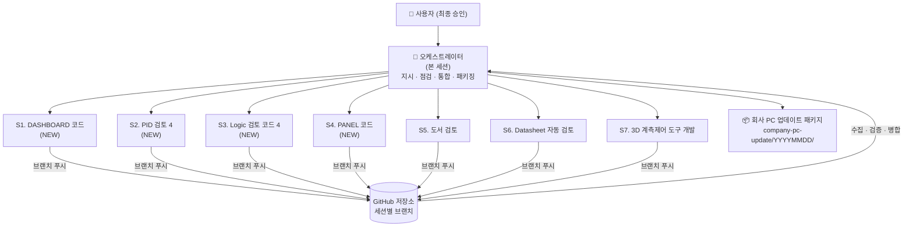
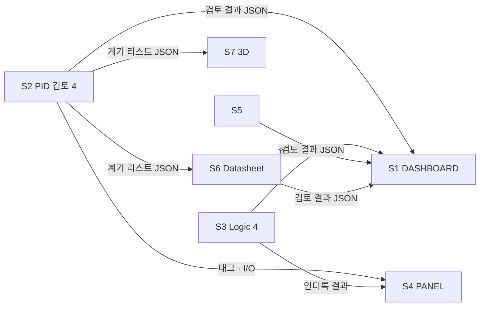

# 멀티 세션 오케스트레이션 기획안

> 상태: **실행 중** — Phase 0(확인)·Phase 1(규약) 완료, Phase 2(세션 지시) 진행. 3.1절이 실제 값입니다.
> 작성일: 2026-11-07 · 저장소: `tmddnr1415-gif/AI-P-ID-Extraction-tool`

---

## 1. 목적과 원칙

| 원칙 | 내용 |
|---|---|
| **총괄은 본 세션** | 본 세션(오케스트레이터)은 직접 기능 코드를 쓰지 않는다. 세션 생성·작업 지시·진행 점검·결과 수집만 맡는다. |
| **작업은 각 세션에서** | 7개 업무는 각각 별도의 Claude Code 세션에서 수행한다. 세션 하나당 업무 하나, 브랜치 하나. |
| **회사 PC 업데이트 파일은 여기서 한 번에** | 각 세션이 푸시한 결과를 본 세션이 모아서 **하나의 업데이트 패키지**로 만든다. 각 세션은 따로 배포하지 않는다. |
| **Agent 조직도** | 각 세션 안에서 리드 Agent가 하위 Agent(설계·구현·검증·문서)를 두고 운영한다. |
| **안전 문서 원칙 유지** | P&ID·Logic·Datasheet 결과물은 플랜트 설계 안전 문서다. 자동 결과는 반드시 사람의 검토를 거친다는 원칙을 모든 세션에 공통으로 적용한다. |

---

## 2. 전체 조직도



텍스트 버전:

```
사용자 (최종 승인)
└── 오케스트레이터 (본 세션)
    ├── S1  DASHBOARD 코드          [NEW]
    ├── S2  PID 검토 4              [NEW]
    ├── S3  Logic 검토 코드 4       [NEW]
    ├── S4  PANEL 코드              [NEW]
    ├── S5  도서 검토               [기존]
    ├── S6  Datasheet 자동 검토     [기존]
    └── S7  3D 계측제어 도구 개발   [기존]
        └── (각 세션 공통) 리드 Agent
            ├── 설계 Agent
            ├── 구현 Agent
            ├── 검증 Agent
            └── 문서 Agent
```

---

## 3. 세션 명세

| ID | 세션 이름 | 구분 | 작업 브랜치 (안) | 작업 폴더 (안) | 주요 산출물 |
|---|---|---|---|---|---|
| S0 | 오케스트레이터 | 본 세션 | `claude/trusting-cray-v68axq` | `ORCHESTRATION_PLAN.md`, `company-pc-update/` | 기획안, 진행 현황, 통합 패키지 |
| S1 | DASHBOARD 코드 | NEW | `ws/s1-dashboard` | `dashboard/` | 전체 도구 진행·결과를 보는 대시보드 (standalone HTML) |
| S2 | PID 검토 4 | NEW | `ws/s2-pid-review-v4` | `pid-review-v4/` | P&ID 검토 4차 버전 (기존 `pid-instrument-tool` 기반) |
| S3 | Logic 검토 코드 4 | NEW | `ws/s3-logic-review-v4` | `logic-review-v4/` | Logic(인터록·제어 로직) 검토 코드 4차 버전 |
| S4 | PANEL 코드 | NEW | `ws/s4-panel` | `panel/` | 제어 PANEL 관련 코드 |
| S5 | 도서 검토 | 기존 | 기존 세션 브랜치 유지 | `doc-review/` | 설계 도서 검토 도구 |
| S6 | Datasheet 자동 검토 | 기존 | 기존 세션 브랜치 유지 | `datasheet-review/` | 계기 Datasheet 자동 검토 도구 |
| S7 | 3D 계측제어 도구 개발 | 기존 | 기존 세션 브랜치 유지 | `3d-instrument/` | 3D 계측제어 도구 |

> 브랜치·폴더 이름은 제안입니다. 기존 세션(S5~S7)이 이미 쓰고 있는 이름이 있으면 그것을 따릅니다.

### 3.1 Phase 0 확인 결과 (2026-11-07, 실제 값 — 위 표보다 우선)

7개 세션이 **모두 이미 존재**합니다("(NEW)"는 세션 제목의 일부). 새 세션은 만들지 않고 기존 세션에 지시합니다.
저장소는 7개 모두 `tmddnr1415-gif/AI-P-ID-Extraction-tool` 하나를 씁니다.

| ID | 세션 | 세션 ID | 실제 작업 브랜치 | 최근 배포물 (Phase 0 시점) |
|---|---|---|---|---|
| S1 | 1. DASHBOARD 코드 (NEW) | `session_016Ntz71xxniTkCj7pC8ZpXL` | `ccr-248a5c4d-3dji7g` | `dashboard_patches/UPDATE_from_v16.57_to_v16.58.zip` |
| S2 | 2. PID 검토 4 (NEW) | `session_01Muj82H8eDSPwWi9XQC7rFh` | `claude/gracious-ride-26nqrf` | `out/PID_dev+ops_hotfix132_2026-11-05.zip` |
| S3 | 3. Logic 검토코드 4 (NEW) | `session_01Muj82Ewiqsoeo54Ei1FzrE` | `ccr-cc45909d-fjjmrb` | 커밋된 zip 없음 (L91) |
| S4 | 4. PANEL 코드 (NEW) | `session_01K7LLEGxyo6V5bYVwmtJfS4` | `ccr-d82d97fa-bb3ty3` | `dashboard_patch_20261107_0159.zip` (커밋 안 됨) |
| S5 | 5. 도서 검토 | `session_014zoSs8H5yNiq8r2ATBV4YL` | `claude/new-session-v23o67` | 커밋된 zip 없음 (`booksearch/`) |
| S6 | 6. Datasheet 자동 검토 | `session_01Muj82EMRakKAAS1HYXcE7d` | `ccr-efbe7e75-n915ze` | `out/PID_dev+ops_valve35_2026-11-07.zip` |
| S7 | 7. 3D 계측제어 도구 개발 | `session_01Muj82FVwL2Yt5DTXGPNkcp` | `claude/practical-newton-n6bt58` | `IC_Dashboard.zip` (커밋 안 됨) |

**확인된 회사 PC 조건** (`dashboard/DASHBOARD_ARCHITECTURE.md`): Windows · Edge file:// · Python 3.11 표준 라이브러리만 · CDN/npm/pip 금지 ·
사내망 전용 · DASHBOARD 서버가 `apps\` 폴더로 다른 도구를 메뉴에 연결 · 회사 PC 기준점은 `delivered.txt`, 배포는 `UPDATE_from_A_to_B.zip`(`APPLY.bat` + `base/` + `new/`).

**겹침 주의**: S2와 S6가 같은 `PID_dev+ops` 꾸러미를 각각 만들고, S1과 S4가 같은 DASHBOARD에 패치를 냅니다. 통합할 때 어느 꾸러미가 최신인지 오케스트레이터가 정합니다.

**Phase 1 산출물**: [`CONVENTIONS.md`](CONVENTIONS.md) — 배포물 자리 `dist/company_pc/<SID>/`, `MANIFEST.json` 양식.

---

## 4. 세션별 Agent 조직도

모든 세션은 아래 공통 틀을 따르고, 세션마다 특화 역할을 덧붙입니다.

### 4.1 공통 틀

| 역할 | 책임 | 산출물 |
|---|---|---|
| **리드 Agent** (세션 본체) | 오케스트레이터 지시 해석, 하위 Agent 배분, 결과 취합, 커밋·푸시 | `STATUS.md` 갱신, 커밋 |
| **설계 Agent** (Plan) | 요구사항 → 구현 계획, 기존 코드와의 접점 정리 | 설계 메모 |
| **구현 Agent** | 코드 작성 | 소스 코드 |
| **검증 Agent** | 테스트·실제 실행 확인, 샘플 도면/문서로 대조 | 검증 기록 |
| **문서 Agent** | README, 사용법, 회사 PC 설치 메모 | `README.md`, `RELEASE_NOTE.md` |

### 4.2 세션별 특화

```
S1 DASHBOARD 코드
├── 리드
├── 데이터 연동 Agent   — S2·S3·S6 결과 JSON 스키마를 읽어 집계
├── UI Agent            — standalone HTML 화면
└── 검증 Agent          — 샘플 결과로 화면 확인 (스크린샷)

S2 PID 검토 4
├── 리드
├── 판독 규칙 Agent     — rules / typicals 개정 (review_log.md 반영)
├── 추출 엔진 Agent     — PDF 판독·타일링 (pid-extractor 계승)
├── Excel 출력 Agent    — excel_format.json 템플릿 서식 유지
└── 정확도 검증 Agent   — samples/test_set_v1 정답 대조

S3 Logic 검토 코드 4
├── 리드
├── 로직 파싱 Agent     — 인터록·Cause & Effect 해석
├── 규칙 점검 Agent     — 누락·모순 탐지 규칙
└── 검증 Agent          — 대표 로직 세트 대조

S4 PANEL 코드
├── 리드
├── 배치/구성 Agent     — PANEL 구성·I/O 할당
├── 출력 Agent          — 도면·리스트 출력
└── 검증 Agent

S5 도서 검토
├── 리드
├── 문서 파싱 Agent     — PDF/Word 도서 읽기
├── 대조 Agent          — 기준·사양과의 불일치 지적
└── 검증 Agent

S6 Datasheet 자동 검토
├── 리드
├── 추출 Agent          — Datasheet 항목 추출
├── 교차 검증 Agent     — 계기 리스트(S2 결과)와 대조
└── 검증 Agent

S7 3D 계측제어 도구 개발
├── 리드
├── 3D 뷰 Agent         — 3D 표시·탐색
├── 데이터 연결 Agent   — 계기 태그 ↔ 3D 객체 매핑
└── 검증 Agent
```

### 4.3 세션 간 의존 관계



**공통 결과 스키마**가 먼저 정해져야 S1·S4·S6·S7이 막히지 않습니다. → Phase 1에서 오케스트레이터가 확정합니다.

---

## 5. 실행 명령 기획

> 아래는 **승인 후 실행할 명령의 계획**입니다. 현재 실행하지 않았습니다.

### Phase 0 — 사전 확인 (오케스트레이터)

| # | 명령 (도구) | 목적 |
|---|---|---|
| 0-1 | `list_sessions(mine: true)` | S5·S6·S7 기존 세션 ID 찾기 |
| 0-2 | `list_environments` | 새 세션을 띄울 환경 확인 |
| 0-3 | `list_repos` | 세션별로 다른 저장소가 필요한지 확인 |
| 0-4 | 사용자 확인 | 7장 "확인 필요 사항" 답변 받기 |

### Phase 1 — 공통 규약 확정 (오케스트레이터)

- `CONVENTIONS.md` 작성: 브랜치 규칙, 폴더 규칙, 커밋 메시지 규칙, `STATUS.md` 양식
- `schemas/` 작성: 세션 간 주고받는 결과 JSON 스키마 (계기 리스트, 검토 지적 사항)
- 본 브랜치에 커밋·푸시 → 모든 세션이 이 규약을 읽고 시작

### Phase 2 — 세션 생성 및 지시

**신규 세션 (S1~S4)** — `create_session`

```text
create_session(
  title       = "S2 · PID 검토 4",
  source_url  = "https://github.com/tmddnr1415-gif/AI-P-ID-Extraction-tool",
  outcome_branch = "ws/s2-pid-review-v4",
  tags        = ["orch:main", "ws:s2"],
  prompt      = <아래 지시 템플릿>
)
```

**기존 세션 (S5~S7)** — `send_message` + `set_session_tags(["orch:main", "ws:s5"])`

**공통 지시 템플릿**

```text
[오케스트레이터 지시 · ws:sN]
너는 "<세션 이름>" 업무의 리드 Agent다.

1. 먼저 CONVENTIONS.md 와 schemas/ 를 읽어라.
2. 작업 범위: <업무 설명>
   작업 폴더: <폴더>   브랜치: <브랜치>
3. 하위 Agent(설계·구현·검증·문서)를 두고 진행하라.
4. 완료 기준: <세션별 완료 기준>
5. 회사 PC 배포 파일은 만들지 마라. 배포 대상 파일은
   <폴더>/dist/ 에 두고 dist/MANIFEST.json 에 목록만 적어라.
6. 매 단계 끝마다 <폴더>/STATUS.md 를 갱신하고 커밋·푸시하라.
7. 결과는 안전 관련 문서다. "사람 검토 필요" 항목을 STATUS.md 에 남겨라.
```

### Phase 3 — 진행 점검 (오케스트레이터)

자식 세션은 정상 완료해도 오케스트레이터에 알려 주지 않으므로, **직접 점검**합니다.

| 명령 | 주기 | 확인 내용 |
|---|---|---|
| `get_session(session_id)` | 세션별 | `status_bucket` — working / blocked / review_ready / completed / failed |
| `list_events(kinds=["assistant","result"])` | blocked·failed 일 때 | 막힌 이유 |
| `git fetch origin ws/*` + `STATUS.md` 읽기 | 일 1회 또는 요청 시 | 실제 진척 |
| `send_message` | 필요 시 | 방향 수정, 의존 세션 결과 전달 |
| `interrupt_session` | 이탈 시 | 잘못된 방향 중단 후 재지시 |

진행 현황은 본 브랜치의 `ORCHESTRATION_STATUS.md` 한 장에 표로 모읍니다.

### Phase 4 — 통합 및 회사 PC 업데이트 파일 생성 (오케스트레이터)

```
1. 각 세션 브랜치 fetch
2. 각 <폴더>/dist/MANIFEST.json 확인 (누락·검증 미완료 세션은 제외하고 기록)
3. 통합 브랜치 release/YYYYMMDD 에 dist 파일만 모음
4. 패키지 구성:
   company-pc-update/YYYYMMDD/
   ├── UPDATE_GUIDE.md      설치·교체 방법 (한 장)
   ├── CHANGELOG.md         세션별 변경 요약
   ├── MANIFEST.json        파일 목록 · 버전 · SHA-256
   ├── dashboard/           S1
   ├── pid-review-v4/       S2
   ├── logic-review-v4/     S3
   ├── panel/               S4
   ├── doc-review/          S5
   ├── datasheet-review/    S6
   └── 3d-instrument/       S7
5. 압축: company-pc-update-YYYYMMDD.zip
6. 검증: 압축 해제 → 각 standalone.html 브라우저로 열어 확인
7. 사용자 승인 후 커밋·푸시
```

### Phase 5 — 정리

- 완료된 세션은 사용자 확인 후 `archive_session`
- 다음 회차 업데이트는 Phase 2부터 반복

---

## 6. 회사 PC 업데이트 파일 원칙

| 항목 | 원칙 |
|---|---|
| 설치 | 가능한 한 **설치 없이 더블클릭으로 열리는 standalone HTML** 우선 (기존 `pid-instrument-tool` 방식 유지) |
| 외부 접속 | 회사망에서 CDN이 막힐 수 있으므로 라이브러리는 패키지 안에 포함 |
| API 키 | 패키지에 키를 넣지 않는다. 사용자가 각 도구 설정에서 입력 |
| 무결성 | `MANIFEST.json` 에 파일별 SHA-256 기록 |
| 버전 | 패키지 단위 날짜 버전 + 도구별 버전을 함께 표기 |

---

## 7. 확인 필요 사항 (실행 전 답변 필요)

1. **저장소 구성** — 7개 업무를 이 저장소 하나에 폴더로 나눌지(권장: 통합 패키징이 쉬움), 업무별 별도 저장소로 갈지
2. **기존 세션 (S5·S6·S7)** — 이미 진행 중인 세션이 있는지, 있다면 세션 이름 또는 링크
3. **"4"의 의미** — "PID 검토 4", "Logic 검토 코드 4"가 4차 버전을 뜻하는지, 이전 버전(1~3) 코드는 어디 있는지
4. **회사 PC 환경** — Windows 여부, 인터넷(CDN·Anthropic API) 접속 가능 여부, 설치 권한 여부
5. **각 업무의 완료 기준** — 특히 S1·S3·S4·S7은 범위 정의가 필요
6. **업데이트 주기** — 한 번만 만드는지, 정기(주 1회 등)로 만드는지

---

## 8. 다음 단계

이 기획안이 승인되고 7장 답변을 받으면 **Phase 0 → Phase 1** 부터 실행합니다.

### 4.4 실제 역할 Agent (2026-11-07 세션 검토 뒤 조정)

4.2 의 세션별 특화 Agent 는 기획 시점의 안이다. 각 브랜치를 검토한 뒤 **실제 기능에 맞춘 역할**은 `status/build_status.py` 의 `ROLES` 표가 기준이며, 현황판(세션 지도 · 조직도)에 그대로 나온다.
브랜치에 정식 정의된 Agent · Skill(`.claude/agents` · `.claude/skills`)은 자동으로 읽어 함께 표시한다 (지금은 7. 3D 의 Agent 15 · Skill 8, 4. PANEL 의 Skill 1).
공통 틀(설계 · 구현 · 검증 · 문서)은 4.1 그대로.
