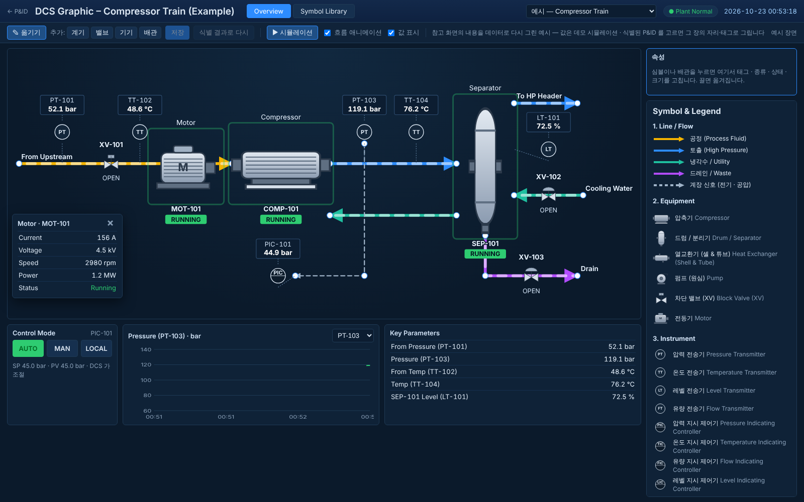
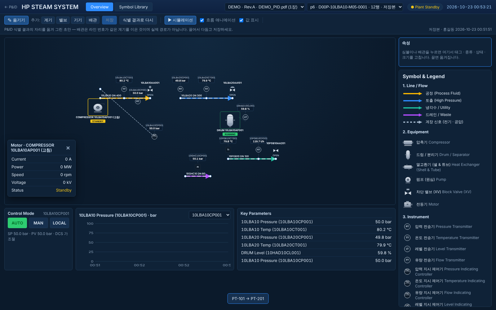
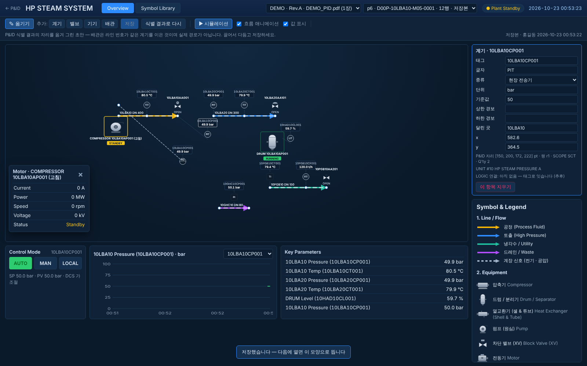
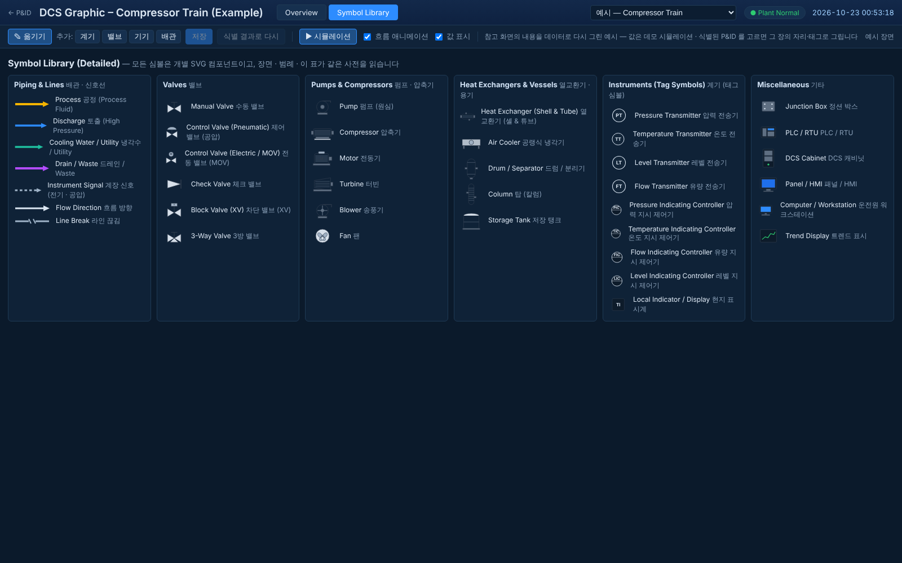
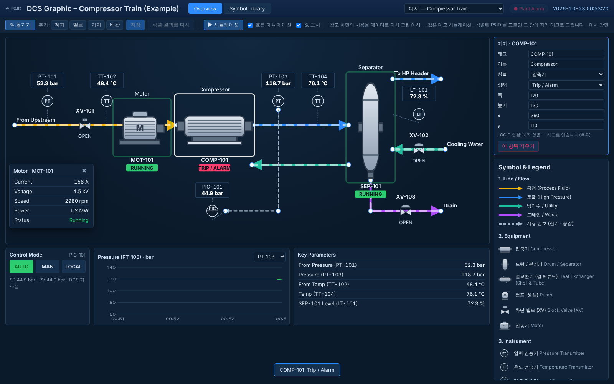

> **hotfix110 — 이 문서는 LOGIC 브랜치에서 가져온 원문이다.**  그 H1 화면이 이 저장소의 `/dcs` 화면이 되었다 (`app/static/dcs.html` +
> `app/static/hmi/{hmi.js,hmi_symbols.js,hmi.css}`).  달라진 것: 주소는 `/dcs/api/*` · 장면은 `app/hmi/scene.py from_model`(실제 P&ID 배치 ·
> 탭한 런 · 같은 배율) · LOGIC 태그 연동 · 확대/이동 · 내려받기.  자세한 기록은 CLAUDE.md hotfix110 절.  그림은 LOGIC 브랜치 `docs/hmi_handover/`.

# HMI 그래픽 이관 문서 — 다른 패널 개발 코드로 옮기기 위한 정리

> 이 저장소(P&ID 식별 툴)에서는 **HMI 그래픽을 더 개발하지 않는다** (사용자 결정 · 2026-10-23).
> 지금까지 만든 것(H1회차 · 커밋 `d2c5fbe`)을 그대로 떼어 다른 패널 개발 코드로 옮길 수 있게,
> 무엇이 어디 있고 · 무엇에 기대고 · 무엇을 어떻게 떼어 가는지를 한 장으로 적는다.
> 이미지는 `docs/hmi_handover/` (같은 그림이 `out/hmi1/` 에도 있다).

## 1. 한눈에

| 항목 | 내용 |
| --- | --- |
| 하는 일 | 식별된 P&ID 한 장의 계기·밸브·기기를 **DCS HMI 화면처럼** SVG 로 그린다. 심볼은 개별 SVG 컴포넌트 · 배관은 색과 흐름 화살 · 기기는 Running/Standby/Trip 색 · 오른쪽에 Trend · Key Parameters · Control Mode · Symbol & Legend. 값은 **데모 시뮬레이션**이고 화면이 그렇게 적는다 (실제 공정값 아님). |
| 배치·태그의 출처 | P&ID 식별 결과 — 계기·밸브는 버블 자리와 `tag_no`, 기기는 Description 근거의 기기 라벨 자리. **배관은 실제 경로가 아니다** (같은 라인 번호 항목을 x 순으로 이은 띠 · `basis` 에 그렇게 적힘). |
| 사람이 하는 것 | 끌어 옮기기 · 화살표 키 · 두 번 눌러 태그 수정 · 속성 판(종류·상태·심볼·단위·기준값·경보·크기·배관 종류/방향) · 추가/삭제 · 저장(작성자 필수) · 식별 결과로 되돌리기. |
| 판정 엔진과의 관계 | **없다.** P&ID 엔진을 import 하지 않고(시험이 AST 로 못박음) 분석 DB 를 읽기만 한다. 지문·회귀에 닿을 길이 없다. |
| LOGIC 연결 | **자리만** 두었다 — 항목마다 `tag` · `logic: null`, 장면의 `links.logic`. 태그로 잇는 설계이고 구현은 안 했다. |
| 코드 크기 | 서버 ~350줄 · 화면 ~1,000줄 · 예시 장면 JSON 300줄 · 시험 6건 |

## 2. 파일 목록 (떼어 갈 것)

| 파일 | 줄 | 역할 | 이 저장소에 기대는 것 |
| --- | ---: | --- | --- |
| `app/static/hmi/hmi_symbols.js` | 242 | **심볼 사전 하나** — 배관 5종 · 밸브 6 · 회전기기 6 · 열교환기/용기 5 · 계기 버블 · 기타 6 · 상태색 5 · 계기 머리글자 표. `window.HMI_SYM` · `HMI_SYM_CATS` · `HMI_LINES` · `HMI_STATUS` · `HMI_INSTRUMENTS` · `HMI_SYMBOLS{svg,g,defs,lineDefs,instrumentKind,bubble}` | 없음 (순수 브라우저 JS · 의존 0) |
| `app/static/hmi/hmi.js` | 569 | 그리기 · 패널 · 데모 시뮬레이션 · 끌기 · 속성 판 · 저장. `window.HMI = {A, render, tick, loadScene, chooseSource}` | `/hmi/api/*` 네 주소 · `localStorage["pid.author"]` (작성자 이름 — P&ID 화면과 같은 열쇠) |
| `app/static/hmi/hmi.html` · `hmi.css` | 90 · 101 | 화면 틀 (머리 · 도구줄 · 캔버스 · 오른쪽 패널 · 라이브러리 탭) | `← P&ID` 링크 하나 |
| `app/hmi/scene.py` | 187 | **식별 행 → 장면 JSON** (`build(rows, page, drawing_no, title)`). 계기 머리글자 → 단위·기준값, 라인 낱말 → 배관 종류, 기기 명사 → 심볼 | 식별 행의 모양 (`values.type/tag_no/line_no/system` · `rect` · `tab` · `evidence.candidates[kind=EQUIPMENT]`) |
| `app/hmi/store.py` | 48 | 사람이 다듬은 장면 저장 `{data}/hmi/<분석>/p<장>.json` (원자적 · `.bak`) | `app.jsonstore` · `app.paths` (다른 코드에서는 아무 원자적 JSON 저장으로 바꾸면 된다) |
| `app/hmi/api.py` | 113 | FastAPI 라우터 7개 (아래 §4) | `app.db`(`get_job` · `merged_rows_cached`) · `app.paths.resource` |
| `config/hmi_example_compressor_train.json` | 303 | 참고 DCS 화면(압축기 열차)을 **데이터로** 다시 그린 예시 장면 — PNG 안 씀 | 없음 |
| `tests/test_hmi.py` | 147 | 장면 생성 · 심볼 존재 · PNG 배경 없음 · 저장 작성자 · API 왕복 · 엔진 import 금지 | pytest · FastAPI TestClient |
| 연결 자리 (떼어 갈 때 지울 것) | | `app/main.py` 4969~4971 (`from app.hmi import api as _hmi_api` · `bind(CON)` · `include_router`) · `app/static/index.html` 27 (`#nav-hmi` 메뉴) | |

## 3. 장면 JSON (두 코드 사이의 계약)

```jsonc
{
  "title": "…", "basis": "배치·태그의 출처 한 줄", "size": [1400, 800],
  "equipment":   [{"id","sym","x","y","w","h","tag","label","status"}],      // status: running|standby|trip|stopped|oos
  "pipes":       [{"id","kind","label","pts":[[x,y],…],"arrow":true}],        // kind: process|discharge|cooling|drain|signal
  "valves":      [{"id","sym","tag","x","y","w","h","rot","state"}],          // state: open|closed
  "instruments": [{"id","func","tag","x","y","value","unit","on","kind","alarm":{"hi","lo"}}],  // on = 기기 id 또는 배관 id
  "panels":      {"trend":{"tag","min","max"}, "key":[tag…], "control":{"tag","mode"}, "motor": id},
  "links":       {"logic": null},                                             // LOGIC 과 잇는 자리 (태그로) — 미구현
  "saved": false, "saved_by": "", "saved_at": ""
}
```

* `sym` 은 `hmi_symbols.js` 사전의 이름이다 (§5 표). 장면과 범례와 라이브러리가 **같은 사전**을 읽으므로 그림과 설명이 어긋날 길이 없다.
* 좌표는 캔버스 좌표(`size`) — P&ID 좌표를 비례로 옮긴 것이라 사람이 끌어 다듬는다.
* 예시 장면이 `config/hmi_example_compressor_train.json` 이고 그 자체가 계약의 보기다.

## 4. API (서버 쪽 — 다른 코드에서는 같은 모양으로 다시 만들면 화면 JS 가 그대로 돈다)

| 메서드 · 주소 | 하는 일 |
| --- | --- |
| `GET /hmi` | 화면 (`hmi.html`) |
| `GET /hmi/api/example` | 예시 장면 JSON |
| `GET /hmi/api/jobs` | 끝난 P&ID 분석 목록 (`id` · `filename` · `project` · `revision` · `pages`) |
| `GET /hmi/api/jobs/{job}/pages` | 그 분석의 장 목록 (쪽 번호 · 도면번호 · 제목 · 행 수) |
| `GET /hmi/api/jobs/{job}/scene/{page}?fresh=0` | 저장본이 있으면 그것(`saved: true`), 없으면 식별 행에서 새로 만든 장면 |
| `POST /hmi/api/jobs/{job}/scene/{page}` `{scene, author}` | 저장 (작성자 없으면 400) |
| `DELETE /hmi/api/jobs/{job}/scene/{page}` | 저장본을 지우고 식별 결과로 되돌림 |

## 5. 심볼 사전 (이름 · 묶음 · 뜻)

| 이름 | 묶음 | 뜻 |
| --- | --- | --- |
| `valve_manual` · `valve_control_pneumatic` · `valve_control_electric` · `valve_check` · `valve_block` · `valve_3way` | valve | 수동 · 제어(공압) · 전동(MOV) · 체크 · 차단(XV) · 3방 |
| `pump` · `compressor` · `motor` · `turbine` · `blower` · `fan` | rotating | 펌프 · 압축기 · 전동기 · 터빈 · 송풍기 · 팬 |
| `heat_exchanger` · `air_cooler` · `separator` · `column` · `storage_tank` | vessel | 열교환기 · 공랭식 냉각기 · 드럼/분리기 · 탑 · 저장 탱크 |
| `instrument` (+ `bubble(letters, kind)`) | instrument | 계기 버블 — `kind` field/dcs/local 은 머리글자 표(`HMI_INSTRUMENTS`)에서 |
| `junction_box` · `plc` · `dcs_cabinet` · `panel_hmi` · `workstation` · `trend_display` | misc | 정션 박스 · PLC · DCS 캐비닛 · 패널 · 워크스테이션 · 트렌드 |
| 배관 `process` 노랑 · `discharge` 파랑 · `cooling` 청록 · `drain` 보라 · `signal` 회색 점선 | line | 색은 참고 화면 관례 (ISA 5.1 뜻 아님) |
| 상태 `running` 초록 · `standby` 노랑 · `trip` 빨강 · `stopped` 회색 · `oos` 흰색 | status | |

심볼 하나 = `def(name, cat, label, ko, draw(opts) → SVG 안쪽 글자, ports)` · viewBox `0 0 100 100`.
새 심볼은 사전에 한 줄 더하면 그래픽 · 범례 · 라이브러리에 같이 선다.

## 6. 식별 행 → 장면 규칙 (`scene.py`) — 옮겨 갈 코드가 알아야 할 것

1. 계기·밸브 자리 = 식별 행 `rect`(버블 사각형) 중심 · 태그 = `values.tag_no` (없으면 TYPE) · `tab` 으로 밸브 심볼(MOV → 전동 · PNEUMATIC → 공압 · BFV → 수동).
2. 기기 = `evidence.candidates` 의 EQUIPMENT 후보 — Description 문장이 고른 것, 없으면 가장 가까운 것. 명사(COMPRESSOR · PUMP · TANK …)로 심볼.
3. 배관 = 같은 `line_no` 의 항목을 x 순으로 이은 띠. 종류는 라인·계통 낱말 (COOLING/CCW → cooling · DRAIN/BD → drain · DISCHARGE/HEADER → discharge · 그 밖 process).
4. 전송기(PT·TT·LT·FT) → 같은 태그의 제어기(PIC …)는 signal 선.
5. 값 = 머리글자별 기준값 둘레의 데모 (`UNITS`) — 실제 공정값이 아니다.
6. Trend · Key · Control Mode 는 장면의 첫 압력 전송기 · 처음 여섯 · 첫 제어기.

## 7. 떼어 가는 절차

1. §2 의 파일 9개를 복사한다. `hmi_symbols.js` · `hmi.js` · `hmi.html` · `hmi.css` · 예시 JSON 은 의존이 없다.
2. 서버 쪽은 §4 일곱 주소를 그 코드의 틀로 다시 쓴다. 식별 행을 주는 곳(`merged_rows_cached`)만 그 코드의 데이터 접근으로 바꾸고 `scene.build` 는 그대로.
3. 저장은 `store.py` 를 아무 원자적 JSON 저장으로 바꾼다 (작성자 필수는 유지).
4. 작성자 이름은 `localStorage["pid.author"]` 를 읽는다 — 패널 코드의 로그인 이름이 있으면 `author()` 한 함수만 바꾼다.
5. 이 저장소에서는 `app/main.py` 세 줄과 `index.html` 메뉴 한 줄을 지우면 HMI 가 사라지고 나머지는 아무 영향이 없다 (시험 `tests/test_hmi.py` 도 함께 옮긴다).

## 8. 알려진 한계 (다음 개발자가 먼저 볼 것)

* 실 프로젝트 장은 계기가 촘촘해 값 상자가 겹칠 수 있다 — 끌어 다듬는 자리이고 자동 배치는 없다.
* 배관은 실제 경로가 아니다 (§6-3). P&ID 의 배관 그래프는 추적률이 낮아(13%) 쓰지 않았다.
* LOGIC 연결은 자리만 있다 (`links.logic` · 태그로 잇는 설계).
* 이 환경에 실 P&ID 분석 DB 가 없어 **합성 분석 12행**으로만 띄워 확인했다 (아래 그림 2·3).
* 브라우저 끌기에서 `setPointerCapture` 를 쓰면 click/dblclick 대상이 svg 로 바뀐다 — 창 단위 pointermove/up 과 CSS `user-select:none` 으로 풀었다 (같은 덫을 다시 밟지 않게).

## 9. 그림

| 그림 | 무엇 |
| --- | --- |
|  | 1. 예시 장면 — 참고 DCS 화면(압축기 열차)을 데이터로 다시 그린 것. 오른쪽 Trend · Key · Control Mode · Symbol & Legend |
|  | 2. 식별된 P&ID(합성 12행)에서 만든 초안 — 버블 자리와 태그 그대로 · 배관은 라인 번호 띠 |
|  | 3. 기기를 골라 속성 판에서 상태 · 심볼 · 태그를 바꾸고 끌어 옮긴 뒤 저장 |
|  | 4. Symbol Library 탭 — 사전의 모든 심볼 · 배관 · 상태색 |
|  | 5. 기기 상태를 Trip 으로 — 상태색 · Plant 알약 · 경보 |
