# 판넬 공간확보 메뉴 추가 · 세 메뉴 UI 정리 — 작업 보고 (2026-10-22)

브랜치 `ccr-d82d97fa-bb3ty3` (대시보드 브랜치 `ccr-248a5c4d-3dji7g` v16.23 위에서 진행).
화면 `APP_VERSION 2026-10-22.1 → 2026-10-22.3`, 서버 `SERVER_VERSION 2026-10-22.1 → 2026-10-22.2`.

캡처는 모두 **실제 브라우저(Chromium) 캡처**다. 시험용 임시 운영 폴더 + 가짜 계정(홍길동)으로 대시보드 서버(8780)를 띄우고,
P&ID · LOGIC 은 `claude/titleblock-parsing-c5st4x` 소스를 그대로 8000 에 띄웠다. 업무 데이터는 쓰지 않았다.

| 단계 | 결과 | 커밋 |
|---|---|---|
| 1 판넬 공간확보 메뉴 통합 | 완료 — A안(`apps/space/` + 대시보드 화면 틀) | `5284394` 원본 · `131b133` 폐쇄망 · `ad4025a` 메뉴 |
| 2 세 메뉴 UI 일관성 | 대시보드 · 공간확보 쪽 완료. P&ID · LOGIC 쪽은 **변경안**(3절) | `1d2a769` 헤더 · `d52fef5` 공간확보 |
| 3 공간확보 기능 보완 | 4개 완료 (각각 커밋) | `84224e2` · `0ee28dc` · `5361c35` · `e71a24c` |
| 4 P&ID 연계 | **설계안만** (5절) | — |

---

## 1. 단계별 보고

### 1단계 — 판넬 공간확보 메뉴 통합 (A안)

- **변경 파일**: `dashboard/apps/space/index.html`(새 파일), `dashboard/dashboard.html`, `dashboard/server.py`
- **변경 이유**
  - 대시보드에 이미 `/apps/` 정적 파일 자리가 있고 같은 출처라 다운로드가 그대로 된다 → B안(5,400줄 한 파일에 편집기 섞기)보다 위험이 작다.
  - 원본 툴의 Google Fonts(IBM Plex)는 폐쇄망에서 실패 → 제거, 맑은 고딕 / Consolas.
  - claude.ai 전용 다운로드 분기(`window.claude`, DXF 를 `.dxf.txt` 로 저장) 제거 → 브라우저 Blob 저장, **`.dxf` 그대로**.
  - 다크모드 제거(대시보드는 라이트 전용 — 다크 PC 에서 iframe 만 검게 보였음).
  - 원본은 `<!doctype>` 이 없었고, `.modal{display:flex}` 가 `hidden` 을 이겨 **출력 창이 처음부터 떠 있는 버그**가 있었다(claude.ai 가 `[hidden]` 규칙을 넣어 줘서 안 보였던 것) → 수정.
- **대시보드 연결**: `APP_ROUTES` / `renderApp` — P&ID 와 같은 화면 틀(본문 전체 iframe, 1분 자동 갱신에도 iframe 유지 → 편집 중 배치 보존). 메뉴는 LOGIC 분석 아래 같은 레벨 `🗄 판넬 공간확보`. 권한 표(`server.py MENUS`)에도 추가.
- **확인**: 메뉴 진입 · 공통 헤더 안에 표시 · 외부 요청 0건 · 출력 4종 실제 다운로드(아래 2단계 캡처).

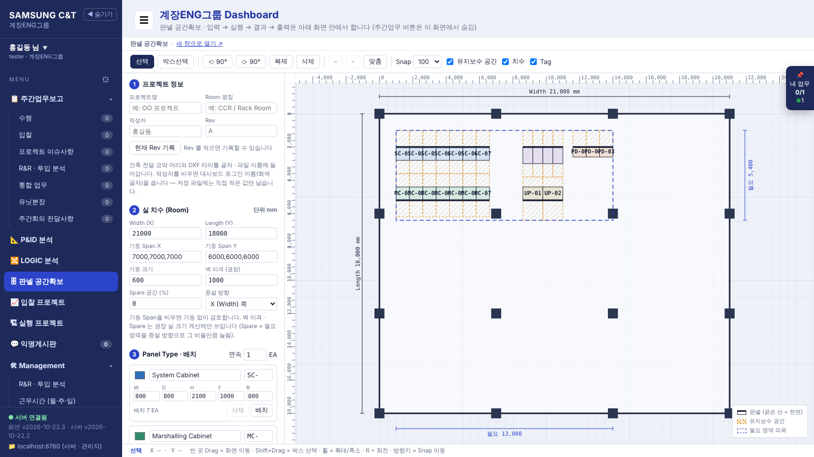

### 2단계 — 세 메뉴 UI 일관성

- **변경 파일**: `dashboard/dashboard.html`, `dashboard/apps/space/index.html`
- **변경 이유와 내용** (0단계 불일치 목록의 상 · 중 항목)
  1. **[상] 대시보드 헤더**: P&ID · LOGIC 화면 위에 주간업무 전용 버튼(주차 · 전체 저장 · 금주 마감 · CSV · **엑셀 내보내기** · 인쇄 · 대기열)이 그대로 있었다 — P&ID 화면에서 '엑셀 내보내기'를 누르면 주간업무가 받아지는 혼동. 세 도구 화면에서 숨기고 부제목을 `<메뉴> · 입력 → 실행 → 결과 → 출력은 아래 화면 안에서 합니다` 로. (홈 · 시트 화면은 그대로 — 캡처 `1_후_홈_변화없음`)
  2. **[상] 폐쇄망 · 다크모드** — 1단계에서 처리.
  3. **[중] 흐름 · 번호**: 공간확보를 ① 프로젝트 정보 → ② 실 치수 → ③ Panel Type · 배치 → ④ 검토 결과(자동 계산) → ⑤ 출력. 번호 모양은 P&ID · LOGIC 첫 화면의 ① ② 와 같게.
  4. **[중] 버튼 이름**: '<형식> 출력' 으로 (P&ID 'Excel 출력' 과 같은 말) — 4절 비교표.
  5. **[중] 상태 pill · 숫자**: 대시보드 색으로 옅게 채운 OK / 경고 / 간섭 pill. 숫자는 우측 정렬 · 고정폭(원래 그랬음, 유지).
  6. **[중] 오류 · 경고 문장**: 검토 목록과 건축 전달 요약에 '무엇이(넘친 mm 포함) → 어떻게 고치나'. 불러오기 실패는 빈 출력 창 대신 무엇이 빠졌고 어떤 파일을 골라야 하는지 알림.
  7. **진행 표시**: 공간확보는 계산이 즉시라 해당 없음. P&ID · LOGIC 은 이미 진행 화면/진행 줄이 있음.
- **판정 · 산출 숫자는 바꾸지 않았다**: 같은 시나리오에서 권장 실 크기 23,400 × 10,600 (3단계 전후 동일, Rev A 기록값으로도 확인).

| 변경 전 (LOGIC) | 변경 후 (LOGIC) |
|---|---|
| 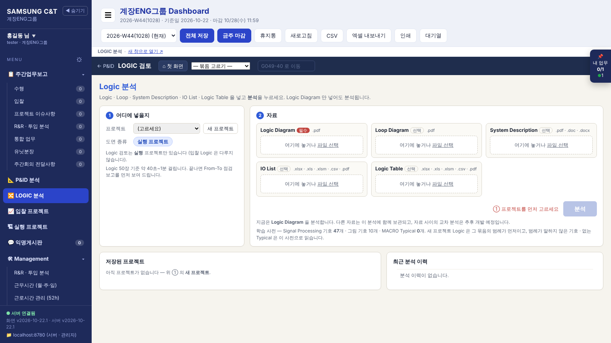 | 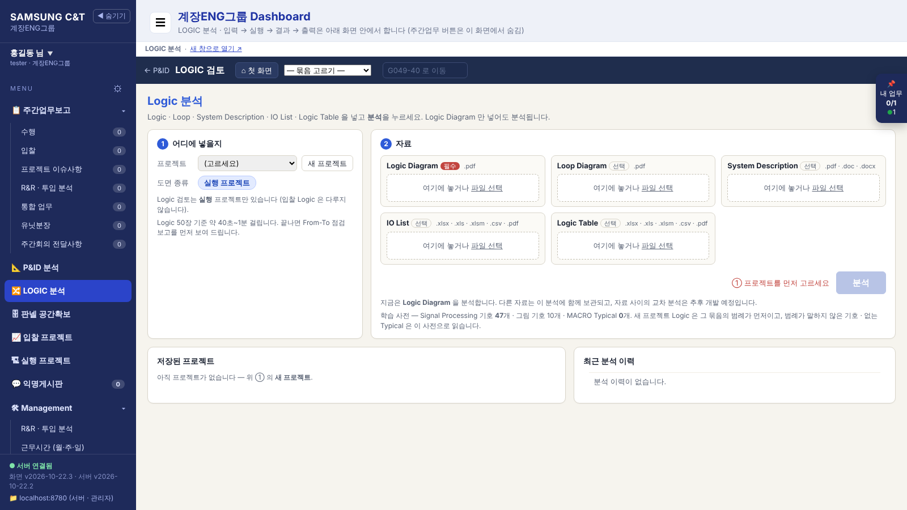 |

| 변경 전 (P&ID) | 변경 후 (P&ID) |
|---|---|
| 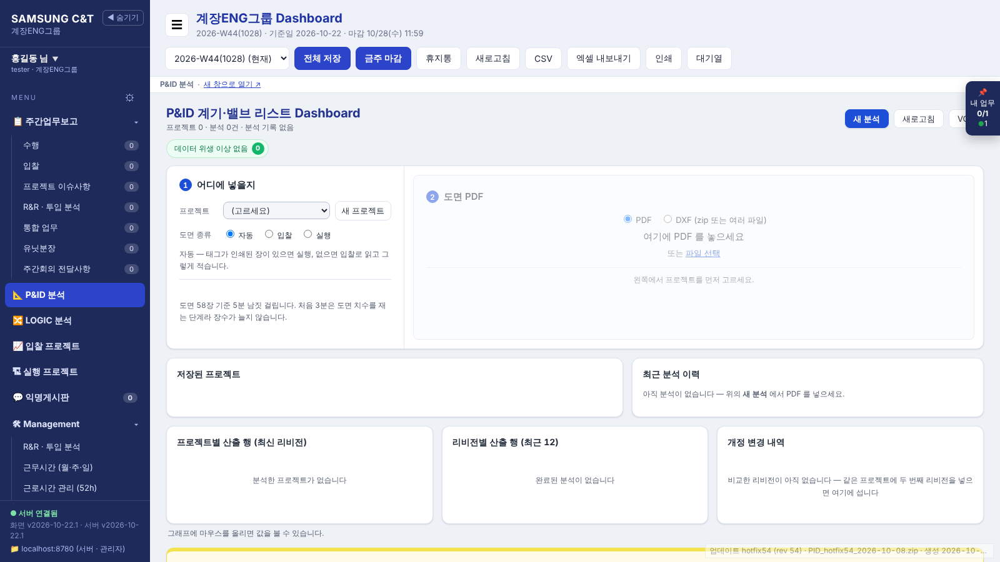 | 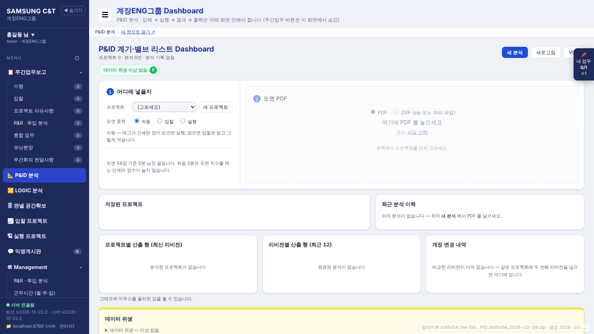 |

검토 결과 · 오류 문장 · 출력:

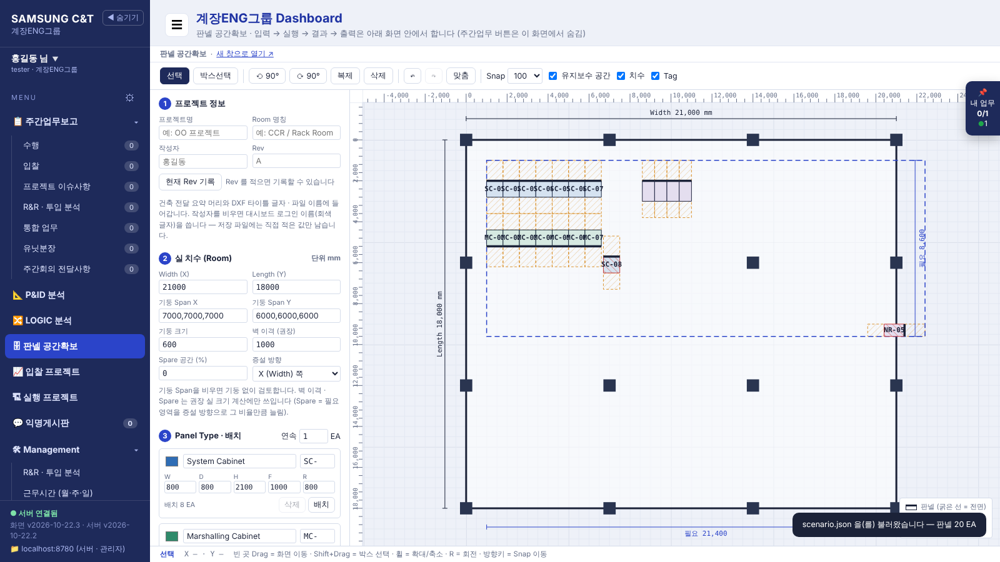
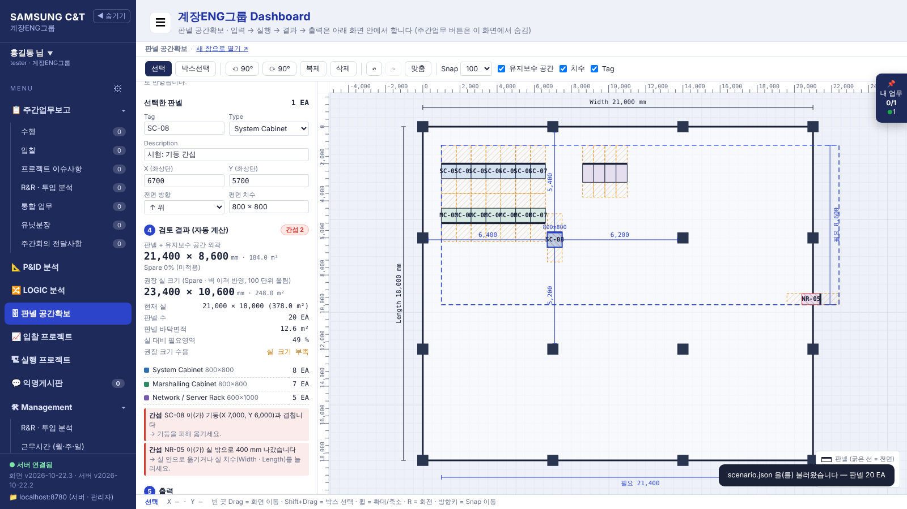
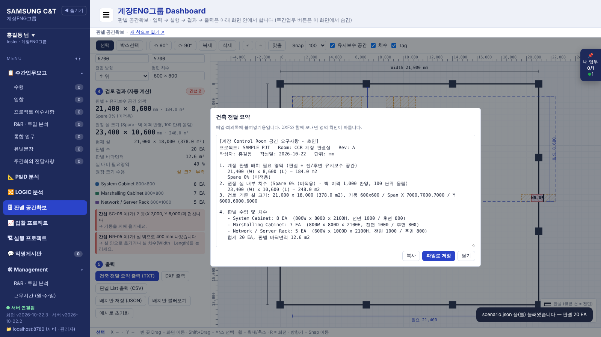
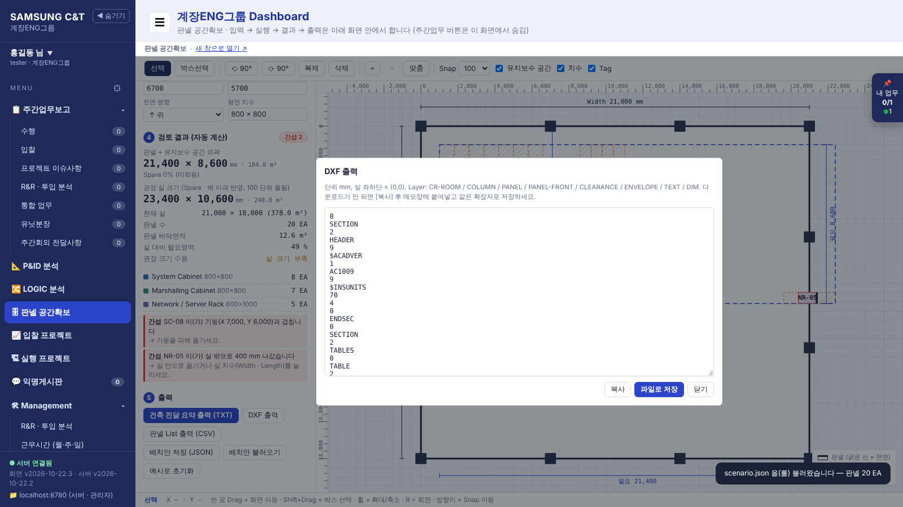
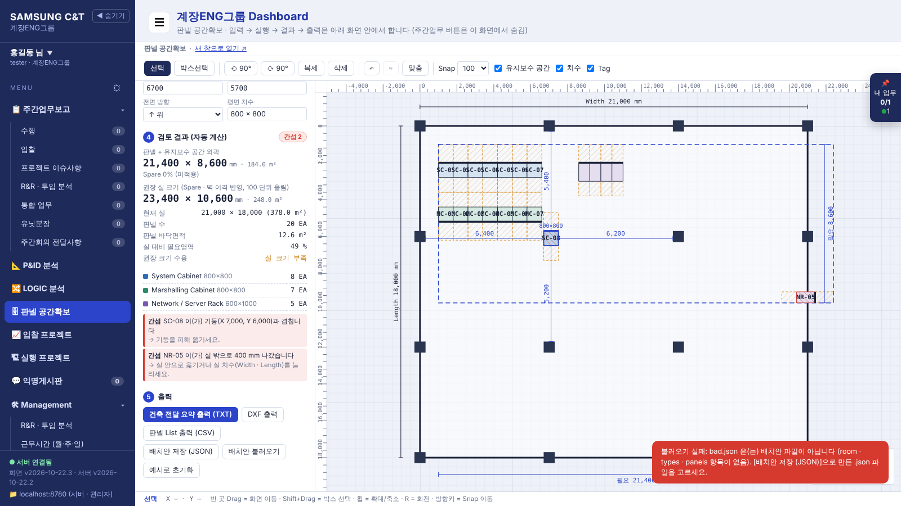

### 3단계 — 공간확보 기능 보완 (항목마다 커밋)

| # | 기능 | 동작 | 확인 |
|---|---|---|---|
| 3-1 | 프로젝트 정보 | 프로젝트명 · Room 명칭 · 작성자 · Rev → 요약 머리 2줄, DXF 타이틀 4줄(실 아래, CR-TEXT), 파일 이름 `프로젝트_Room_Rev_종류_날짜`. 작성자를 비우면 로그인 이름을 회색으로 보여 주고 출력에 쓰되 **저장 데이터에는 사람이 적은 값만**(자동값/입력값 분리). DXF 글자 스타일 `CR-KOR`(malgun.ttf) — 기본 txt.shx 는 한글이 `?` 로 보임 | 요약 · DXF · 파일 이름 (`sample/`) |
| 3-2 | Panel Type 프리셋 | [프리셋 저장] `{kind:'crspace-types', types:[…]}` JSON / [프리셋 불러오기] 프리셋 또는 배치안 JSON. 이름이 같은 Type 은 덮어쓰고(배치 판넬 즉시 반영) 없으면 추가, '추가 n · 갱신 m' 알림 | 추가 1 · 갱신 1, 잘못된 파일 → 실패 문장 |
| 3-3 | Spare 공간 % | 기본 0%. 증설 방향(X/Y)은 사람이 고름(근거 없는 배분 규칙을 만들지 않음). 필요 영역은 그대로, 증설 방향 길이만 % 늘려 권장 실 크기 산출. 화면에 Spare 영역 점선, 요약에 적용값 항상 명시(`Spare 0% (미적용)`), DXF 에 Spare 사각형 · 타이틀 | 21,400 × 8,600 · 20% X · 이격 1,000 → 25,680 → **27,700 × 10,600** (손 계산 일치) |
| 3-4 | Rev 이력 | [현재 Rev 기록] 으로 Rev 별 권장 실 크기 · 면적 · 판넬 수 · Spare 를 배치안에 저장. 이력 표 + 요약 '6. Rev 이력' 에 이전 Rev 대비 면적 · W · L 변화 | Rev A 23,400×10,600 → Rev B(판넬 1개 삭제 · 이격 1,500) 24,400×11,600, **+35.0 m²** |

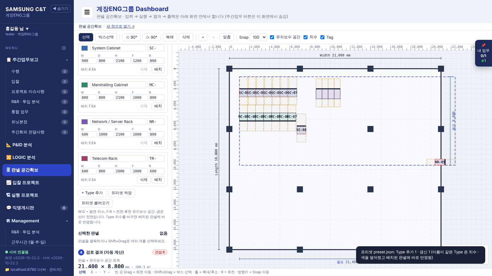
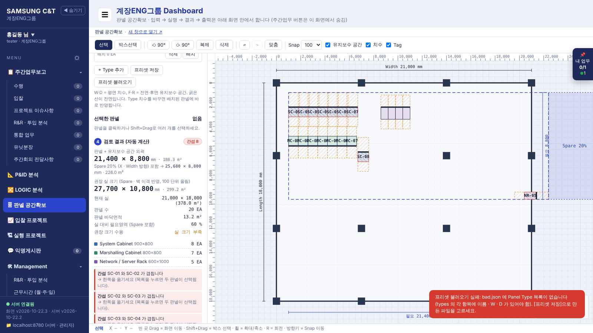
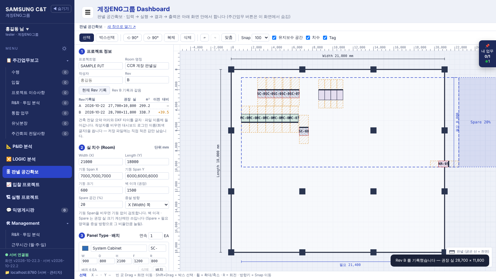

DXF (ezdxf 로 그린 그림 — **AutoCAD 캡처가 아님**. 이 컨테이너에 한글 글꼴이 없어 한글이 네모로 보인다):

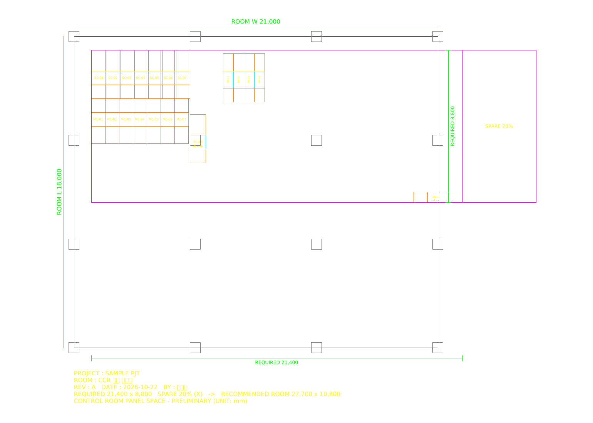

`sample/DXF_ezdxf_점검.txt`: AC1009(R12) · `$INSUNITS 4`(mm) · **audit 오류 0** · Layer CR-ROOM / COLUMN / PANEL / PANEL-FRONT / CLEARANCE / ENVELOPE / TEXT / DIM.

---

## 2. 0단계 불일치 처리 현황

| 심각도 | 항목 | 처리 |
|---|---|---|
| 상 | 원본 툴 Google Fonts | ✅ 제거 (1단계) |
| 상 | 헤더 중복 (대시보드 헤더 + 도구 자체 헤더) | ✅ 대시보드 쪽: 주간업무 버튼 숨김 · 공간확보 `embed=1` 이면 자체 제목 숨김. ⏸ LOGIC 자체 navy 헤더 · `← P&ID` 링크는 titleblock 코드 → 3절 변경안 |
| 상 | 원본 툴 다크모드 | ✅ 제거 |
| 중 | 명칭 LOGIC 분석 / LOGIC 검토 / Logic 분석 | ⏸ 3절 변경안 (titleblock 코드) |
| 중 | 출력 버튼 이름 · 위치 | ✅ 공간확보 · ⏸ LOGIC 은 3절 |
| 중 | 색 네 벌 | ✅ 공간확보 = 대시보드 토큰. ⏸ P&ID · LOGIC 은 3절 |
| 중 | 오류 표시 방식 | ✅ 공간확보 (목록 문장 + toast). ⏸ LOGIC 헤더 상태 글자는 3절 |
| 중 | 저장 방식 (공간확보만 브라우저 보관) | ⏸ 서버 저장 **제안**(4절) — 지시대로 승인 후 구현 |
| 하 | 실행 개념 · 숫자 표 · pill 토큰 이름 · P&ID 고정폭 | 이번 범위 밖 (하) |

⏸ 항목을 이번에 직접 고치지 않은 이유: P&ID · LOGIC 화면은 다른 저장소 브랜치(`claude/titleblock-parsing-c5st4x`)와 다른 배포(hotfix 꾸러미)이고, 이 세션은 지정 브랜치에만 푸시할 수 있다.
**P&ID · LOGIC 코드는 이 작업에서 0줄 바뀌었다** → fingerprint · LOGIC 결과가 바뀔 경로가 없다.

---

## 3. P&ID · LOGIC 쪽 변경안 (titleblock 브랜치에서 · UI 만)

| # | 심각도 | 무엇을 | 바꿀 곳 | 회귀 |
|---|---|---|---|---|
| L1 | 상 | 대시보드 안(`?embed=1`)에서 LOGIC 헤더의 `← P&ID` 링크와 h1 을 숨기고 도구 버튼(묶음 · 이동 · 보고서)만 남김. 대시보드 `PID_ROUTES.logic.q` 를 `'embed=1&'` 로 | `app/static/logic.js`(embed 판정 → body class), `logic.css`, 대시보드 `PID_ROUTES` | UI 시험 · LOGIC 샘플 1건 |
| L2 | 중 | 명칭 통일: `<title>` · h1 'LOGIC 검토' → 'LOGIC 분석', 첫 화면 h2 'Logic 분석' → 'LOGIC 분석' | `logic.html` | 문구만 |
| L3 | 중 | 출력 버튼: 'Excel 보고서' → 'Excel 출력', '검토 PDF' → '검토 PDF 출력' (위치는 유지 — LOGIC 결과 화면은 시트 뷰라 헤더 오른쪽이 결과 머리 역할) | `logic.html` | 문구만 |
| L4 | 중 | 오류 표시: 헤더 오른쪽 12px 상태 글자 → 실패 시 본문 위 띠 + '무엇이 · 어떻게' 문장 | `logic.js` 상태 표시 함수 | UI 시험 |
| L5 | 중 | 색: LOGIC 베이지 배경 `#f6f4ee` → `#eef1f8`, navy/blue → `#1e2a5a` / `#2b44c9` | `logic.css :root` | 캡처 비교 |
| P1 | 중 | P&ID 글꼴 순서 `-apple-system,"Segoe UI","Malgun Gothic"` → `"Malgun Gothic","맑은 고딕",system-ui`, 고정폭 `ui-monospace,SFMono` → `Consolas,monospace` | `app/static/styles.css` (2112행 · mono 쓰는 곳) | UI 시험 · 캡처 |
| P2 | 중 | P&ID accent `#1d4ed8` → `#2b44c9` (1429행 덮어쓰기 블록). 1행의 옛 종이 테마 토큰은 남은 참조를 확인한 뒤 정리 | `styles.css` | 캡처 비교 |

회귀 게이트(titleblock CLAUDE.md 그대로): 빠른 시험 · UI 시험 · `python3 spike/regression_3p.py` (fingerprint · 행 수 · Q'ty) · LOGIC 샘플 1건. **이 컨테이너에는 발주처 PDF 가 없어(gitignore) 회귀를 돌릴 수 없다** — 회사 PC 에서.

---

## 4. 세 메뉴 용어 · 버튼 비교표 (변경 전 / 후)

| 항목 | P&ID 분석 (이번 미변경) | LOGIC 분석 (이번 미변경) | 판넬 공간확보 — 전 (원본) | 판넬 공간확보 — 후 |
|---|---|---|---|---|
| 메뉴 / 화면 제목 | P&ID 분석 / P&ID 계기·밸브 리스트 Dashboard | LOGIC 분석 / LOGIC 검토 · Logic 분석 | (메뉴 없음) / Control Room 공간확보 | 판넬 공간확보 (대시보드 띠, 자체 제목은 embed 시 숨김) |
| 대시보드 위쪽 버튼 | 전: 주간업무 버튼 8개 → **후: 숨김** | 전: 같음 → **후: 숨김** | — | 숨김 |
| 입력 단계 | ① 어디에 넣을지 ② 도면 PDF | ① 어디에 넣을지 ② 자료 | 번호 없음: Room · 실 치수 / Panel Type | ① 프로젝트 정보 ② 실 치수 ③ Panel Type · 배치 |
| 파일 넣기 | 파일 선택 · 끌어 놓기 | 파일 선택 · 끌어 놓기 | 불러오기 | 배치안 불러오기 · 프리셋 불러오기 |
| 실행 | 새 분석 | 분석 | (실시간) | (실시간) — 결과 머리에 '자동 계산' |
| 진행 표시 | 진행 화면(단계) | 진행 줄 | — | — (즉시) |
| 결과 | 결과 표 + 도면 | 시트 + 점검 목록 | 공간 요구 | ④ 검토 결과 (자동 계산) |
| 상태 표시 | 등급 · 검토 필요 | 연결 점검 | OK / 경고 n / 간섭 n (테두리) | 같은 말, 대시보드 색으로 채운 pill |
| 출력 | Excel 출력 | Excel 보고서 · 검토 PDF | 건축 전달 요약 · DXF · 판넬 List CSV · 배치안 저장(JSON) | ⑤ 건축 전달 요약 출력 (TXT) · DXF 출력 · 판넬 List 출력 (CSV) · 배치안 저장 (JSON) · 프리셋 저장 |
| 출력 창 버튼 | — | — | 복사 · 파일 다운로드 · 닫기 | 복사 · 파일로 저장 · 닫기 |
| 오류 표시 | 진행 화면 실패 문장 + 조치 버튼 | 헤더 상태 글자 · 빨간 안내 | 짧은 문구 / 불러오기 실패 = 빈 창 | '무엇이 → 어떻게' 문장 · 알림(toast) |
| 저장 | 서버 (SQLite) | 서버 | 브라우저 + JSON 파일 | 같음 (서버 저장은 4절 제안) |
| 글꼴 · 색 | Segoe UI 먼저 · `#1d4ed8` | 맑은 고딕 · `#2f5bd8` · 베이지 | IBM Plex(외부) · `#1f5fd1` · 다크 | 맑은 고딕 / Consolas · `#1e2a5a` / `#2b44c9` |

---

## 5. 제안 (승인 후 구현)

### 5-1. 서버 폴더에 프로젝트별 저장

- API(server.py, 로그인 + 메뉴 권한 `space`): `GET /api/space/projects` · `GET /api/space/<프로젝트>/<배치안>` · `PUT /api/space/<프로젝트>/<배치안>` `{data, baseRev}` (rev 비교로 동시 수정 충돌 → 기존 `rec` API 와 같은 방식).
- 저장: 운영 폴더 `modules/space/<프로젝트>/<배치안>.json` (+ 저장마다 `history/` 사본 7일), 공유 프리셋 `modules/space/_presets/<이름>.json`. 쓰기는 `with LOCK:` + `write_json()`, 일일 백업 zip 에 포함. 기존 `data/` 구조는 안 바꿈.
- 화면: ⑤ 출력 옆 [서버에 저장] [서버에서 열기], 프리셋도 [서버 프리셋]. JSON 파일 저장은 그대로 둠.
- 영향: `SERVER_VERSION` 올림 + 서버 재시작.

### 5-2. 4단계 설계안 — P&ID 결과로 Marshalling / System Cabinet 면수 초안

**전제 확인**: 지금 P&ID 결과 행(`app/pipeline.py Row`)에는 I/O 유형이 없다 — `tab · type · qty · scope · system · …` 뿐. 그래서 **Type → I/O 수 대응표를 사람이 넣는다.** 근거 없는 기본값은 두지 않는다.

1. **자료 경로** (권장 A)
   - **A (권장)**: P&ID 결과에 '계기 Type 집계 CSV 출력' 버튼(scope 별 · Type 별 qty 합) → 공간확보 [P&ID 집계 불러오기]. 두 서버를 묶지 않고 파일로 넘김 → 폐쇄망 · 권한 문제 없음.
   - B: 공간확보가 `http://<서버>:8000/jobs/<id>/rows` 를 직접 호출 — 다른 출처라 P&ID 서버의 CORS/출처 규칙을 풀어야 함 → 비권장.
   - C: P&ID Excel 파일을 브라우저에서 직접 읽기 — 발주처 양식마다 열이 달라 깨지기 쉬움 → 비권장.
2. **사용자 입력 (모두 빈 칸에서 시작)**
   - 대응표: 계기 Type(예: PT, FT, MOV …) → AI / AO / DI / DO 수. 비어 있는 Type 은 계산에서 빼고 '대응 없음 n종 (수량 m)' 으로 표시.
   - 포함할 scope (예: SCT 만).
   - I/O Spare %.
   - Cabinet 당 I/O 수: System Cabinet, Marshalling Cabinet 각각 (I/O 유형별로 다르면 유형별).
3. **계산**: 유형별 I/O = Σ qty × 대응 수 → × (1 + I/O Spare) → Cabinet 면수 = ⌈I/O ÷ Cabinet 당 I/O⌉. 계산 근거 표(Type · 수량 · 대응 · 소계)를 같이 보여 줌.
4. **공간확보로 넘김**: '판넬 수량 초안' 표 → [초안으로 배치] 를 누르면 해당 Panel Type 으로 연속 N EA 배치. 이 판넬은 `src:'pid-estimate'` 로 저장하고 화면에 '추정' 표시, 사람이 옮기거나 고치면 `src:'user'` — 자동값과 사람 값 구분 원칙 유지.
5. **건축 전달 요약**: 'Cabinet 수량 근거: P&ID <프로젝트 · 리비전> 집계, 대응표 · Cabinet 당 I/O = 사용자 입력' 한 줄.
6. 검증: 샘플 프로젝트 1건으로 손 계산과 대조.

---

## 6. 완료 기준

| 기준 | 상태 | 근거 / 남은 일 |
|---|---|---|
| `판넬 공간확보` 메뉴 진입, 같은 헤더 · 스타일 | ✅ | `img/1_후_판넬공간확보.png` |
| 외부 네트워크 요청 0건 | ✅ (자동 기록) / ⏳ DevTools 캡처 | 페이지 + 모든 iframe(P&ID · LOGIC · 공간확보) 요청 목록 `sample/요청목록_*.txt` — localhost 밖 0건. **Edge 개발자도구 Network 탭 캡처는 회사 PC 에서** (이 환경은 헤드리스라 DevTools 창을 찍을 수 없음) |
| DXF 를 AutoCAD 2026 에서 정상 | ⏳ 회사 PC | ezdxf audit 오류 0 · Layer 8개 · mm · 한글 스타일 CR-KOR. AutoCAD 캡처는 `sample/*.dxf` 로 회사에서 |
| P&ID 회귀 fingerprint 동일 | ⏳ 회사 PC (코드 0줄 변경) | PDF 가 저장소에 없어 여기서 못 돌림. `python3 spike/regression_3p.py` |
| LOGIC 결과 동일 (샘플 1건) | ⏳ 회사 PC (코드 0줄 변경) | 같은 이유 |
| 세 메뉴 용어 · 버튼 비교표 | ✅ | 4절 |
| 배포 파일 목록 · 적용 순서 | ✅ | 7절 |

---

## 7. 회사 PC 배포 — 변경 파일과 적용 순서

패치: `dashboard_patch_2026-10-22.zip` (`python3 dashboard_tools/make_patch.py` — 마지막 전달본 v16.23 이후 바뀐 파일만)

| 파일 (운영 폴더 기준) | 내용 | 재시작 |
|---|---|---|
| `dashboard.html` | 메뉴 · 화면 틀 · 헤더 (APP 2026-10-22.3) | 아니오 (30초 안에 deploy 갱신) |
| `server.py` | 메뉴 권한 표에 space (SERVER 2026-10-22.2) | **예** |
| `apps\space\index.html` | 판넬 공간확보 (새 파일 · 새 폴더) | 아니오 |
| `DASHBOARD_ARCHITECTURE.md` | 7장 방법 A' · 변경 이력 2026-10-22 (7) | — |

P&ID 도구(8000)에는 넣을 파일이 없다.

1. 서버 PC: zip 을 풀고 `APPLY.bat` 실행 — 회사본이 전달본과 같으면 `backup\patch_…\` 에 백업 후 덮어씀, 회사에서 고친 파일은 옆에 `.new`. `apps\space\` 폴더는 자동 생성.
2. 서버 재시작: `uninstall_autostart.bat` → `install_autostart.bat` (또는 server 프로세스만 종료해 watchdog 이 다시 켜게).
3. 서버 PC Edge 에서 `http://localhost:8080` Ctrl+F5 → 왼쪽 '🗄 판넬 공간확보' · ⚙ 메뉴 권한 표에 '판넬 공간확보'.
4. 부서원 PC: '새 버전' 배너 → [지금 교체].
5. 확인: Network 탭 외부 요청 0건 · 출력 4종 다운로드(.dxf 확장자 그대로) · DXF AutoCAD · P&ID 회귀 · LOGIC 샘플.

---

## 8. 다시 확인하는 법

- 시험 입력: `sample/시험_시나리오_배치안.json` (기둥 간섭 1 · 실 밖 1), `sample/시험_프리셋.json`.
- 공간확보 툴 단독: `apps/space/index.html` 을 브라우저로 열어도 동작(서버 없이) — 대시보드 안에서는 `?embed=1&user=` 가 붙는다.
- 브라우저 보관 키: localStorage `crspace.v1` (PC · 브라우저마다 따로). 배치안은 [배치안 저장 (JSON)] 으로 파일로 남길 것.

---

## 9. 추가 요청 반영 (2026-10-22) — 어두운 CAD 화면 · 도어

요청: "UI 를 CAD 처럼 어둡게, 도어가 열리는 궤도까지, 판넬 Type 을 만들 때 L-R Open · 전면 · 후면 중 도어 위치를 선택".
지시서에서 Phase 2 로 미뤘던 Door Swing Arc 를 이 요청으로 앞당겼다 (Walkway 폭 검사 · 건축 CAD 위 배치는 여전히 범위 밖).

| 항목 | 내용 |
|---|---|
| 화면 | 기본 = 어두운 CAD (짙은 회색 바탕 · 흰 벽선 · 어두운 입력칸). 도구줄 [☀ 밝게] 로 예전 밝은 화면, 이 PC 에 기억 |
| Door 위치 | 없음 · 전면 · 후면 · 전·후면 (Panel Type 카드) |
| 열림 | L 힌지 · R 힌지 (그 면 **앞에 서서 판넬을 볼 때**의 왼쪽/오른쪽) · 양개 L-R (폭 절반 문짝 둘) |
| 그림 | 90° 열린 문짝 실선 + 회전 궤적 점선 호, [도어] 켜고 끄기 |
| 검토(경고) | 문짝 반경 > 그 면 유지보수 공간 / 궤적이 벽 밖 · 기둥 · 다른 판넬에 닿음 → 고치는 법 문장 |
| 필요 영역 | 궤적이 유지보수 공간 밖으로 나가면 포함 (안쪽이면 숫자 변화 없음) |
| DXF | Layer `CR-DOOR` (색 5): 문짝 LINE + 궤적 ARC |
| 출력 | CSV `Door` · `Hinge` 열, 요약 Type 줄에 도어, 프리셋에 도어 |
| 예전 자료 | 도어 항목이 없는 배치안 · 프리셋 = 도어 없음 → 예전 결과 그대로 (시나리오 권장 실 23,400 × 10,600 확인) |

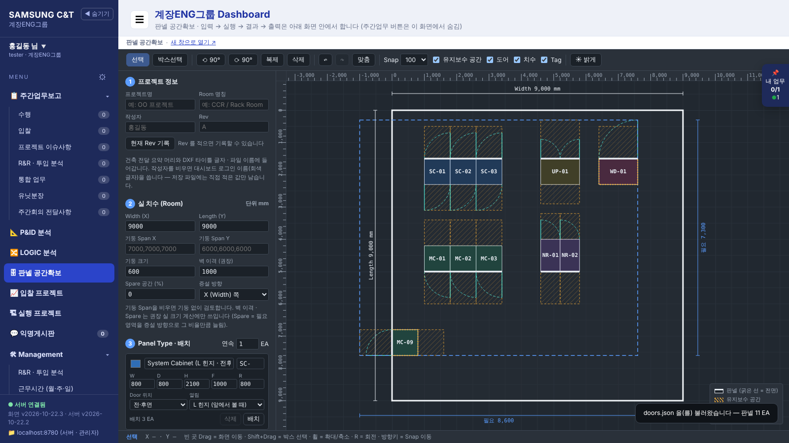

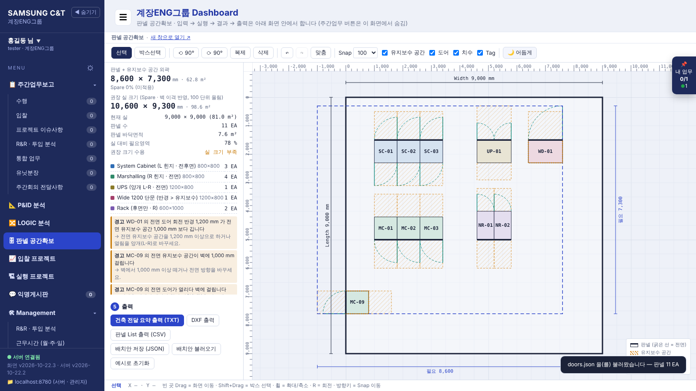
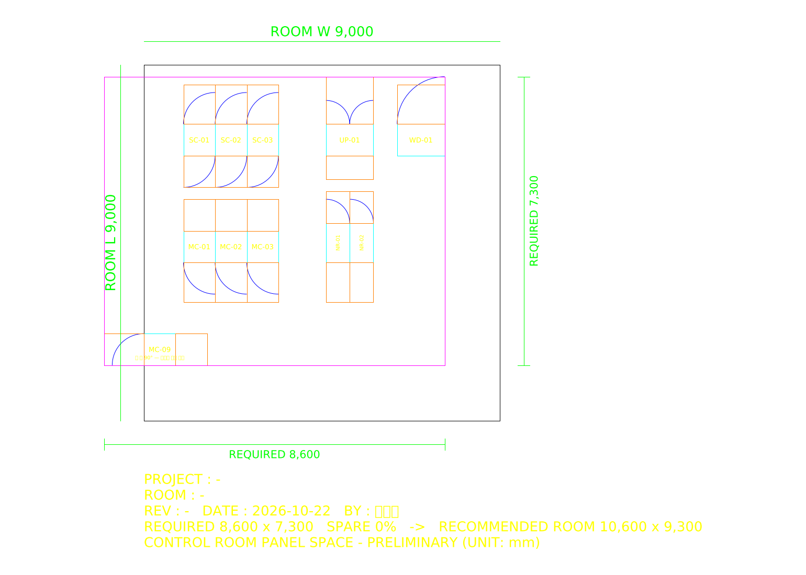

시험 입력 `sample/시험_도어_배치안.json` → 경고 3건 (`sample/시험_도어_검토목록.txt`):
WD-01 단문 1200 > 유지보수 1000 · MC-09(벽 옆, 전면이 벽 쪽) 유지보수 공간 · 도어가 벽에 걸림.
DXF `sample/시험_도어_Layout.dxf`: audit 오류 0, ARC 15 = 문짝 수, SC-01 전면 L 힌지 ARC 중심 = 앞에서 볼 때 왼쪽(동쪽) 끝, 90°→180°.

회사에서 확인할 것: AutoCAD 에서 CR-DOOR 호 방향 · L/R 기준이 부서 관례와 맞는지 (반대면 한 줄로 바꿀 수 있음 — `doors()` 의 `Lv`).
배포: `apps\space\index.html` 한 파일만 바뀜 (서버 재시작 · 대시보드 교체 불필요).

## 10. 추가 요청 반영 — DXF 색을 화면과 같은 톤으로

요청: "DXF 출력도 너무 눈부시다. UI 와 같은 색감으로".
R12 DXF 는 AutoCAD 색 번호(ACI)만 쓸 수 있어, 화면(어두운 CAD) 색마다 가장 가까운 ACI 를 계산해 골랐다. 원색 · 순백은 쓰지 않는다.

| Layer | 전 | 후 | 화면 색 |
|---|---|---|---|
| CR-ROOM | 7 흰색 | 254 밝은 회색 | 벽선 `--wall` |
| CR-COLUMN | 8 회색 | 8 회색 | 기둥 `--col` |
| CR-PANEL | 4 하늘 | 253 회색 | 판넬 선 |
| CR-PANEL-FRONT | 1 빨강 | 254 밝은 회색 | 전면 굵은 선 |
| CR-CLEARANCE | 30 주황 | 43 흐린 주황 | 유지보수 공간 `--clear` |
| CR-ENVELOPE | 6 자홍 | 161 파랑 | 필요 영역 `--accent` |
| CR-TEXT | 2 노랑 | 9 연회색 | 글자 |
| CR-DIM | 3 초록 | 151 하늘 | 치수 |
| CR-DOOR | 5 파랑 | 133 청록 | 도어 `--door` |

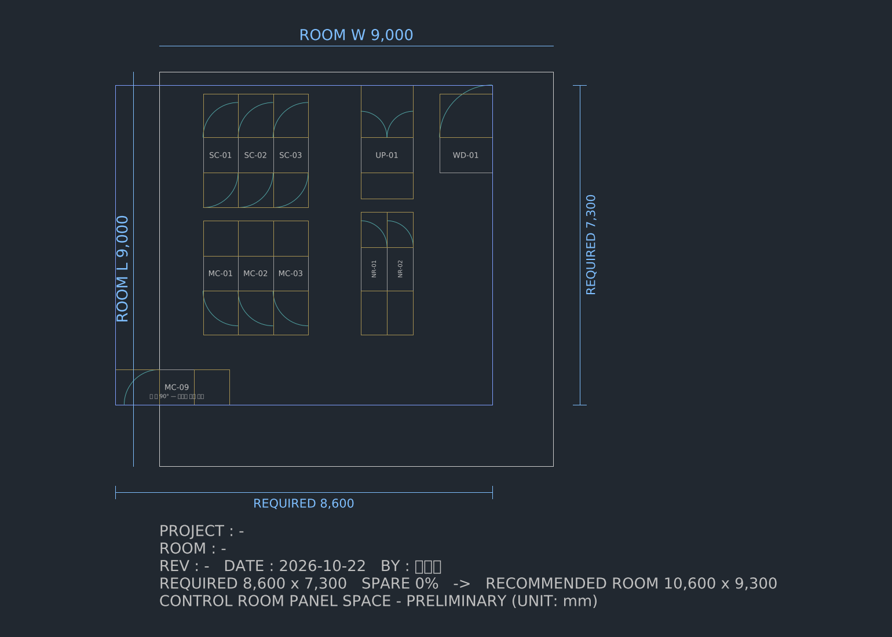

audit 오류 0 (`sample/DXF_도어_ezdxf_점검.txt`). AutoCAD 바탕을 흰색으로 쓰면 회색 선이 흐릴 수 있다 — 그때는 CR-ROOM · CR-TEXT 를 7 로 되돌린다.

## 11. 추가 요청 반영 — PPT 처럼 Type 만들고 눌러서 배치

개발 의도 (요청 원문 요약): ① 계장이 아무것도 없는 상태에서 판넬 사이즈별 제약을 고려해 배치하고 전체 볼륨 확인 → ② 그 사이즈를 건축에 전달 → ③ 건축이 계장 Room 을 CAD 로 설계해 회신 → ④ 계장이 그 CAD 를 backdrawing 으로 상세 배치. **이 툴은 ①.**

| 동작 | 방법 |
|---|---|
| Type 만들기 | 'Panel 삽입' 줄 끝 [＋ 새 Type] (또는 ③ 의 [+ 새 Type]) → 창에서 이름 · Tag 접두어 · 색 · W·D·H · F·R · 도어 → 미리보기 확인 → [만들기] / [만들고 배치] |
| 배치 | 삽입 줄의 Type 단추를 누름 → 도면 클릭 (연속 N EA, R 회전, Esc 끝). 다시 누르면 해제 |
| 고치기 · 지우기 | 단추의 ✎ 또는 두 번 누르기 → 같은 창. 고친 값은 배치된 판넬에 바로 반영. 배치된 판넬이 있으면 삭제 막힘 |
| 저장 | 프로젝트(배치안 JSON · 브라우저 보관)에 저장 + '이 PC 라이브러리에도 저장' 켜면 📚 라이브러리 → 다른 프로젝트에서 [프로젝트에 추가] |

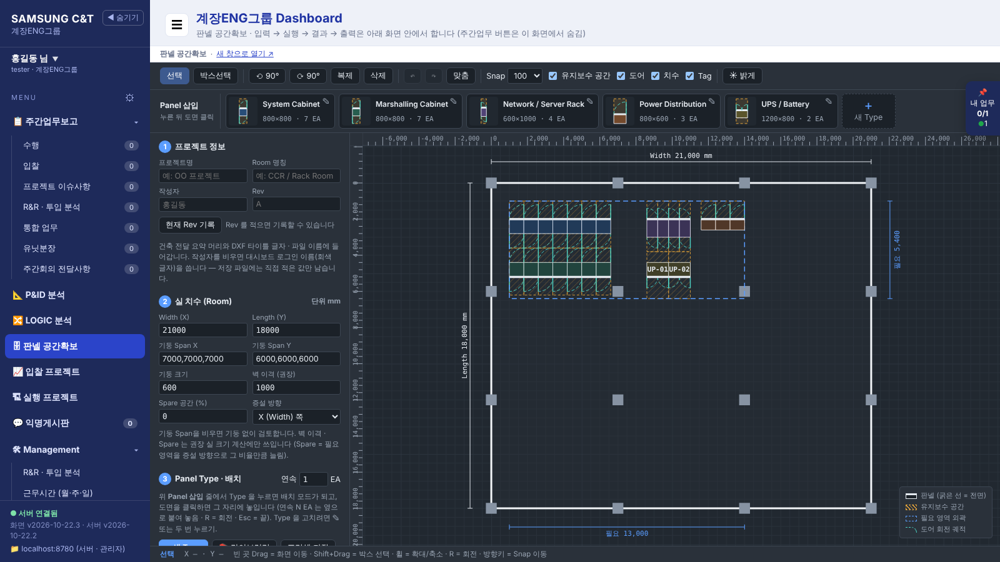
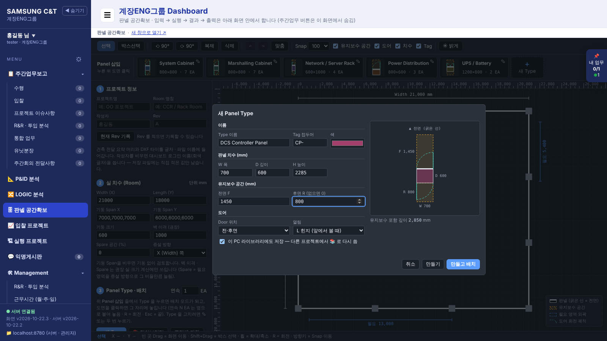
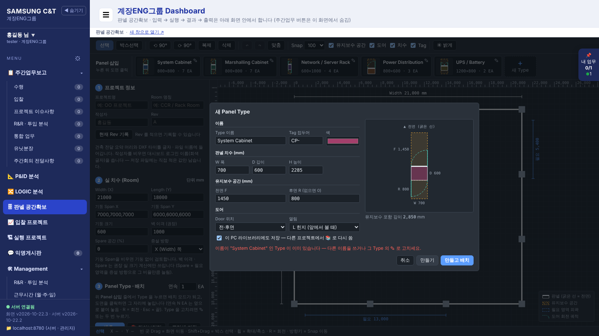
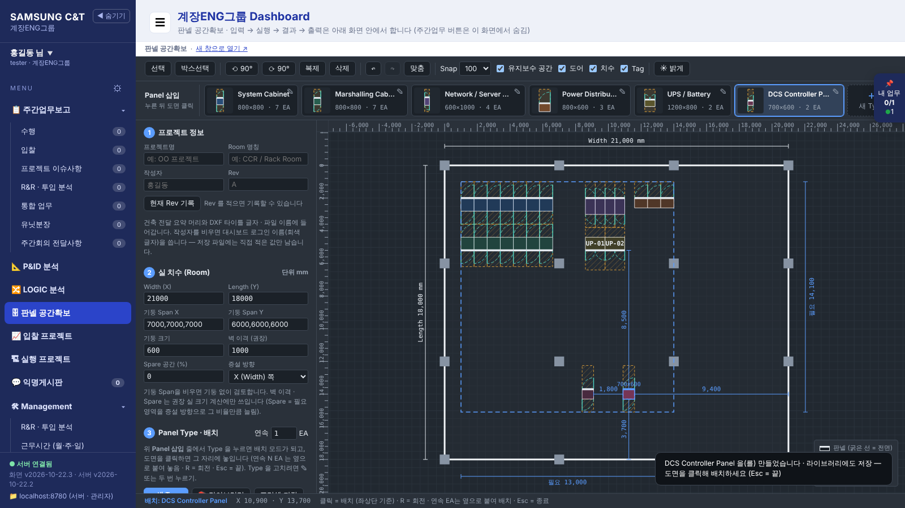
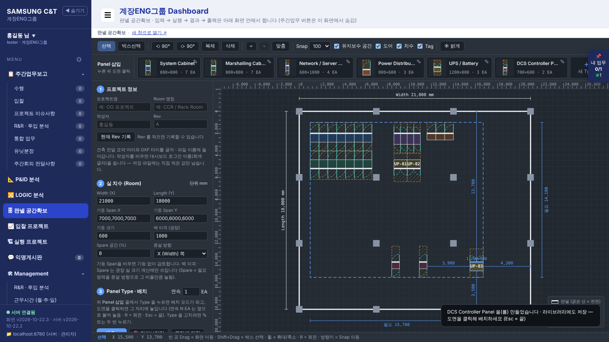
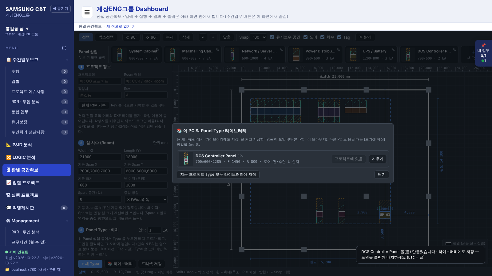

## 12. 추가 요청 반영 — 서버 저장 · 이력 · 노트 · 기둥 편집

요청: "프로젝트별 · 날짜별로 해당 작업을 저장, 도면에 또는 별도 노트를 추가, 다른 부서원이 그 history 를 볼 수 있게, 기둥 위치도 사용자가 바꿀 수 있게". (5-1 서버 저장 제안을 이 요청으로 구현)

| 기능 | 어디서 | 저장 | 누가 보나 |
|---|---|---|---|
| 프로젝트별 · 날짜별 저장 | ① [💾 서버에 저장] / 🗂 창 가운데 | 서버 `space/<프로젝트>/saves/<저장ID>.json` — 매번 새 파일 | 부서원 모두 (보기), 저장은 로그인 + 권한 |
| 저장 이력 | 🗂 창 가운데: 시각 · 저장한 사람 · 메모 · Rev · 판넬 수 · 필요 영역 · 권장 실 · Spare, [이 저장본 열기] | 〃 | 〃 |
| 프로젝트 노트 (별도 노트) | 🗂 창 오른쪽 | 서버 `space/<프로젝트>/index.json` | 부서원 모두, 지우기 = 본인 · 운영자/그룹장 |
| 도면 노트 | 도구줄 [📌 노트] → 도면 클릭 | 배치안 안 (`notes`) → 서버 저장본 · JSON · 요약 · DXF CR-NOTE | 저장본을 연 사람 |
| 기둥 편집 | 도구줄 [기둥 편집] | 배치안 안 (`cols`) | 〃 |

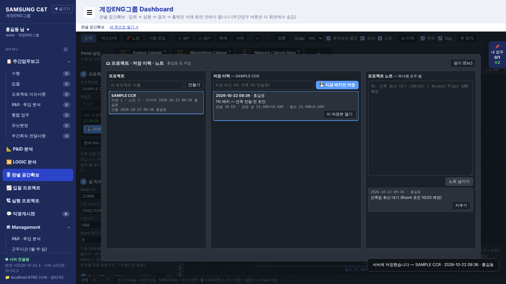
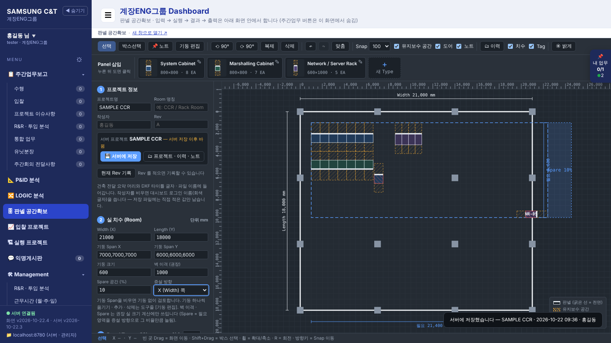
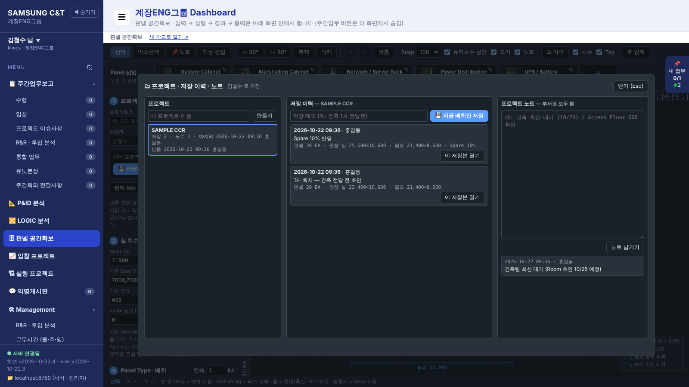
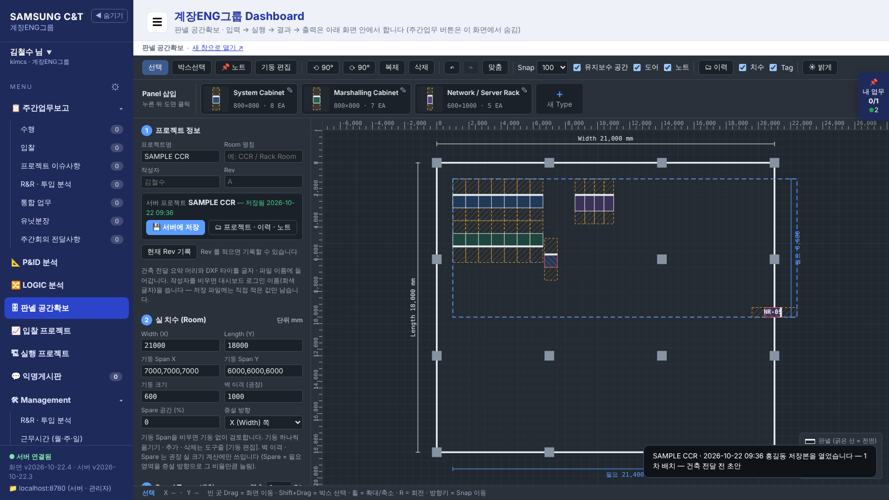
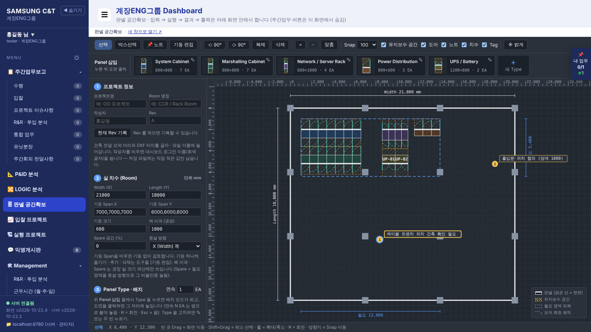

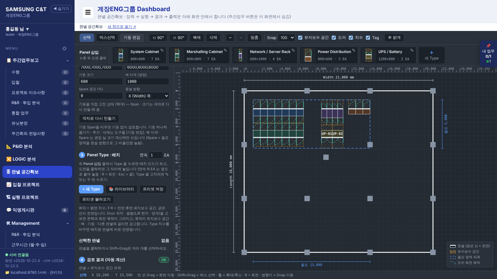

배포: `server.py`(재시작 필요) · `dashboard.html` · `apps\space\index.html`. 운영 폴더에 `space\` 가 새로 생기고 일일 백업에 들어간다.

## 13. 추가 요청 반영 — P&ID · LOGIC 과 같은 첫 화면

요청: "프로젝트별 저장은 P&ID 분석 · LOGIC 분석 첫 화면 UI 와 같이".

| LOGIC 분석 첫 화면 | 판넬 공간확보 첫 화면 |
|---|---|
| 제목 'Logic 분석' + 설명 | 제목 '판넬 공간확보' + 설명 |
| ① 어디에 넣을지: 프로젝트 · 새 프로젝트 · 도면 종류 | ① 어디에 넣을지: 프로젝트 · 새 프로젝트 · Room · Rev |
| ② 자료 (Logic Diagram 등) · [분석] · 빨간 이유 | ② 어떻게 시작할지 (최근 저장본 · 하던 작업 · 빈 실 · 예시 · JSON) · [배치 시작] · 빨간 이유 |
| 저장된 프로젝트 · 최근 분석 이력 | 저장된 프로젝트 · 최근 저장 이력 (줄을 누르면 그 저장본 열기) |
| ⌂ 첫 화면 | ⌂ 첫 화면 (배치 화면 도구줄 맨 앞) |

| LOGIC 분석 (비교) | 판넬 공간확보 |
|---|---|
|  | 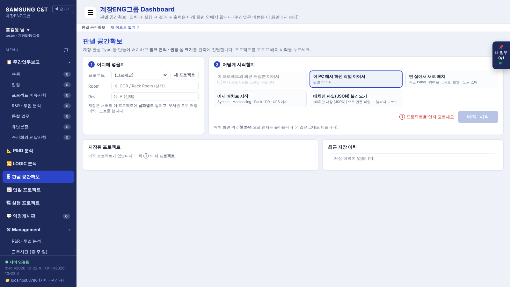 |

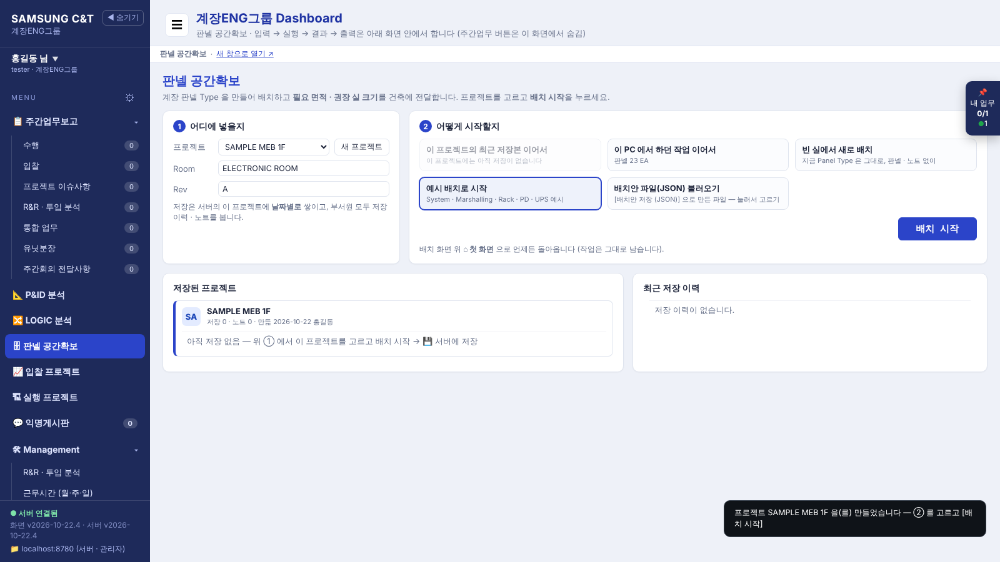
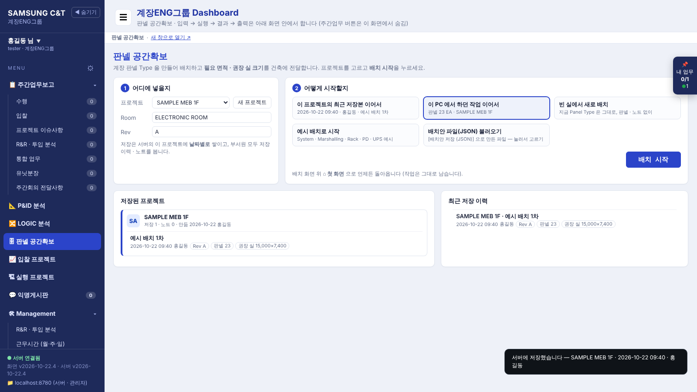
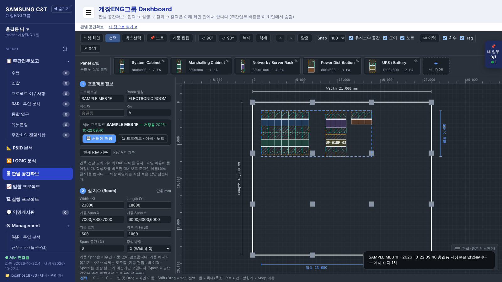

## 14. 추가 요청 반영 — 배치 제약 · Ctrl 정렬

| # | 요청 | 동작 | 시험 결과 |
|---|---|---|---|
| 1 | 기둥과 간섭이면 배치 불가 | 판넬 몸체가 기둥과 겹치면 놓기 · 옮기기 · 회전 막힘 (기둥 편집으로 판넬 위에 기둥 놓기도 막힘) | 기둥 (7,500, 5,000) 위 → 막힘 |
| 2 | 다른 판넬 문 궤적과 간섭이면 불가 | 남의 도어 회전 궤적(사분원) 안에 몸체 / 내 궤적에 남의 몸체 / 궤적끼리 겹침 → 막힘 | A-01 전면 궤적 안 → 막힘 |
| 3 | Ctrl 로 CAD 처럼 정렬 추천 | Ctrl 누른 채 놓기 · 끌기 → 근처 판넬 모서리 · 중심 · 맞닿음 · 이격 · 유지보수 외곽 · 벽 · 기둥 면에 붙고 분홍 안내선 + 이름표 | (2,680, 4,060) → (2,600, 4,000) '맞닿음' + '모서리 정렬' |
| 4 | 판넬 간 이격 입력, 좁으면 불가 | ② 판넬 간 최소 이격 (줄로 맞닿은 0 mm 는 예외 체크) | 500 기준: 300 → 막힘, 0(맞닿음) → 허용 |
| 5 | 도어 간 이격 입력, 좁으면 불가 | ② 도어 간 최소 이격 — 서로 다른 판넬 궤적 사이 실제 최단 거리 (같은 줄 나란한 문 제외) | 1,000 기준: 742 → 막힘, 위로 띄우면 허용 |

막힐 때: 미리보기 · 판넬이 빨강, 상태줄에 '⛔ 놓을 수 없음 — 이유', 끌어 놓은 판넬은 원래 자리로. ② '위반이면 놓지 못하게' 를 끄면 막지 않고 검토 목록에 오류로만 표시.

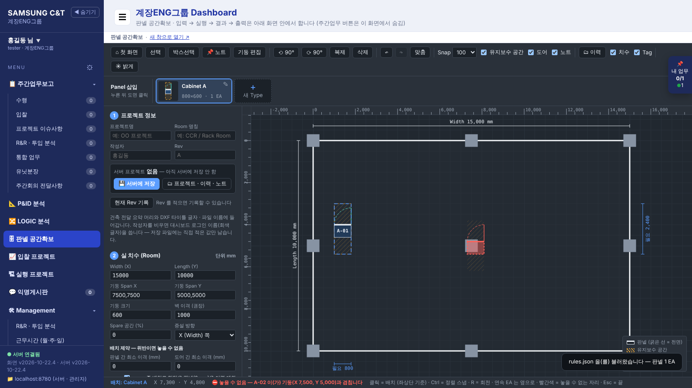
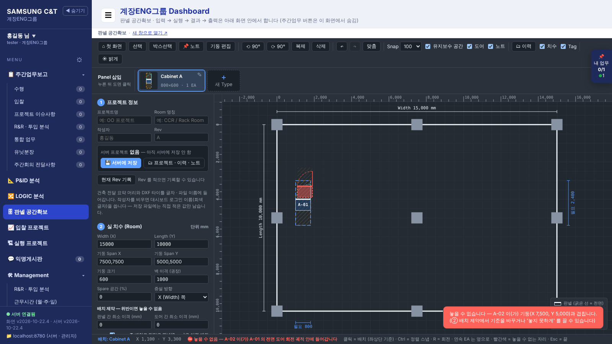
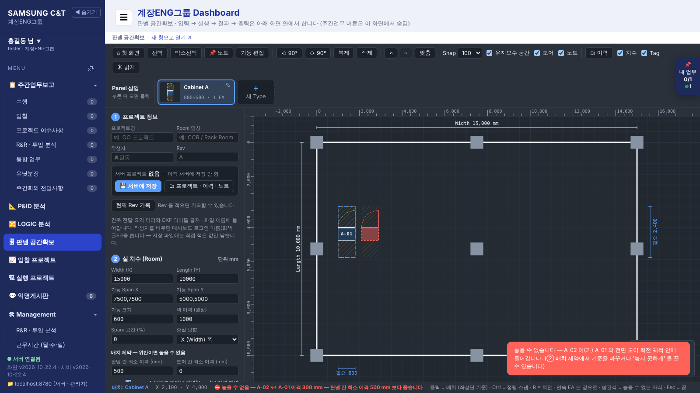
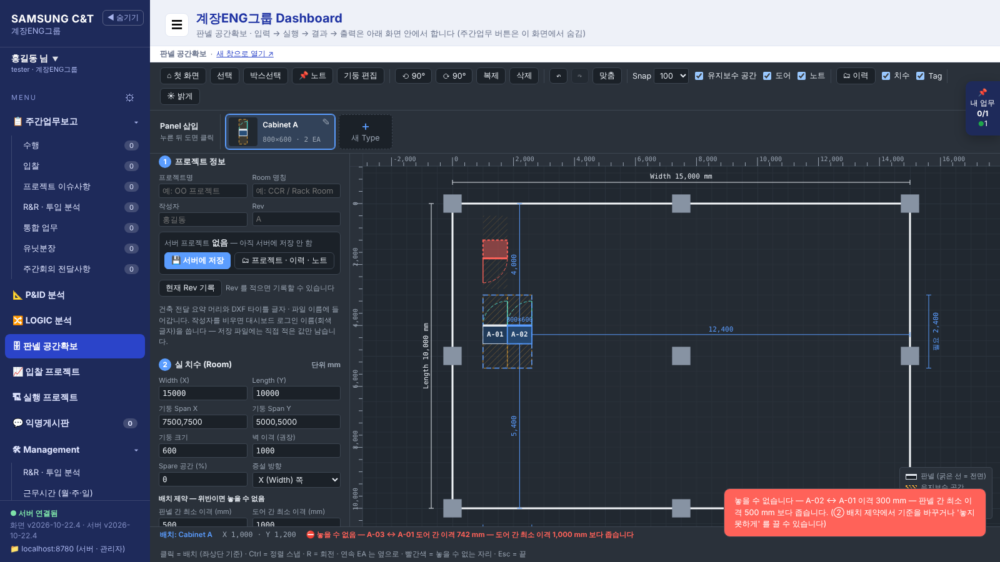
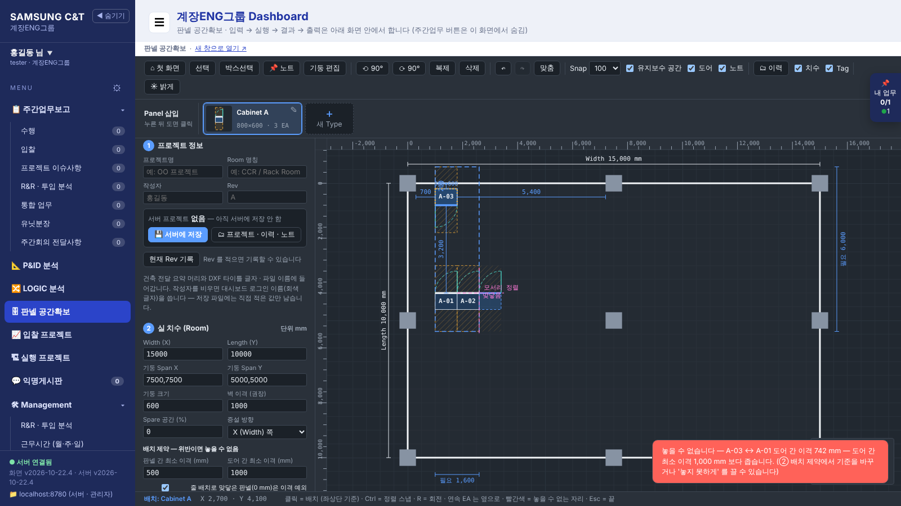
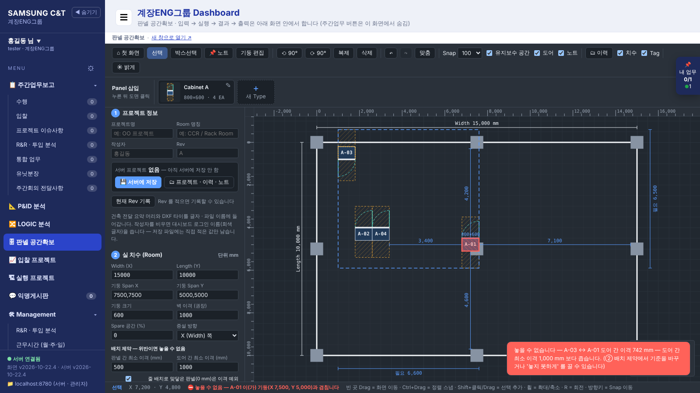

## 15. 추가 요청 반영 — 겹침 금지 · 그룹 W×L · Ctrl+휠 · Equipment List · 기둥 끌기 · 글자 1.5×

| # | 요청 | 동작 | 시험 |
|---|---|---|---|
| 6 | 겹치게 배치 안 되도록 | 판넬끼리 겹침(이미)에 더해 **다른 판넬의 유지보수 공간 안** 도 막음. Type 치수를 바꿔 배치된 판넬끼리 겹치게 되면 Type 저장 거절 | 유지보수 공간 안 → 막힘, W 800→900 → 'SC-01 이(가) SC-02 와 겹칩니다' 로 거절 |
| 7 | Shift 여러 개 → 그룹 W×L | 그룹 외곽 점선 + '그룹 W · 그룹 L' 치수, 속성칸에 W×L (판넬 외곽 / 유지보수 · 도어 포함) | SC-01~03 → 2,400 × 800 |
| 8 | Ctrl+휠 줌 · Equipment List | Ctrl+휠 = 도면 줌(사이드 위에서도, 브라우저 확대 안 함), [－][＋], + / -. 오른쪽 칸 EQUIPMENT LIST (NO · TAG · DESCRIPTION · SIZE), 판넬에 같은 번호 육각 balloon, DXF 표 · 번호 | 줌 0.025 → 0.045, 목록 23줄, DXF CR-LIST |
| 9 | 기둥을 마우스로 이동 | 선택 모드에서도 기둥 끌기 ([기둥 편집] 안 켜도). 판넬 위로는 막힘 | (7,000, 6,000) → (7,000, 6,800), 판넬 위 → 원래 자리 |
| 10 | Scale 1.5배 | 도면 글자 · 치수 · 노트 · 번호 · 안내선 배율, 기본 1.5×, 도구줄 '글자' 1~2× | 1.5× 기본 · 2× 바꿈 |

> 'Scale 1.5배' 는 도면 위 글자 · 표시 크기로 해석했습니다. 화면 전체(단추 · 사이드) 배율이나 처음 줌을 말한 것이면 알려 주세요 — 바로 바꿀 수 있습니다.

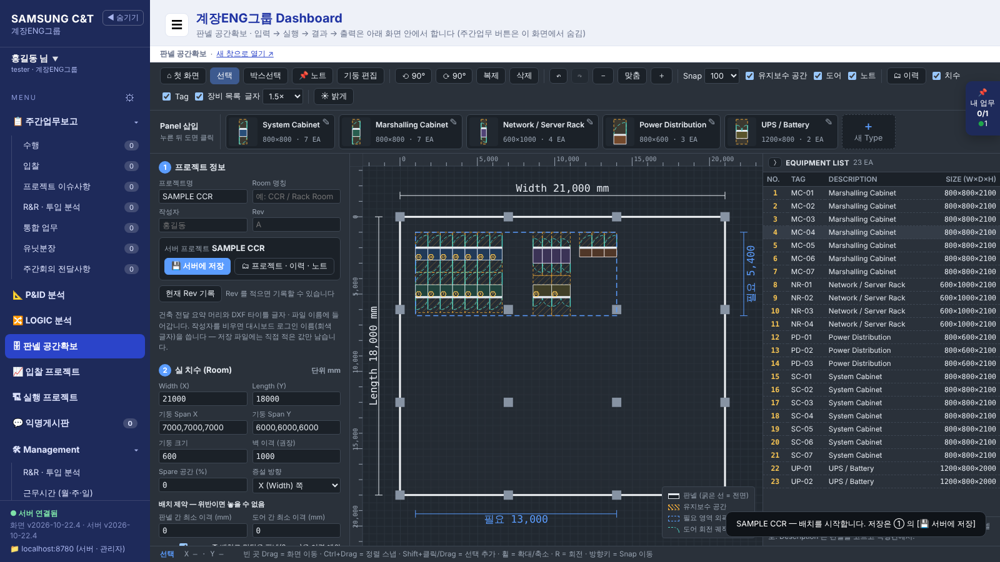
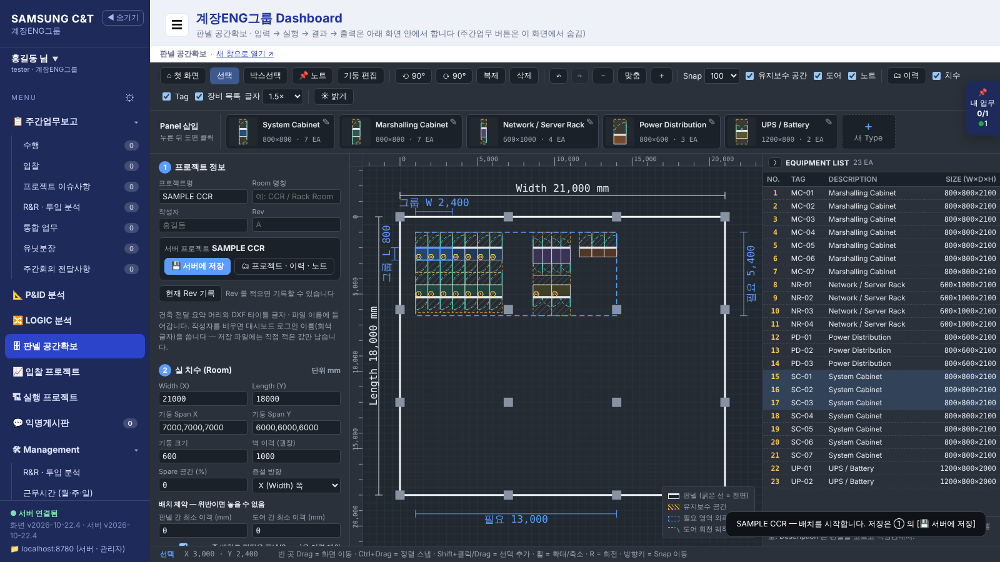
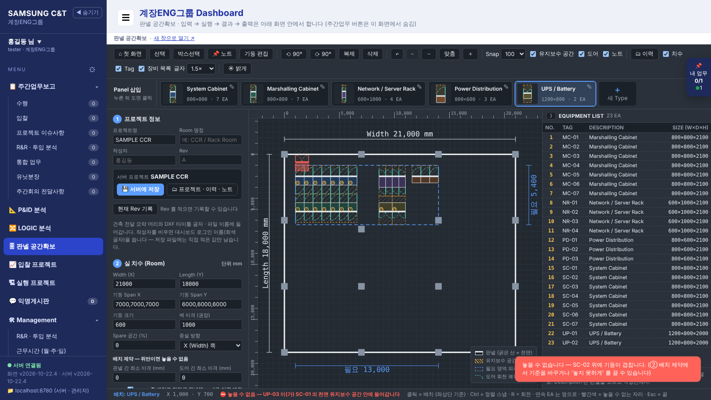
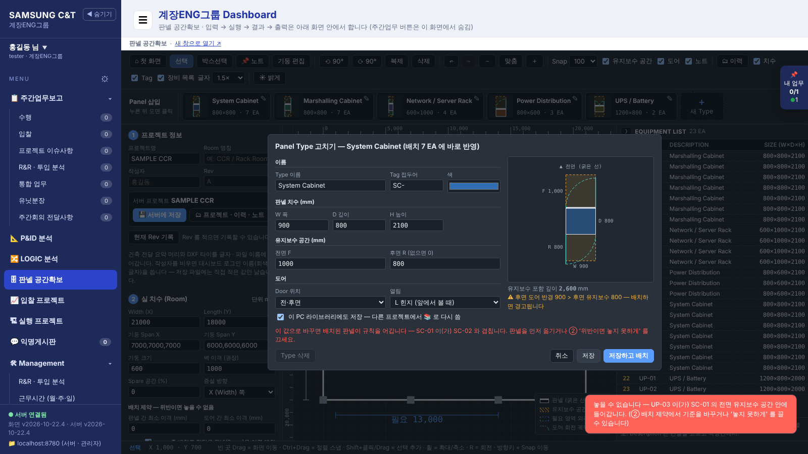
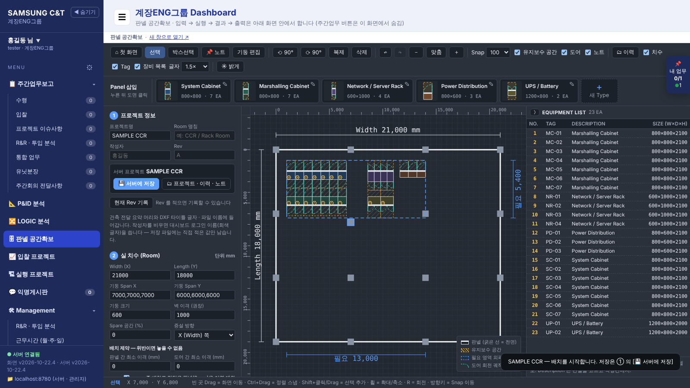
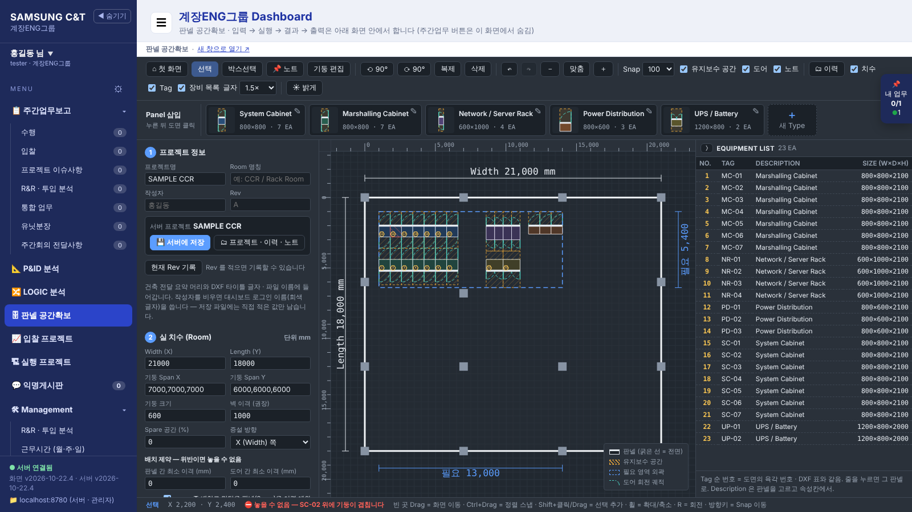
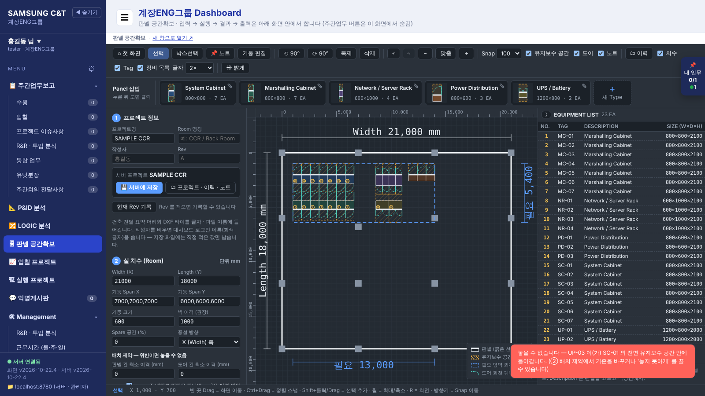
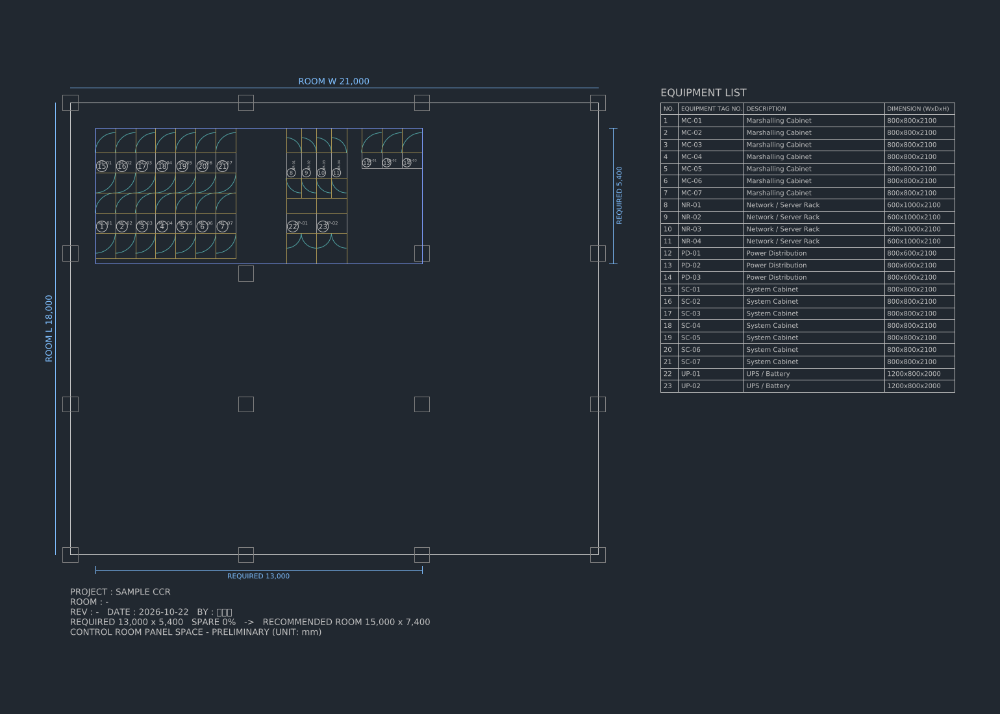

## 16. 추가 — 개선 · 보완 7가지

| # | 기능 | 어디서 | 시험 |
|---|---|---|---|
| 1 | 정렬 · 균등 배치 | 여러 개 선택 → 속성칸 맞춤(왼쪽 · 오른쪽 · 위 · 아래) · 균등 간격(가로 · 세로, 간격 입력). 잠긴 판넬 기준 | 위 맞춤 + 가로 500 → 4,000 · 5,300 · 6,600 |
| 2 | 거리 재기 | [📏 거리] 두 점 클릭 → 거리 · X · Y | 3,606 (X 3,000 · Y 2,000) |
| 3 | 도면 PNG 저장 | ⑤ 출력 — 지금 보이는 도면 2배 해상도 | 1320×1256 px 저장, 아래 그림 |
| 4 | 출력 전 검사 | 간섭(오류)이 있으면 요약 · DXF 출력 전에 확인창 | '간섭(오류) 1건 — A-05 이(가) 기둥과 겹칩니다' |
| 5 | 판넬 잠금 | 속성칸 🔒 · L 키 · 여러 개 [🔒 잠금] — 옮기기 · 회전 · 삭제 막음, 도면에 🔒 | 잠근 뒤 끌기 · Delete 에도 그대로 |
| 6 | 단축키 | Ctrl+S 서버 저장 · Z 선택으로 줌 · ? 도움말 · 목록 Shift+클릭 | 모두 동작 |
| 7 | 장비 목록 검색 | 찾기 칸 · '선택만' | 'A-03' → 1줄 |

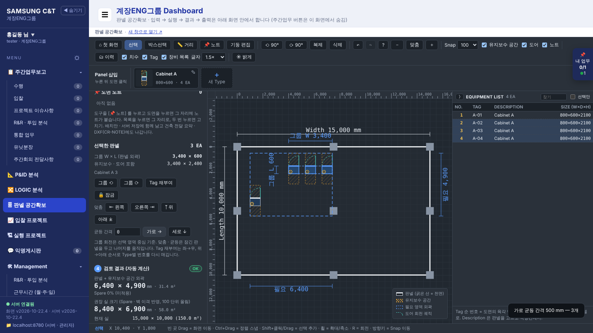
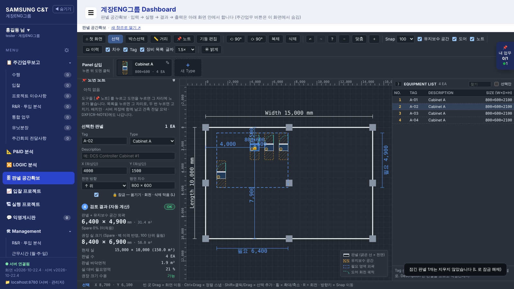

## 17. 추가 — 벽 이격 표시

요청: "벽과의 이격거리를 입력하면 최상단 · 하단 · 우측 · 좌측 판넬로부터 이격거리를 도어 궤도처럼 특정 표기로".

| 항목 | 내용 |
|---|---|
| 입력 | ② 실 치수 '벽 이격 (권장)' (기존 칸 그대로) |
| 표기 | 필요 영역(판넬 + 유지보수 · 도어 궤적, Spare 포함) 외곽에서 바깥으로 이격만큼 **보라 빗금 띠** — 위 · 아래 · 왼쪽 · 오른쪽 끝에 있는 판넬마다 그 판넬 폭(깊이)만큼 + 치수선 '이격 1,000'. 전체 이격선(= 권장 벽 위치)은 보라 일점쇄선. 띠에 마우스를 올리면 지금 벽까지 거리 |
| 부족 | 실 벽이 이격선보다 안쪽이면 그 띠가 빨강 + '⚠ 700 부족', 검토 목록 경고 "벽 이격 부족 (아래쪽): NR-05 외곽에서 벽까지 300 mm < 1,000 mm → 700 mm 안쪽으로 옮기거나 실을 그만큼 넓히세요". 놓기는 막지 않음(경고) |
| 끄기 | 도구줄 [벽 이격] 체크, 이격 0 이면 표시 없음 |
| 출력 | 건축 전달 요약 2절에 '벽까지 실제 거리: 위쪽 1,000 / 아래쪽 300 (부족) / …', DXF 새 Layer `CR-MARGIN`(ACI 191 연보라): 이격선 · 띠 · `WALL CLR 1,000 (NOW 300)` |

시험(Chromium): 예시 배치 이격 1000 → 띠 4개 · 경고 0, 시나리오 실을 22,800 × 9,900 으로 줄임 → 아래쪽 300 · 오른쪽 400 부족 경고 2건, Spare 20 % (X) → 오른쪽 Spare 가 벽 밖으로 나간 경고, 표시 끔 → 띠 0, 이격 0 → 띠 0 · 경고 0. DXF audit 0, CR-MARGIN LINE 24 · TEXT 4. 이전 시험(배치 제약 · 6~10 · 개선 7가지 · 출력) 다시 통과, 권장 실 23,400 × 10,600 그대로. 외부 요청 0, 스크립트 오류 0.

## 18. 추가 — 3D 보기

요청: "H 까지 있으니 3D 보기 누르면 3D 로 볼 수 있도록".

| 항목 | 내용 |
|---|---|
| 여는 곳 | 도구줄 [🧊 3D] → 큰 창 |
| 그리는 것 | 판넬 = Type 의 W · D · **H** 상자(Type 색, 전면 = 밝은 면 + 윗변 선), 기둥 · 벽(높이 입력, 기본 3,000 — 이 PC 에 기억, 배치안에는 안 들어감), 바닥 1 m 격자, 유지보수 공간(바닥 반투명), 도어(90° 열린 문짝 반투명 판 + 바닥 회전 궤적), Tag 글자(겹치면 가까운 것만) |
| 조작 | 끌기 = 돌려 보기, Shift+끌기 · 오른쪽 끌기 = 옮기기, 휠 = 확대 · 축소, 더블클릭 = 처음 시점, [등각][정면][측면][위], 판넬 위에 마우스 = Tag · Description · W × D × H |
| 벽 | 카메라 쪽 벽은 자동으로 숨김(안이 보이게) |
| 기타 | [PNG 저장] (글자 포함), 판넬 H 가 벽 높이보다 크면 ⚠ 표시. 보기 전용 — 배치안은 안 바뀜 |
| 폐쇄망 | WebGL 을 직접 씀(Three.js 등 외부 라이브러리 없음), 외부 요청 0. WebGL 이 꺼진 PC 면 안내 문장 |

시험(Chromium · SwiftShader WebGL): 예시 23 EA 등각 · 돌리기 · 확대 · 마우스(PD-01 800 × 600 × H 2,100) · 정면 · 측면 · 위 · PNG 저장 · Esc 닫기, 도어 시험 배치 11 EA, 높이 1,800 → ⚠ 표시, 밝은 화면. 이전 시험(배치 제약 · 개선 7가지 · 출력 · 벽 이격) 다시 통과. 외부 요청 0, 스크립트 오류 0.

## 19. 추가 — 3D 사람 (175 cm · 80 kg)

요청: "175 cm 80 kg 성인 남성을 3D 화면에 표기하고 움직일 수 있게".

| 항목 | 내용 |
|---|---|
| 모양 | 정수리 1,750 mm · 어깨 폭 약 580(팔 포함) · 몸통 430 × 250(80 kg 체격) · 다리 · 팔 · 손 · 머리(구) · 코 = 보는 방향, 바닥 그림자. 머리 위 '사람 175 cm · 80 kg' |
| 처음 자리 | 처음 시점에서 가장 잘 보이는 판넬 유지보수 공간 가운데, 판넬을 바라봄 |
| 움직이기 | 사람을 끌기(50 mm 단위) · 방향키 100 mm(Shift 500, 화면 기준) · R / Shift+R · [↻ 사람] 45° 돌리기 |
| 막힘 | 판넬 몸체 · 기둥 · 벽은 못 지나감 — 50 mm 씩 걸어가다 닿으면 그 앞에서 멈추고(벽 따라 미끄러짐) 옷이 빨강 + '막힘 — 판넬 · 기둥 · 벽'. 도어 문짝(열린 상태 가정) · 유지보수 공간은 지나감 |
| 사람 시점 | [👁 사람 시점] = 사람 어깨 너머에서 보는 방향으로(사람과 앞 판넬 크기 비교). ↑↓ 걷기 · ← → 15° 돌기, 다시 누르면 등각. 다른 판넬 뒤에 가려진 Tag 는 안 그림 |
| 끄기 | [사람] 체크. 보기 전용 — 배치안 · 저장 파일에는 안 들어감 |

시험(Chromium · SwiftShader WebGL): 등각에서 사람 보임 · 마우스 정보, 끌어서 옮기기, PD-03 쪽으로 끌면 둘러 감(뚫지 않음), 사람 시점에서 MC-01 앞으로 계속 → 막힘(빨강), 왼쪽 90° → 통로가 보임, R 돌리기. 이전 시험(3D · 배치 제약 · 개선) 다시 통과, 외부 요청 0, 스크립트 오류 0.

## 20. 추가 — 3D 재기 · 통로 폭 · 3D 품질

요청: "거기를 측정할 수 있는 기능도 만들어 줘, 3D 조금 더 퀄리티 있게".

| 항목 | 내용 |
|---|---|
| 📏 재기 | [📏 재기] 켜고 두 점 클릭 → 거리 + X · Y · 높이(H) 차. 판넬 · 기둥 · 벽 면과 바닥을 찍고, 모서리 · 꼭짓점 가까우면 거기로 붙음(아니면 10 mm 단위). 여러 개 남김, [재기 지우기], 오른쪽 클릭 = 첫 점 취소. 선은 가려지지 않게 맨 위 |
| 통로 폭 (자동) | 사람이 서 있는 자리에서 앞뒤 · 좌우로 허리 높이 1,000 에서 판넬 · 기둥 · 벽까지 → '앞뒤 8,200 · 벽 ↔ MC-09', '좌우 4,000 · MC-01 ↔ 벽'. 사람을 옮기거나 돌리면 바로 바뀜. [통로 폭] 끄기 |
| 품질 | 빛(반구광 + 주광 + 보조광 + 반사광), 바닥 그림자(주광 방향, 판넬 · 기둥 · 사람, 겹쳐도 한 번만), 옆면 아래쪽 그늘, 판넬 받침(베이스 100), 문짝 줄눈 · 손잡이(Type 의 도어 · 힌지대로), 바닥 600 격자(Access Floor) · 3 m 진하게, 배경 그라데이션, Tag 에 Type 색 띠 · 둥근 모서리, 가려진 Tag 숨김 |

시험(Chromium · SwiftShader WebGL): MC-01 → NR-01 3,406 mm (X 3,400 · Y 200), 판넬 면 → 바닥 2,797 mm (H 840), 통로 폭 앞뒤 8,200 · 좌우 4,000, 사람 시점 · 밝은 화면. 이전 시험 다시 통과, 외부 요청 0, 스크립트 오류 0.

## 21. 추가 — 3D 를 DCS Graphic 결로

요청: "3D 는 이런 느낌으로 (DCS Graphic 화면 캡처 3장), 소스는 3. Logic 코드 개발 참조".

참조: LOGIC 개발 브랜치 `claude/logic-review-design-pd2z75` 의 `app/static/hmi/hmi.css` · `hmi_symbols.js` (DCS Graphic – Compressor Train). **코드는 가져오지 않고 색 · 모양 규칙만** 맞춤 (외부 라이브러리 없음 그대로).

| DCS Graphic | 3D 에 옮긴 것 |
|---|---|
| 남색 무대 (`#11283f` → `#0b1a2b` 원형 그라데이션) | 3D 배경 · 바닥 `#0f2237` · 격자 `#2a4a6b` · 벽 `#16304f` |
| 금속 기기 (`#e3eaf2` → `#8b9bb0`), 테두리 `#2c3a4b` | 판넬 몸체 금속 그라데이션 · 어두운 테두리, 윗면 · 전면 명판 = Type 색 |
| 태그 상자 (어두운 상자 + 값) | Tag + W×D×H 상자 (윗변 Type 색 띠) |
| 상태 알약 RUNNING · STANDBY · TRIP | 배치 검토 결과 NORMAL(초록) · WARNING(노랑) · ALARM(빨강) |
| 운전 기기 초록 테두리 | 고른 판넬 · 마우스 올린 판넬 초록 테두리 |
| 배관 색 (공정 노랑 · 토출 파랑 · 냉각수 청록) | 유지보수 공간 노랑, 도어 청록, 통로 폭 파랑, 재기 노랑 |
| 머리 띠 · 단추 색 | 3D 창 머리 띠 · 단추 · 칸 |

창 위 [화면] 에서 **DCS (기본)** / **도면 색**(이전 모양) 을 고름 — 이 PC 에 기억.

시험(Chromium · SwiftShader WebGL): 예시 23 EA · 도어 시험 11 EA, 재기 · 통로 폭 · 사람 시점 · 상태 알약(MC-09 · UP-01 WARNING). 외부 요청 0, 스크립트 오류 0.

## 22. 추가 — 3D 에서 판넬 옮기기

요청: "3D 에서도 판넬을 마우스로 옮길 수 있나?" → 됨.

- 판넬을 누르고 끌면 바닥 위로 옮겨짐 (Snap 단위). 이미 여러 개 골라 둔 판넬 중 하나를 끌면 묶음 전체.
- **2D 와 같은 배치 규칙**(겹침 · 기둥 · 도어 궤적 · 판넬 간 / 도어 간 이격, ② '놓지 못하게' 켜짐일 때): 끄는 동안 위반이면 판넬 테두리가 빨강 + '⛔ 놓을 수 없음 — NR-01 이(가) NR-02 와 겹칩니다', 놓으면 제자리로.
- 잠긴(🔒) 판넬은 끌어도 안 움직이고 안내만.
- 놓으면 배치안에 바로 반영(2D 도면 · 장비 목록 · 검토 · 저장), Ctrl+Z / Ctrl+Y 로 3D 안에서 되돌리기 · 다시. 끄는 동안 사람 통로 폭도 실시간으로 바뀜.
- 빈 곳 · 바닥 끌기 = 지금처럼 돌려 보기.

시험(Chromium): NR-01 (4,600, 4,000) → (4,400, 6,800) 옮김 · 통로 폭 앞뒤 3,600 으로 바뀜, Ctrl+Z → (4,600, 4,000), NR-02 자리로 끌기 → 빨강 · 놓으면 제자리 + '놓을 수 없습니다' 알림. 이전 시험 다시 통과, 스크립트 오류 0.

## 23. 추가 — 3D 조작 · 속성 칸 · 기둥 · 간격 치수

요청: "휠 누르면 그 곳 기준 360° 돌리기 · 휠 돌려 줌 / 3D 재기 / 3D 에서 판넬 눌러 속성(사이즈 · 도어 · 오픈 방향 · 양문 · 단문 · Tag · Description) / 기둥도 보이고 이동 / 판넬 사이 · 벽과 판넬 사이 edge to edge 를 <───> 치수로".

| 기능 | 내용 |
|---|---|
| 휠 누르고 끌기 | 누른 곳(판넬 · 기둥 · 벽 면 · 바닥)을 중심으로 360° 회전, 중심에 표시 |
| 휠 | 마우스가 가리키는 점 쪽으로 확대 · 축소 |
| 3D 재기 | 이미 있던 [📏 재기] 를 도구줄 왼쪽 앞으로 (전에는 오른쪽 끝이 대시보드 '내 업무' 단추에 가려 안 보였음), **M** 키 켜고 끄기, 재기 중 Esc = 재기만 끝 |
| 판넬 클릭 → 속성 칸 (오른쪽) | Tag(중복이면 * 붙음) · Type · Description · **W · D · H** · 전면/후면 유지보수 · **도어 위치**(없음 · 전면 · 후면 · 전·후면) · **도어 형식**(단문 L 힌지 · 단문 R 힌지 · 양문 L-R) · 전면 방향 · ⟲⟳ 90° · X · Y · 🔒. 크기 · 도어는 Type 값이라 **'이 판넬만'**(같은 값 Type 이 있으면 그것, 없으면 '<이름> (변형)' 새 Type) / **'같은 Type 전체 N EA'** 를 고름. 모두 2D 와 같은 배치 규칙 — 어기면 적용 안 하고 이유 표시. 빈 곳 클릭 = 선택 풀기 |
| 기둥 | [기둥] 보이기 체크, 정보 줄에 기둥 개수(없으면 '② 기둥 Span 입력 또는 2D 기둥 편집'), **기둥 끌어 옮기기**(판넬 위로는 못 놓음 · Ctrl+Z), 마우스 올리면 크기 · 중심 |
| 간격 치수 | [간격 치수] 켜면 마주 보는 판넬 몸체 모서리 사이와 벽 ↔ 가장 가까운 판넬 사이를 바닥에 **<───>** 화살 치수 + 값 (같은 두 모서리는 한 줄로 합침, 8 m 넘는 판넬 사이는 생략). 판넬 뒤에 가린 값은 안 그림 |

시험(Chromium): MC-02 → Tag MC-02A · Description · 양문 · H 2,300 '이 판넬만' → 'Marshalling (R 힌지 · 전면) (변형)' 새로, 다른 MC 는 R 힌지 그대로 / SC 전체 W 1,400 → "SC-01 이(가) SC-02 와 겹칩니다" 로 거절 / 휠 줌 · 휠 누르고 회전 / M 재기 · Esc 뒤 창 열림 그대로 / 기둥 (7,000, 6,000)→(4,000, 6,700) 옮김 · 위 시점에서 MC-01 위로 → "MC-01 위에 기둥이 겹칩니다" / 간격 치수 1,000(벽) · 1,600 · 2,000 · 1,400 · 600 · 15,400 등. 이전 시험 다시 통과, 외부 요청 0, 스크립트 오류 0.

## 24. 추가 — 실 크기 자동 맞춤 · 운전실 가구 (Operation Workstation)

### 24.1 실 크기 자동 맞춤
요청: "판넬 사이즈를 바꾸면 2D · 3D 바닥 사이즈가 그 판넬을 수용하게 바뀌어야 한다".
- 판넬(몸체 + 유지보수 공간 + 도어 궤적)이 **오른쪽 · 아래 벽을 넘으면 실 W · L 을 100 단위로 넓힘** — Type 창 · 3D 속성 칸 · 배치 · 끌기 · 회전 어디서 고쳐도. 알림 "실 크기를 넓혔습니다 — W 9,000 → 9,800", Ctrl+Z 로 되돌림.
- 이번 고침으로 넘친 것만 넓힘 (불러온 파일 · 예전부터 넘쳐 있던 배치는 그대로 = 검토 '실 밖' 경고 유지), 줄이지는 않음, 벽 이격은 넣지 않음(권장 실 크기에서 계산).
- ② 실 치수 '실 크기 자동 맞춤' 체크로 끔. 왼쪽 · 위 벽을 넘는 경우는 판넬을 옮기는 것이라 넓히지 않고 지금처럼 '실 밖' 간섭으로 알림.
- 시험: 도어 시험 배치 WD-01 W 3,400 · D 1,600 → 실 9,000 → 9,800, Ctrl+Z → 9,000.

### 24.2 운전실 가구 (Emerson 결)
요청: "EMERSON 사의 Operation Desk, Large Screen, Chair, Monitor 등 Operation Workstation 가구를 검색해서 디자인을 따오고, Type 으로 사이즈를 고칠 수 있게".

찾은 것 (공개 자료, 그림 · 파일은 가져오지 않고 치수 · 구성만 참고 — 폐쇄망 규칙):
- Emerson 운전 공간(DeltaV iOps Workspace) = **Vertiv(Knürr) · Evosite 운전 데스크 + Barco 대형 화면(OpSpace)**, 좌식/입식 데스크 · HPL 작업면.
- Knürr 데스크: 폭 1,400 / 1,800 / 2,200 (ErgoCon), 작업면 깊이 800 / 900, 높이 650 ~ 1,250 (Elicon · Synergy).
- DeltaV 운전원 워크스테이션 = 모니터 4대 (Four-Monitor Workstation).
- Emerson 이 직접 낸 데스크 · 의자 치수 도면은 공개 자료에 없음 → 위 값으로 시작값을 정했고 Type 에서 바꿈.

| 종류 (Type '종류') | 3D 모양 | 사용자가 고치는 값 | 시작값 |
|---|---|---|---|
| Operation Desk | HPL 작업면 + 뒤 기술 하부장(Type 색) + 옆판, 운전원마다 키보드 · 모니터 기둥 · 모니터(켜진 화면 + 추세선) | W · D · 작업면 높이 · 운전원 수 · 모니터/운전원 · 모니터 inch · 모니터 단 수 · 전면(운전 공간)/후면 | 3,600 × 1,200, 작업면 740, 운전원 2 · 모니터 4 (27", 2단), 전면 1,500 · 후면 800 → H 1,652 자동 |
| Large Screen | 받침장 + 틀 + 화면 장(공정 선 · 기기 상자 · 추세선) | 가로 · 세로 장 수 · 한 장 inch · 바닥에서 화면 아래 · D · 전면/후면 | 3 × 2 · 55", 바닥 900, D 600 → W 3,733 · H 2,330 자동 |
| Operator Chair | 5발 다리 · 바퀴 · 가스 실린더 · 좌판 · 등받이 · 팔걸이 | W · D · H | 680 × 680 × 1,150 |

- 넣는 법: 삽입 줄 **[🪑 운전실 가구]** → 세 Type 추가(OWS- · LS- · CH-) → 눌러서 배치. 고치는 법: ✎(Type 창 '종류' 에 따라 칸이 바뀜) 또는 3D 에서 누르고 오른쪽 속성 칸.
- 2D 도면: 데스크 = 운전원 자리 나눔 · 모니터 · 키보드 자리, 대형 화면 = 화면 장 · 화면 선, 의자 = 원 + 등받이. DXF(CR-PANEL) 에도 같은 선 · 원.
- 규칙: 의자는 **겹침만** 막음 — 데스크 앞 운전 공간(전면 칸) 안에 의자를 놓는 것이 정상. 나머지 가구는 판넬과 같은 규칙.
- 운전원 · 모니터 수를 바꾸면 시작 이름의 숫자도 따라 바뀜 ('운전원 3 · 모니터 3'). 건축 전달 요약에 종류 · 운전원 · 모니터 · 화면 구성 줄.
- 시험: LS-01 · OWS-01 · CH-01/02 배치(검토 위반 0), OWS 운전원 3 · 모니터 3 · 1단 · W 4,200 → H 1,256 자동, W 5,400 은 기둥(14,000, 12,000) 과 겹쳐 거절, LS 4 × 2 → W 4,951, DXF audit 0 (CIRCLE 2 · LINE 133). 이전 시험 모두 다시 통과, 권장 실 23,400 × 10,600 그대로, 스크립트 오류 0.

참고 자료: Emerson iOps Workspace 발표 (emerson.com/en-us/news/automation/1808-iops-workspace-solution), DeltaV Four Monitor Workstation (emerson.com catalog), Vertiv Knürr ErgoCon · Elicon · Synergy 카탈로그 (vertiv.com · schneider.co.il 배포본).

## 25. 추가 — 2D · 3D 같은 자료 실시간 · 나란히 / 새 창 · 가볍게

요청: "2D 에서 배치하면 3D 에 같은 좌표 · 사이즈로, 3D 에서 고치면 2D 에도 같게. 왼쪽 2D · 새 창으로 3D, 그리고 듀얼로 — 어느 쪽에서 고쳐도 실시간으로 같이. 모든 동작은 가볍고 빠르게".

| 보기 | 여는 곳 | 같이 바뀌는 방식 |
|---|---|---|
| 🧊 3D | 도구줄 — 2D 위에 크게 (예전과 같음) | 같은 자료 |
| **◧ 2D \| 3D** | 도구줄 — 왼쪽 2D 도면 · 오른쪽 3D (장비 목록 자리) | 같은 화면 · 같은 자료: 2D 에서 끄는 중에도 3D 가 따라가고, 3D 에서 끄는 중에도 2D 가 따라감. 키보드는 마지막에 누른 쪽(2D 면 2D 단축키, 3D 면 사람 · 재기 · Ctrl+Z) |
| **↗ 3D 새 창** | 도구줄 — 새 창(다른 모니터로 옮기면 듀얼 모니터) | 같은 PC 창끼리 `BroadcastChannel`: 고칠 때마다 배치안 전체, **끄는 중에는 판넬 · 기둥 자리만 매 화면**, 선택도 같이 (한쪽에서 고르면 다른 쪽 속성 칸도 그 판넬). 안 되는 브라우저는 저장(localStorage) 이벤트로 |

- 좌표 · 크기는 같은 배치안(S) 하나를 그리므로 늘 같음 — 2D X · Y = 3D 바닥 X · Z, Type W · D · H 그대로.
- 다른 창에서 받은 변경도 Ctrl+Z 로 되돌릴 수 있음(받는 쪽 되돌리기 목록에 넣음).
- 가볍게: 3D 장면(판넬 · 기둥 · 벽 · 가구 · 치수)은 **자료가 바뀔 때만** 만들어 GPU 에 올려 두고, 돌리기 · 줌 · 재기 선은 다시 그리기만. 벽은 네 면을 미리 만들어 카메라 쪽만 뺌. 판넬 상자를 한 번 계산해 Tag 가림 · 마우스 고르기에 다시 씀. 나란히 보기의 2D 는 판넬 자리 · 선택이 바뀐 때만 3D 를 다시 만듦.
- 속도(이 PC, 소프트웨어 WebGL · 판넬 300 EA): 돌리기 · 줌 한 화면 **9 ~ 10 ms**(전 20 ms), 장면 다시 만들기 25 ~ 55 ms, 처음 여는 한 번만 1.6 s (셰이더 준비 — 회사 PC 의 그래픽 카드면 짧음). 콘솔에서 `crspaceSpeed()` 로 볼 수 있음.

시험(Chromium): 나란히 — 2D 로 UP-01 (8,600, 4,400)→(8,600, 11,000), 3D 로 (5,300, 9,800) 옮기면 2D 속성 칸 X · Y 도 같이, 3D 를 누른 뒤 Ctrl+Z 한 번 = 한 단계만 / 새 창 — 메인 2D X 8,200 입력 → 새 창 3D 속성 칸 8,200 (선택 UP-01 도 따라옴), 새 창 3D 에서 끄는 중 메인 2D X 9,400 (놓기 전 실시간). 이전 시험 모두 다시 통과, 권장 실 23,400 × 10,600 그대로, 스크립트 오류 0.

## 26. 추가 — 3D 관찰자 시점을 2D 에

요청: "3D 에서 관찰자 시점을 2D 에서도 보여줘야 한다".

- 2D 도면에 **3D 카메라 자리(카메라 모양 · 보는 방향) · 가로 시야(점선 부채꼴) · 보는 점(원) · '3D 시점 · 높이 n'**, 사람이 있으면 **사람 자리(원) · 보는 방향(화살)**.
- 3D 를 돌리고 · 옮기고 · 줌하고 · 사람 시점으로 바꾸면 2D 표시가 바로 따라옴 — 2D | 3D 나란히는 3D 를 그릴 때마다, 3D 새 창은 창끼리 전달(새 창을 닫으면 사라짐).
- 카메라가 2D 화면 밖(등각 시점은 실 밖 멀리)이면 도면 가장자리에 그쪽을 가리키는 '3D 카메라 31 m' 표시.
- 2D 도구줄 [3D 시점] 체크로 끔. 배치안 · 출력에는 안 들어감(보기만).
- 시험: 나란히 열기 → 높이 20,123 카메라, 돌린 뒤 13,063 · 자리 바뀜, 사람 시점 → 높이 1,732 · 사람 옆, 나란히 끔 → 사라짐, 새 창에서 돌림 → 메인 2D 따라옴, 새 창 닫음 → 사라짐. 이전 시험 다시 통과, 스크립트 오류 0.

## 27. 추가 — 2D 눈금 500 mm

요청: "스케일을 더 작게 — 눈금 하나당 500". 2D 위 · 왼쪽 자의 작은 눈금을 **500 mm** 로 고정(1,000 마다 조금 긴 눈금, 숫자는 화면 크기에 맞춰 5,000 등), 도면 격자도 500 mm 를 더 멀리 줄일 때까지 유지. 아주 멀리 줄여 500 눈금이 2.5 px 보다 촘촘해질 때만 굵게. 시험: 맞춤 화면 눈금 간격 12.4 px = 500 mm.

## 28. 추가 — 눈금(스케일) 사용자가 고름

요청: "사용자가 스케일을 조정할 수 있게". 2D 도구줄 **[눈금]**: 자동 · 100 · 250 · 500(기본) · 1,000 · 2,000 mm — 자 · 격자의 작은 눈금 하나가 그 길이, 두 칸마다 중간 길이 눈금, 숫자 눈금은 그 배수. 이 PC 에 기억. 지금 배율에서 2.5 px 보다 촘촘하면 굵게 보이고 알림('확대하면 보입니다'). 시험: 250 → 250 mm, 1,000 → 1,000, 2,000 → 2,000, 100 → 맞춤에서는 굵게 · 확대하면 100, 새로 고침 뒤 기억.

## 29. 추가 — 휠 누르고 돌려 눈금 바꾸기

요청: "스케일을 휠 누르고 위로 돌리면 작아지고 아래로 돌리면 커지게". 2D 도면에서 **휠을 누른 채 위로 돌리면 눈금이 한 단계 작게(촘촘), 아래로 돌리면 크게** — 100 · 250 · 500 · 1,000 · 2,000 mm, 도구줄 [눈금] 칸도 같이 바뀌고 기억. 휠만 돌리면 예전처럼 확대 · 축소, 휠 누르고 끌기는 예전처럼 화면 이동. 시험: 500 → 위 250 → 위 100 → 아래 250 → 500 → 1,000, 그동안 배율 그대로, 휠만 돌리면 확대.

## 30. 추가 — 판넬 공급 Scope

요청: "판넬의 공급 Scope 도 입력 · 표기. 마우스로 범위를 지정하고 Scope 를 바꾸면 그 범위 판넬의 Scope 도 바뀌고, Table 에도 표기".

- 입력: 판넬 하나 → 속성 칸 **공급 Scope**(2D · 3D 속성 칸 모두). 자유 입력 + 목록(EPC · OWNER · VENDOR · DCS VENDOR · PACKAGE · BY OTHERS + 이 배치안에서 쓴 값).
- **범위로 한꺼번에**: [박스선택] 또는 Shift+끌기로 범위를 잡으면 속성 칸에 '공급 Scope [ ] [n EA 에 적용]' — 적으면 범위 안 판넬 모두 바뀜(빈칸 = 지움, Enter 도 됨). 지금 섞여 있는 값과 개수도 보임. Ctrl+Z 로 되돌림.
- 표기: 2D 판넬 아래쪽 **Scope 색 띠**(이름마다 색) + 크게 보면 Tag 밑에 Scope 글자, **EQUIPMENT LIST 표 SCOPE 열**(색 표시, 찾기에도 걸림), 3D 마우스 정보 · DCS 태그 상자 옆 Scope 표시.
- 출력: CSV Scope 열, DXF EQUIPMENT LIST 표 SCOPE 열, 건축 전달 요약 '공급 Scope: (미지정) 8 EA / EPC 7 EA / OWNER 7 EA / VENDOR 1 EA'.
- 시험: 박스선택으로 MC 줄 7 EA → OWNER, SC 줄 7 EA → EPC(Enter), UP-01 하나 → VENDOR, 표 · 찾기 'OWNER' 7 EA, CSV · 요약 확인, DXF audit 0. 이전 시험 다시 통과, 스크립트 오류 0.

## 31. 추가 — 📐 필요 사이즈 내보내기 (건축팀 요약 + 2D PDF)

요청: "필요 사이즈 내보내기를 누르면 건축팀에 필요한 사이즈 · 벽과의 이격 거리 · 그 조건을 요약하고 2D 를 PDF 로 출력".

- 단추: 도구줄 **[📐 필요 사이즈]**, ⑤ 출력 **[📐 필요 사이즈 내보내기 (요약 + 2D PDF)]**.
- 누르면 ① **PDF 파일을 바로 내려받음**(A3 가로) ② 같은 요약 글 창(메일 본문 · 복사 · TXT 저장).
- PDF 1쪽: 2D 도면(밝은 화면 · 실 맞춤 · 선택 · 3D 시점 표시는 뺌) + **도면 위 '필요 실 W × L (벽 이격 포함)' 보라 일점쇄선** + 오른쪽 칸: 필요 실 크기 · 면적, 벽 이격(사방) · 지금 실 기준 방향별 거리(부족 빨강), 필요 영역, 검토한 실, Type 별 수량, 범례. 아래 띠: 프로젝트 · Room · Rev · 작성자 · 날짜 · 쪽.
- PDF 2쪽~: 요약(필요 실 크기 산식, 벽 이격, **산정 조건** 1~8 — 필요 영역 정의 · Spare · 벽 이격 · 판넬/도어 간 이격 · Type 별 유지보수 · 도어 회전 반경 · 기둥 · 판넬 최고 높이 · 수량 · 공급 Scope, 배치 검토, 도면 노트, 요청 사항) + Equipment List. 길면 두 단 · 다음 쪽으로.
- 외부 라이브러리 없이 PDF 를 직접 만듦(쪽마다 캔버스를 JPEG 로 넣음 — 폐쇄망 OK, 글꼴은 이 PC 맑은 고딕). 화면은 내보낸 뒤 원래대로.
- 시험(Chromium): 예시 배치 → 2쪽 A3(1190.55 × 841.89 pt) PDF 1.3 MB, 약 3 초, `pdfinfo` 정상, 쪽 그림 확인. 화면 테마 · 보기 되돌아옴. 이전 시험 통과, 권장 실 23,400 × 10,600 그대로, 스크립트 오류 0. 예시 파일: `sample/필요사이즈_예시.pdf`.

## 32. 추가 — 프로젝트 → 룸 → Rev 만들기 · 워터마크 · 출력에 날짜 · Rev

요청: "건축에서 룸 사이즈 계산에 필요한 자료가 된다 / 출력 시 날짜와 Rev 도 표기 / 새 프로젝트 만들기, 그 안에서 룸별, 그리고 Rev 별 만들기 — 그 값에 따라 워터마크".

- 첫 화면 ① **프로젝트 [새 프로젝트] → Room [새 룸] → Rev [새 Rev]** (Rev 는 다음 값을 미리 적음 A→B). 아래에 경로 "프로젝트 › 룸 › Rev". 셋을 다 골라야 [배치 시작].
- 새 Rev 를 만들면 ② 에 **"이전 Rev A 의 최근 저장본에서 시작"** 이 나옴 → 이전 배치를 그대로 열고 Rev 만 B 로. 저장하면 Rev B 로 쌓임 (Rev A 저장본은 그대로).
- 서버 저장본마다 룸 · Rev 가 붙어 이력 · 최근 저장 줄에 칩으로 보임. 예전 프로젝트도 그대로 열림.
- **워터마크**: "프로젝트 · 룸 · Rev X / PRELIMINARY · 공간확보 초안 · 날짜" — 2D · 3D 화면, PDF 쪽마다. 도구줄 [워터마크] 체크로 화면에서 끌 수 있음.
- **출력 날짜 · Rev**: PDF 쪽 오른쪽 아래 "Rev B │ 2026-10-24 출력" 칸, CSV 첫 줄 Project · Room · Rev · Date, DXF 는 타이틀에 REV · DATE.
- **서버 재시작 필요** (server.py, 서버 v2026-10-24.1 — 룸 · Rev 만들기 API 가 새로 생김).
- 시험(Chromium + curl): 새 프로젝트 → 룸 CCR · Rack Room → Rev A → 예시 배치 저장 → 새 Rev B(이전 Rev A 에서) → 저장 = Rev B, 같은 이름 룸 · 같은 Rev 거절(409), CSV · PDF 확인, 이전 시험 다시 통과.

## 33. 추가 — 프로젝트 · 룸 · Rev 지우기

요청: "프로젝트 삭제, Room 별 삭제, 리비전 삭제 기능".

- 첫 화면 ① 의 프로젝트 · Room · Rev 줄 끝 **🗑** 단추. 고른 것이 없으면 꺼짐.
- Rev · 룸: "같이 지워지는 저장본 n개" 확인 창. 프로젝트: **이름을 그대로 적어야** 지움 (잘못 누름 방지).
- 지운 것은 서버 `space/_trash/` 로 옮겨짐 — 운영자가 되살릴 수 있음 (방법은 변경 이력 32).
- 지울 수 있는 사람: **만든 사람 또는 운영자**. 다른 사람은 "만든 사람(홍길동) 이나 운영자만 지울 수 있습니다".
- 지금 열어 둔 저장본의 Rev 를 지우면 서버 연결만 끊기고 화면 배치는 그대로 남음.
- **서버 재시작 필요** (서버 v2026-10-24.2).

## 34. 고침 — 3D 새 창과 2D 실시간 연동 (회사 PC)

요청: "3D 새 창으로 띄웠을 때는 2D 랑 실시간 연동이 안 된다".

- 원인: 회사에서 대시보드를 **파일로 열거나 주소가 다르면**, Edge 가 보안상 판넬 화면(대시보드 안 iframe)의 창 간 통신 · 저장소를 3D 새 창과 따로 나눔 → 서로 못 들음. 이곳 시험 브라우저는 이 기능이 꺼져 있어 지난번엔 못 잡았음.
- 고침: 2D 와 3D 새 창이 **창끼리 직접** 주고받는 길을 더함 (나뉘어도 통함). 3D 새 창은 열리자마자 2D 의 지금 배치를 받아 옴.
- 2D 화면을 새로 고치면 3D 새 창에 "연동이 멈추면 [↗ 3D 새 창] 을 다시 누르세요" 안내 → 다시 누르면 같은 창이 이어짐.
- 시험: 분할 켬(Edge 와 같게) × 대시보드 다른 주소 · 파일 · 같은 주소 모두 — 2D ↔ 3D 고침 · 지우기 · 끌기(끄는 중 따라옴) · Ctrl+Z · 3D 시점 표시 확인.

## 35. 추가 — 2D 에서 판넬 · 가구를 누르면 크기 · 속성 바로 고치기

요청: "2D 에서 Panel 또는 Workstation 등을 클릭하면 속성을 변경할 수 있게, 최초 Type Panel 만들 때처럼 사이즈와 속성을 변경".

- 판넬을 누르면 왼쪽 '선택한 판넬' 에 Tag · Type · Description · Scope · X/Y · 방향 + **W · D · H · 전면/후면 유지보수 · 도어 위치 · 단문 L/R · 양문**(데스크는 작업면 높이 · 운전원 수 · 모니터, 화면은 장 수 · inch).
- **이 판넬만** (같은 값 Type 이 없으면 '(변형)' Type 을 만들어 이 판넬만) / **같은 Type 전체**. 다른 판넬과 겹치면 거절 문장. 3D 속성 칸과 같은 것.

## 36. 추가 — Ref. PJT Room Layout 학습 · Option B 불러오기

요청: "기존 학습된 Ref. PJT 의 저장된 Room Layout 을 불러올 수 있게 / 첨부 Ref 를 학습하고 저장".

- 받은 도면 6개 PJT 를 21개 룸 배치로 옮겨 저장: **F3 PJT**(CER · CCR · Engineering · Metering) · **NT34**(CCR · Electronic · Engineering) · **Tanajib**(CCR · Electronic · Engineering · Metering) · **Amiral**(CCR · Electronic · Engineering) · **QFE**(Electronic & Cabinet · CCR · Engineer Room-1 · 2) · **UAD**(CCR · Engineering · Electronic).
- 크기는 Equipment List, 자리는 도면 치수선으로 읽은 근사(±200~300 mm). 곡선 콘솔은 곧게, 벽걸이 · 책상 위 물건은 뺌. 21개 모두 앱에서 간섭 0.
- 첫 화면 ② **Option B** 또는 도구줄 **[📚 Ref. PJT]** → 룸을 고르면 미리보기 · 특징 → [이 배치로 시작]. 프로젝트 · 룸 · Rev 이름은 지금 것 그대로, 배치만 바뀜.
- **학습한 값**(Ref 배치에서 잰 거리, mm): 판넬 앞면끼리 통로 1,730 (1,300~2,360) · 판넬 앞 ↔ 다음 줄 뒤 1,240 · 판넬 한 줄 5,700 · 콘솔 ↔ 대형 화면 2,000 (890~3,510) · 마주 보는 데스크 줄 3,100 · 그룹 사이 900 · 프린터는 벽에서 100. → Option A 시작값.
- 다음 Ref 를 보내 주면 같은 방식으로 더함(스크립트 `dashboard_tools/space_ref_build.py`).

## 37. 추가 — Option A · Equipment List 로 자동 배치

요청: "Equipment List 를 input 하면 panel 수량 · size · description · dimension 을 인식해 최적의 배치로 처음부터 배치, 이후 사용자가 수정. 생성 전에 제약조건(벽 이격, panel 간 이격 등) 입력".

- 첫 화면 ② **Option A**(새 Room Layout 이면 기본) 또는 도구줄 **[⚡ 자동 배치]**.
- ① 엑셀 Equipment List 를 **머리줄째 복사 → 붙여넣기**(CSV · TXT 도). NO · TAG · DESCRIPTION · SIZE(W×D×H) · QTY 를 알아서 찾고 표로 보여 줌 — 종류(판넬 · 데스크 · 프린터 · 대형 화면 · 빼기) · 크기는 표에서 고침. 크기 '-' 는 이름으로 짐작, 시계 · EPB · Mimic 등은 '빼기'.
- ② 제약조건 — 실 W · L(비우면 맞춤), 벽 이격, 판넬 간 · 앞면끼리 · 뒤끼리 통로, 전면 유지보수, 한 줄 최대 길이, 그룹 사이, 콘솔 ↔ 화면, 운전원 공간, 데스크 줄 간격, 판넬 줄 방향. **시작값 = Ref 학습값**, 칸마다 Ref 범위 표시.
- ③ [자동 배치] → Ref 에서 본 꼴로 배치: 대형 화면 → 운전 콘솔 → 뒷줄 / 엔지니어링 룸은 위 · 아래 데스크 마주 봄 / 판넬은 두 줄씩 앞면끼리 마주 봄(같은 계열 · 그룹끼리) / 프린터는 벽 따라. 이후 끌기 · 2D/3D 속성 칸으로 고침, Ctrl+Z 로 되돌림.
- 시험: 예시(판넬 19 · 데스크 7 · 화면 2 · 프린터 2) → 간섭 0, 실 W 16,000 지정 · 같은 방향, NT34 꼴 크기 '-' 데스크 18대 엔지니어링 룸. 화면 · 프린터는 Ref 처럼 벽에 붙여 '벽 이격' **경고**만 남음.

## 38. 추가 — 블록 지정: 일괄 속성 · 최소 이격 · 묶음 이동 / PDF Room 명칭

요청: "블록을 지정하면 지정된 equipment 의 속성 변경과 더불어 사전에 정의된 최소 이격거리도 수정 / 블록 지정한 equipment 는 그룹으로 같이 이동 / Room 명칭을 PDF 에 Enginnering 인지 Engineering 인지 명확하게 식별하고 표기".

- **묶음 이동**: [박스선택] 으로 고른 뒤 고른 판넬 하나를 누르고 끌면 묶음째 옮겨짐 (전에는 박스선택 모드에서 끌면 새 박스가 시작돼 옮길 수 없었음).
- **일괄 속성 · 최소 이격**: 여러 개 고르면 왼쪽에 칸이 나옴 — W · D · H · 전면/후면 유지보수 · **최소 이격 (주위)** · 도어 위치 · 형식 · Type · Description (빈칸은 그대로). [고른 것만] / [Type 전체]. 겹치거나 이격을 어기면 적용 안 하고 이유 표시. 같은 칸에서 ② 의 **공통 판넬 간 · 도어 간 최소 이격**도 고침.
- **최소 이격 (주위)** 은 장비(Type)마다 새로 둔 값 — 공통 값보다 크면 그 장비 둘레는 이 값으로 검토. Type 창 · 2D/3D 속성 칸에서도 고침.
- **Room 명칭**: 철자를 표준 룸 낱말과 맞춰 읽음 — 'Enginnering Room' → **Engineering Room (엔지니어링 룸)**. PDF 1쪽 제목 아래 크게 표기 + 종류 + "입력 'Enginnering Room' → 철자 고침" 표시, 쪽 아래 · 요약 · CSV · DXF · 워터마크 모두 같은 이름. Room 명칭 칸 아래에 "→ Engineering Room 로 읽음 [고치기]".

## 39. Option A 시뮬레이션 — Ref 도면의 Equipment List 로 자동 배치 ↔ 실제 도면

요청: "Option A 도 시뮬레이션하고 스크린샷 출력".

- 방법: 받은 Ref 도면 5개 룸의 Equipment List(번호 · 설명 · W×D×H)를 그대로 **엑셀 붙여넣기처럼 Option A 에 넣고** 첫 화면 → Option A → 자동 배치. 각 룸을 ① 실 크기 비움(자동) ② 도면의 실 W × L 을 제약조건으로 넣음, 두 번 돌려 **실제 도면(Ref)** 과 나란히 놓음.
- 처음 돌렸을 때 나온 문제 → 고침: UAD 엔지니어링 룸 간섭 8(프린터 줄이 데스크 뒤에 너무 붙음), 세로로 긴 실에서도 짧은 가로 줄, QFE 가 3줄(도면은 2줄), 실 끝 벽 이격 부족, 화면 앞 콘솔에 보조 계통 데스크.
- 고친 뒤 결과 (간섭은 모두 0):

| 룸 | Option A (도면 실 크기 넣음) | 실제 도면 |
|---|---|---|
| F3 · Central Electronic Room | 실 6,400 × 17,600, 세로 줄 | 6,000 × 17,600, 세로 두 줄 |
| F3 · Central Control Room | 화면 → 주 콘솔(Group #1 · Common · ECMS) → 뒷줄(Group #2 · 보조) | 화면 앞 콘솔 한 줄 12대 + 뒷줄 4대 |
| Tanajib · Electronic Room | 10,700 × 7,900 안, 같은 방향 줄 | 10,700 × 7,900, 세 줄 같은 방향 |
| UAD · Engineering Room | 데스크 한 줄 8,000 + 프린터 줄, 10,700 × 6,000 안 | 데스크 한 줄 8,000 + 프린터 줄 |
| QFE · Electronic & Cabinet Room | 두 줄 12,200, 16,600 × 6,800 | 두 줄 13,460, 16,600 × 6,650 |

- 차이: Option A 판넬은 후면 유지보수(≤ 600)를 두어 필요 영역이 도면보다 조금 큼(도면은 후면 0). F3 CCR 처럼 한 줄에 12대면 '콘솔 한 줄 최대 데스크 수' 를 12로 올리면 도면과 같아짐(시작값은 Ref 위 25% = 9대). 곡선 콘솔은 곧게.

## 40. 자동 배치 = Ref PJT 배치 방식 기반 · 규칙 찾기 · 실 크기 따라 다시 배치 · 3D 새 창 연동 확인

요청: "새 창 3D 로도 변환 · 실시간 링크 확인 / 자동 배치는 학습된 다른 PJT 의 배치 알고리즘을 기반으로, 규칙을 찾아라 / 실 크기를 조절하면 그에 맞는 최적 배치, 실 크기가 Ref PJT 와 비슷하면 Ref PJT 처럼 배치".

**Ref 6개 PJT 에서 찾은 규칙**
- CCR 대형 화면은 **긴 벽** 쪽 (15/15)
- CCR 데스크는 화면과 **나란히** (85%) — 주 운전 OWS 가 화면 앞 콘솔, 보조 계통은 뒷줄
- ER 판넬 줄은 실의 **긴 쪽을 따라감** (줄 길이의 99%)
- 엔지니어링 룸 데스크는 **긴 벽 두 개에 붙여 마주 봄** (97/98)
- 프린터는 **벽 따라** (벽에서 500 이내 90%)
- 실 비율(긴 쪽/짧은 쪽) 중앙: CCR 1.44 · ER 1.67 · 엔지니어링 1.9
- 거리: 판넬 앞면끼리 통로 1,730 · 콘솔 ↔ 화면 2,000 · 마주 보는 데스크 줄 3,100 · 콘솔 한 줄 9대(위 25%)

**배치 방법**
1. 넣은 실 W · L 과 장비 구성이 **같은 종류 Ref 와 비슷하면(실 크기 80% · 구성 60% 이상) 그 Ref 처럼**: Ref 의 줄(콘솔 · 판넬 줄 · 프린터 · 화면)을 그대로 내 실로 옮기고, 같은 크기 장비부터 그 줄에 채움. 실이 조금 크거나 작으면 줄 자리를 실 비율대로 늘이거나 줄임, 벽에 붙은 줄은 벽에 그대로. 규칙을 어기면 줄을 밀어 고치고, 그래도 안 되면 쓰지 않음.
2. 비슷한 Ref 가 없으면 **찾은 규칙**으로 배치 (실 크기를 안 적었으면 룸 종류의 Ref 실 비율에 맞춰 크기를 정함).
3. 자동 배치 창에서 **실 W · L 을 바꾸면 바로 미리보기**와 "Ref ○○ 처럼 — 실 크기 97% · 구성 96%" 가 바뀜. 배치 방식은 자동 / 학습 규칙만 / Ref 지정.
4. 배치한 뒤 ② 실 치수를 바꾸고 **[⚡ 이 실 크기로 다시 자동 배치]** → 같은 List 로 그 실 크기에 맞춰 다시.

**확인**
- 21개 Ref 의 List 를 그 실 크기로 넣으면 21개 모두 자기 Ref 처럼 배치(간섭 0). 실 W +10% · L −5% → 20개, W −10% · L +10% → 17개가 그 Ref 처럼, 실이 1.5배면 규칙으로.
- 시뮬레이션 5개 룸 × (실 비움 · 도면 실 크기 · W +15% L +10%) 모두 간섭 0 — 아래 비교 그림 (왼쪽부터 실 비움 · 도면 실 크기 · 크게 · 실제 도면).
- **3D 새 창**: 열어 둔 채로 자동 배치 · 실 크기 바꿔 다시 배치 → 3D 에 바로 반영(판넬 24 EA · 실 크기). 2D 에서 X 를 바꾸면 3D 속성 칸이 따라오고, 3D 에서 바꾸면 2D 가 따라옴. Edge 처럼 저장소를 나누는 환경 · 다른 주소 대시보드에서도 연동 확인.

## 41. Large Screen 받침 표기 · 사람 모형 시야 범위 (안전공학 · 인간공학)

요청: "Large Screen 은 밑에 서포트를 반영해서 표기 / 안전공학 관점에서 사람 모형의 관측 가능 범위 — 175 cm 서 있는 사람, 앉은 사람".

**Large Screen 받침** — Type · 속성 칸 '받침': 스탠드(기본: 기둥 + 받침발 + 바퀴) · 받침장 · 벽걸이. 2D 평면과 3D 에 그림.

**사람 모형** — 서 있는 175 cm(눈 높이 1,640), 데스크 운전 자리마다 앉은 사람(눈 높이 1,240).

**시야 범위** (바라보는 방향 기준)

| 구역 | 수평 각 | 뜻 |
|---|---|---|
| 최적 (초록) | ±15° | 중요 표시를 두는 곳 |
| 눈만 돌려 (노랑) | ±30° | 머리를 안 돌리고 봄 |
| 머리 돌려 (회색) | ±60° | 머리를 돌려야 봄 |
| 시야 밖 | 60° 넘음 | 몸을 돌려야 봄 |

- 정상 시선 = 수평 아래 15° (점선). 데스크를 고르면 그 운전원 → 화면마다 시선 · 각도 · 판정, 속성 칸에 **👁 시야 검토** 표(수평 · 수직 각, 거리, 화면을 45° 넘게 비스듬히 보는지).
- 예: F3 CCR Ref 데스크 2 → 화면 18 은 34°(머리 돌려), 화면 19 는 74°(시야 밖) — 화면 배치 · 각도 검토 대상.
- 근거: ISO 11064-4:2013 (제어실 작업 자리 — 정상 시선, 벽 화면은 모든 자리에서 보여야), MIL-STD-1472G/F (중요 표시 15° 안), 제어실 설계 문헌 · NUREG-0700 · EN 894-2, 인체 치수(앉은 눈 높이). 값은 초기 검토용이며 발주처 HF 기준이 있으면 그 값으로 바꿈.

## 42. 인간공학 기준 PDF (별도 파일)

요청: "PDF 출력 시 어떤 인간공학이 반영되었는지 그 기준도 별도 PDF 로 출력".

- **[📐 필요 사이즈 내보내기]** 를 누르면 필요 사이즈 PDF 와 함께 **`…_인간공학기준_<날짜>.pdf`** 가 내려받아짐. ⑤ 출력의 **[👁 인간공학 기준 PDF]** 로 따로도 받을 수 있음.
- 1쪽: 2D 도면 위 운전원 시야 부채꼴 + 사람 모형 · 시야 구역 · 결과 요약
- 2쪽: **적용한 기준 표**(항목 · 값 · 근거 표준 · 비고)와 **출처 9건**(ISO 11064-4, MIL-STD-1472G/F, NUREG-0700, EN 894-2, FAA, …)
- 3쪽~: **운전원 × 대형 화면 결과**(수평 · 거리 · 수직 · 판정), 시야 밖은 빨간 줄
- 예시 파일: [예시_인간공학기준_F3CCR.pdf](예시_인간공학기준_F3CCR.pdf)

## 43. 시야 기준 창 — 켜고 끄기 · PDF 반영 여부 · 기준 값 고치기

요청: "시야각 2D · 3D 끄고 켤 수 있도록, 출력 PDF 에 반영 · 미반영할 수 있도록, 수정도 할 수 있도록".

도구줄(2D · 3D 둘 다)의 **[👁 시야 기준]**:
- **표시 켜고 끄기** — 2D 도면에 시야 / 3D 에 시야 / 3D 앉은 사람 (이 PC 에 기억, 도구줄 체크와 같음)
- **PDF 출력 반영** — 인간공학 기준 PDF 를 같이 출력(기본 켬) / 필요 사이즈 도면 1쪽에 시야 부채꼴 넣기(기본 끔)
- **기준 값 고치기** — 앉은 · 선 눈 높이, 정상 시선 각, 최적 · 눈만 돌려 · 머리 돌려 각, 화면 비스듬히 경고 각, 부채꼴 반경. 배치안에 저장되고(Ctrl+Z 됨) 2D · 3D · 시야 검토 표 · PDF 에 같이 반영. 고친 값은 인간공학 기준 PDF 에 **★ 사용자 수정 (기본 …)** 으로 표시. [기준 값 기본으로] 로 되돌림.

## 44. 가볍게 동작하도록

요청: "Panel, 프로그램이 너무 무겁다 가볍게 동작하도록".

**원인** — 재 보니 계산(JS)은 한 번에 5 ms 안팎이고, 무거운 것은 브라우저가 2D 도면(그림 요소 500여 개)을 마우스가 움직일 때마다 **통째로** 다시 읽고 배치하고 칠하는 일이었음. 2D | 3D 나란히에서 3D 를 돌리면 2D 도면도 매번 통째로 다시 그림.

**고친 것**
- 2D 도면을 층(격자 · 판넬마다 · 치수 · 시야 · 3D 시점 · 워터마크 · 자)으로 나눠 **바뀐 것만** 다시 그림 — 판넬을 끌면 그 판넬만, 화면 이동은 위치만, 3D 를 돌리면 2D 의 3D 시점 표시만.
- 끄는 중 규칙 검사는 화면 한 장에 한 번, 상태줄 글은 바뀔 때만.
- 시야 부채꼴을 구역마다 한 도형으로.
- 2D 에서 끄는 동안 나란히 3D · 3D 새 창은 0.1~0.15 초에 한 번만 따라 그림(놓으면 바로).
- 3D 는 그린 화면을 매 장 복사해 두지 않고, 고해상도 화면에서 픽셀 배율을 1.5 까지만.

**잰 결과** (한 번 움직일 때 쓰는 시간, 시험 PC · ms — 작을수록 가벼움)

| 동작 | 전 | 후 |
|---|---|---|
| 판넬 끌기 | 31.0 | **13.7** |
| 화면 이동 | 24.9 | **13.9** |
| 휠 확대 · 축소 | 24.7 | **19.6** |
| 2D \| 3D 나란히 — 2D 끌기 | 29.0 | **16.8** |
| 2D \| 3D 나란히 — 3D 돌리기 | 45.6 | **31.5** |

화면 · PDF · PNG 결과는 이전과 같음.

## 45. 시야 상하 기준 · 가림 빨강 · Equipment List Excel · 글 간결 · 가볍게

요청: "UI 글은 간략하게 핵심만 / Equipment List format 을 출력할 수 있게 / 가볍게 / 시야각은 좌우뿐 아니라 상하도 스펙 기준으로, 스펙 시야각에 간섭이 있으면 붉은색 / 스스로도 개선".

**시야 상하 · 가림**
- 상하 기준: 정상 시선(수평 아래 15°) ±15° = 최적(수평 0° ~ −30°), ±40° = 허용(+25° ~ −55°, ISO 11064-4 1차 표시 구역). 화면 위 · 아래 끝이 허용을 넘으면 빨강.
- 가림: 운전원 눈에서 화면 9 점까지 선이 데스크 모니터 · 판넬 · 의자 · 기둥 · 앞 운전원 머리에 걸리면 빨강. 2D 는 운전원 빨간 고리 + 가린 것 빨간 상자, 3D 는 상하 쐐기와 시선(가린 선 빨강).
- 가렸으면 표에 **'→ 화면 아래 ≥ 1,600'** 처럼 보이려면 몇 mm 올려야 하는지, [⬆ 가리지 않게 화면 높이 맞추기] 로 한 번에(벽 높이 · 앞줄 위 각 넘음은 알림, Ctrl+Z).
- 예(F3 CCR): 데스크 모니터 위(1,409)가 앉은 눈(1,240)보다 높아 화면 아래(900)가 가림 → 앞줄은 1,600, 뒷줄까지는 2,100 필요(벽 높이 넘음) — 화면 크기 · 높이 · 데스크 모니터 높이를 같이 정해야 함.

**Equipment List (Excel)**
- Option A [📄 양식 (Excel)] — 머리줄(NO · TAG · DESCRIPTION · DIMENSION · QTY · TYPE · SCOPE · REMARK) + 예시.
- ⑤ 출력 [Equipment List (Excel)] — 지금 배치를 같은 양식으로, Option A 에 그대로 다시 넣으면 같은 구성.
- Option A 에 회사 .xlsx 를 파일로 바로 넣기.

**글 · 가볍게** — 화면 안내 · 상태줄 · 3D 도움말 · 알림을 핵심만(자세한 것은 마우스를 올리면). 고칠 때 색 값 · 표 · 속성 칸을 바뀐 것만 다시 그림.

