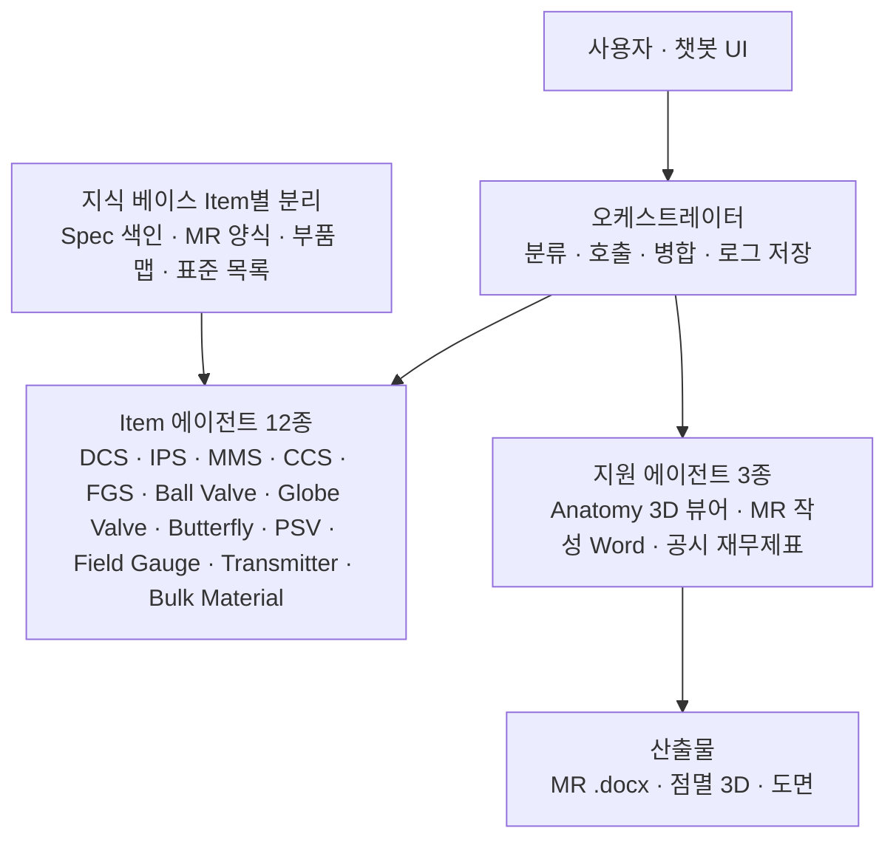

# [에이전트 기획서] 계측제어 설계 멀티에이전트 챗봇

작성일 2026-11-06 · 작성자 백승욱

## 개요

이 기획서는 계측제어 설계자가 채팅으로 묻고, 12개 Item 전문 에이전트가 Spec을 근거로 간결하게 답하며, MR을 Word로 내는 멀티에이전트 챗봇의 설계안이다.

- 구성: 오케스트레이터 1 + Item 에이전트 12 + 지원 에이전트 3(Anatomy 뷰어, MR 작성, 공시 재무제표)
- 공통 원칙: Spec에 없는 수치는 만들지 않고 '미확인'으로 표시하며, 판정은 사람이 한다
- 작성 기준: 016 프롬프트의 5개 항(사용자·입력·절차·사람 확인·규칙/AI 판별)
- 약어 해석(IPS, PRV 등)과 외부 의존(Anatomy skill, 재무제표 대시보드 세션)은 가정이며 마지막 절에 모았다

## 1. 사용자 및 한 문장 성공 정의

- 사용자: Spec 검토, MR 작성, 기술 질의 대응을 지금 직접 하는 계측제어(I&C) 설계 엔지니어. 결재자가 아니다.
- 성공 기준: "AI가 Item별 Spec을 근거로 답변·MR 초안·부품 설명을 간결하게 만들고, 사람이 원본 수치를 대조해 승인한 MR만 발행되면 성공이다."
- 정답을 이미 아는 과거 사례: 0건(현재 확인된 것 없음) — 첫 실행 결과를 담당자가 검토한 뒤 정답으로 삼는다. 과거 발행 MR이 있으면 건수와 위치를 이 줄에 적는다.
- 합격선: 미정 — 정답 사례가 쌓인 뒤 정한다. 단, [규칙] 단계는 같은 입력을 두 번 넣었을 때 결과가 동일해야 한다(5항).

## 2. 입력 자산 및 판단 기준

에이전트가 학습·참조하는 자료는 Item별 Spec 문서이다. 실제 파일명은 확인되지 않아 아래 파일명 규칙을 제안한다.

| 자산 | 파일명 규칙(제안) | 쓰임 |
| --- | --- | --- |
| 프로젝트 Spec | `{ITEM}_ProjectSpec_Rev{n}.pdf` | 검토 기준의 1순위 |
| 데이터시트 | `{ITEM}_Datasheet_Rev{n}.xlsx` | MR 필드 자동 채움 |
| MR 양식 | `MR_Template_{ITEM}.docx` | Word 출력의 틀 |
| 관련 표준 목록 | `Standards_{ITEM}.xlsx` | 표준명·조항 참조표 |
| 치수 도면 데이터 | `Dim_{ITEM}_{Type}.json` | Anatomy·도면 생성 |
| Anatomy 부품 맵 | `Parts_{ITEM}_{Type}.json` | 답변 → 부품 점멸 연결 |
| 재무제표 대시보드 데이터 | 미확인 (다른 세션 산출물) | 공시 재무제표 질의 |

`{ITEM}` = DCS, IPS, MMS, CCS, FGS, BallValve, GlobeValve, ButterflyValve, PSV, FieldGauge, Transmitter, BulkMaterial.

**고정 판단 기준**

- 근거 순위: 프로젝트 Spec > 고객·회사 표준 > 국제·업계 표준 > 일반 지식. 상위 자료와 충돌하면 답변에 충돌을 그대로 표시한다.
- 출처가 없는 수치·조항 번호는 '미확인'으로 표시한다. 기억에 의존한 숫자를 답에 쓰지 않는다.
- 모든 답변의 수치에는 문서명·Rev·절 번호를 붙인다.
- 안전 계통(IPS, FGS, ESDV, BDV, PSV, MMS) 답변은 '초안, 담당자 확인 필수'를 표기한다.
- Spec 학습 방식: 문서를 Item별 지식 베이스로 분리해 색인하고, 다른 Item 문서는 섞지 않는다.

## 3. 처리 절차 및 출력 구조

### 3.1 전체 구조

사용자는 오케스트레이터하고만 대화하고, 오케스트레이터가 Item 에이전트와 지원 에이전트를 호출해 결과를 합친다.

### 3.2 단계별 순서

1. 1단계 취합: 질의에서 Item·작업 유형을 식별하고, 해당 Item의 Spec·템플릿·부품 맵을 불러온다.
2. 2단계 대조: Spec 수치를 프로젝트 기준·표준 목록과 대조하고, 근거 없는 값은 '미확인'으로 표시한다.
3. 3단계 초안: 간결 답변 스킬 형식으로 답변·MR 필드·부품 하이라이트 태그를 만든다.
4. 4단계 확인: 사람이 원본 수치를 대조하고 승인한 뒤에만 MR(.docx)을 확정한다.

### 3.3 오케스트레이터

- 역할: 질의 분류 → 에이전트 호출 → 결과 병합 → 사용자 응답. 모든 답변은 이 경로만 지난다.
- 라우팅: Item 약어 사전(ESDV→Ball Valve 등)을 규칙으로 먼저 쓰고, 모호하면 사용자에게 한 줄로 되묻는다.
- 복합 질의: 여러 Item이 걸리면 해당 에이전트를 병렬 호출하고 답을 하나로 합친다.
- 에이전트 간 직접 호출은 금지한다. 근거 추적이 흐트러지기 때문이다.
- 공통 가드: 출처 표기, '미확인' 표시, 간결 답변 스킬 적용, 질의·답변 로그 저장.

사용자 예시 3건의 처리:

| 질의 | 라우팅 | 산출 |
| --- | --- | --- |
| Ball Valve Control Valve MR Spec. 검토시 유의할 사항은? | Ball Valve (Control Valve) | 검토 체크리스트 + 부품 점멸 링크 |
| Ball Valve Material Requisition을 작성해줘 | Ball Valve → MR 작성 | MR 초안 .docx |
| Ball Valve ESDV의 Partial Stroke Test란? | Ball Valve (ESDV) | 개념 3줄 + Actuator·Solenoid 점멸 |

### 3.4 Item 에이전트 12종

각 에이전트는 자기 Item의 Spec만 알고, 아래 검토축을 기본으로 답한다. 검토축과 참조 표준은 일반적인 초안이며, 프로젝트 Spec 대조 전까지는 '미확인'이다.

| 에이전트 | 범위 | 검토축(초안) | 참조 표준(후보) |
| --- | --- | --- | --- |
| DCS | 제어 시스템 전체 | I/O 수량·여유율, 이중화, 통신 인터페이스, 알람 관리 | 프로젝트 Spec |
| IPS | 보호 계통(SIS) | SIL 요구, 투표 구조, DCS 독립성, Proof Test | IEC 61511, IEC 61508 |
| MMS | 기계 감시 | 진동·변위·온도 프로브, 보호 로직, 알람·트립 설정 | API 670 |
| CCS | 압축기 제어 | 서지 제어, 성능 제어, 응답 시간, 밸브 연동 | 프로젝트 Spec |
| FGS | 화재·가스 감지 | 감지기 타입·배치, 투표 로직, Cause & Effect | IEC 61511 등 |
| Ball Valve | ESDV, SDV, BDV, XV, Control Valve | Fail 방향, 누설 등급, 동작 시간, Partial Stroke Test, Fire Safe, Actuator 사이징 | API 6D, API 607, ISO 5208 |
| Globe Valve | Control Valve, PRV, MOV | Cv 사이징, 캐비테이션·소음, Trim, 누설 등급, Positioner | IEC 60534, ISA 75 계열 |
| Butterfly Valve | Control Valve, MOV | Offset 형식, Shutoff 등급, 토크, Actuator | API 609 |
| PSV | 안전밸브 | Set Pressure, Orifice, Back Pressure 형식, 배관 영향 | API 520, 526, 527 |
| Field Gauge | 압력·온도·레벨·유량 등 | 정확도, 다이얼 크기, 접액 재질, Process Connection | 프로젝트 Spec |
| Transmitter | 압력·온도·레벨·유량 등 | Range, 정확도, 통신 방식, 방폭 등급, SIL 인증 | IEC 60079 계열 |
| Bulk Material | Instrument·Cable Hook-up | Tubing·Fitting 재질, Manifold, Gland, Junction Box | 프로젝트 Spec |

### 3.5 Anatomy 3D 및 점멸 연동

- Type별 3D 모델: 밸브·PSV·Transmitter·Gauge 등 기기 Item은 부품 ID가 붙은 3D 모델을 쓴다. DCS·IPS·MMS·CCS·FGS는 시스템 구성도로 대체한다.
- 점멸 연동: 답변의 문장에 부품 태그(예: `part:actuator`)를 붙이고, 사용자가 문장을 클릭하면 우측 패널의 해당 부품이 점멸한다. 태그→부품 매핑은 `Parts_*.json` 표로 고정한다.
- Anatomy skill: 이 세션에서 확인되지 않아 미확인이다. 스킬 사양(입력 형식·출력 형식)을 받으면 연동 방식을 확정한다.
- Dimensional 도면: 웹에서 공개 카탈로그·표준 치수를 찾아 수치와 출처 URL을 `Dim_*.json`에 기록한다. 도면 이미지는 수집한 수치로 자체 생성하며, 제조사 도면 원본은 복제하지 않고 링크만 제공한다. 출처 없는 치수는 '미확인'이다.

### 3.6 MR Word 출력

1. Item 에이전트가 Datasheet·Spec에서 MR 필드 값을 채운다(JSON).
2. MR 작성 에이전트가 회사 MR 양식(.docx)의 자리표시에 값과 승인된 표준 조항을 넣는다.
3. 빈칸과 근거 없는 값은 '미확인'으로 강조 표시한다.
4. 담당자가 검토·승인하면 .docx를 확정한다. 자동 발송은 하지 않는다.

MR 양식 파일은 확인되지 않았다. 양식을 받기 전까지 목차는 일반 구성(일반 요구사항, Datasheet, 적용 표준, 검사·시험, 문서 요구, 포장·납품)으로 가정한다.

### 3.7 공시 재무제표 대시보드 에이전트

- 적용 방식: 다른 세션의 "공시 재무제표 대시보드"를 그대로 가져와 질의응답 에이전트로 붙인다. 이 세션에서는 그 세션을 읽을 수 없어, 대시보드 링크나 소스 파일이 필요하다(미확인).
- 분리: 계측제어 지식과 섞지 않는다. 오케스트레이터가 재무·공시·실적 키워드를 이 에이전트로만 보낸다.
- API Key: 폴더의 `.env`에 있다. 파일을 열어 보거나 값을 대화·로그·문서에 출력하지 않고, 코드가 실행 시점에 환경변수로 읽는다(예: Python `os.environ`, Node `process.env`).
- Key 취급 규칙: 변수명만 코드에 쓰고 값은 쓰지 않는다. `.env`는 버전관리·공유에서 제외하고, 오류 메시지에 Key가 찍히지 않게 마스킹한다.
- 수치 규칙: 대시보드·API가 주는 원본 값만 인용하고 재계산·추정은 하지 않는다. 값이 없으면 '미확인'이다.

### 3.8 챗봇 UI (Claude Code 데스크톱과 유사한 레이아웃)

- 좌측: 대화 세션 목록과 에이전트 목록(12 + 지원 3), 현재 답한 에이전트가 표시된다.
- 중앙: 대화 스트림. 답변은 결론 1줄, 핵심 항목, 출처·미확인 순이다. 입력창에서 `@BallValve`로 에이전트를 지정하고, `/mr`·`/anatomy`로 명령한다.
- 우측 패널: 탭 전환 — Anatomy 3D, Dimensional 도면, MR 미리보기. 답변 클릭 시 해당 부품이 점멸한다.
- 작업 진행: MR 생성처럼 긴 작업은 단계 목록으로 표시하고, 완료된 .docx는 다운로드 버튼으로 내린다.
- 스타일: 어두운 테마, 고정폭 포인트는 코드·태그에만 쓴다. 레이아웃만 닮고 로고·상표는 복제하지 않는다.

### 3.9 스킬 구성 (간결 답변 포함)

| 스킬 | 역할 | 핵심 규칙 |
| --- | --- | --- |
| `ic-concise-answer` | 모든 답변의 형식 고정 | 결론 1줄 → 항목 최대 5개 → 출처·미확인 → 후속 제안 1개. 장문 설명 금지 |
| `ic-item-{name}` x12 | Item별 Spec 지식·검토축 | 해당 Item 문서만 참조 |
| `ic-mr-writer` | MR 필드 채움·.docx 생성 | 양식과 승인 조항만 사용 |
| `ic-anatomy-link` | 답변 태그 → 부품 점멸 | 매핑표만 사용 |
| `fin-dashboard-qa` | 재무제표 대시보드 질의응답 | 원본 값만 인용, Key는 코드에서만 접근 |

## 4. 사람 확인 지점 (Human Gate)

**AI 금지 사항**

- Spec에 없는 수치(SIL, Set Pressure, 누설 등급, 치수 등)를 추정해 쓰는 것
- 조항 번호·표준 내용을 원문 확인 없이 인용하는 것
- MR을 자동으로 발행·발송하는 것
- 안전 계통 답변을 확정 표현으로 쓰는 것
- 제조사 도면·저작물을 원본 그대로 복제하는 것
- `.env`를 열어 보거나 API Key 값을 출력·기록·전송하는 것(코드의 환경변수 접근만 허용)
- 재무제표 수치를 재계산·추정하는 것

**최종 검토 및 승인자**

| 대상 | 원본 수치 대조 | 승인 |
| --- | --- | --- |
| 일반 Item 답변·MR | 해당 Item 담당 계측 설계 엔지니어 | 팀 리드(MR 발행 승인) |
| 안전 계통(IPS, FGS, ESDV, BDV, PSV, MMS) | 담당 엔지니어 + 안전(SIS) 담당자 | 팀 리드 |
| 재무제표 답변 | 질의자 본인이 대시보드 원본 대조 | 해당 없음 |

직책명은 조직에 맞게 바꾸면 된다(미확인).

## 5. 규칙/AI 영역 판별

기준: 한 번 정해 두면 고정되는 일은 규칙, 매번 새로 해석해야 하는 일만 AI. MR·발주의 근거가 되는 단계는 규칙으로 둔다.

| 단계 | 표시 | 이유 |
| --- | --- | --- |
| Item 약어 매칭, 라우팅 | [규칙(프로그램)] | 약어 사전이 고정된다 |
| 질의 유형 분류(검토·MR 작성·개념) | [AI 판단] | 사용자 표현이 매번 달라 규칙으로 못 적는다 |
| Spec·템플릿·부품 맵 불러오기, Rev 확인 | [규칙(프로그램)] | 파일명·Rev로 판정한다 |
| Spec 문서 구조 파악·조항 추출 | [AI 판단] | 문서마다 양식이 다르다 |
| Spec 수치 ↔ 프로젝트 기준 대조 | [규칙(프로그램)] | 기준값과 비교 식이 고정된다 |
| 검토 유의사항 도출, 우선순위 | [AI 판단] | 프로젝트 맥락마다 중요도가 달라진다 |
| 개념 설명(예: Partial Stroke Test) | [AI 판단] | 질문이 매번 다르고, 발주·정산 근거가 아니다 |
| MR 필드 값 채우기(Datasheet 매핑) | [규칙(프로그램)] | 열 매핑이 고정된다. 발주 근거 |
| MR 표준 조항 삽입 | [규칙(프로그램)] | 승인된 조항 라이브러리만 쓴다. 클레임 근거 |
| 프로젝트 특이 조항 제안 | [AI 판단] | 프로젝트마다 다르다. 제안일 뿐 사람이 승인 |
| .docx 생성 | [규칙(프로그램)] | 템플릿에 값을 넣는 일이다 |
| 답변 간결 포맷 적용 | [규칙(프로그램)] | 스킬의 고정 형식 |
| 부품 태그 → 점멸 | [규칙(프로그램)] | 매핑표로 고정 |
| 웹 치수 수집 | [AI 판단] | 사이트마다 양식이 다르다 |
| 수집 치수 채택 | [사람] | 도면 치수는 사람이 원본과 대조 |
| 재무 수치 조회(API) | [규칙(프로그램)] | 조회 호출이 고정된다. Key는 환경변수 |
| 재무 결과 해설 문장 | [AI 판단] | 질문별로 해석이 다르다. 수치는 원본만 |
| 답변 검토 및 MR 발행 판정 | [사람] | 최종 판정 |

[규칙] 단계 재현성(같은 입력 두 번 → 같은 결과): 미확인 — 구현 후 같은 입력을 두 번 넣어 확인한다.

## 6. 구축 단계와 확인 요청 사항

**구축 단계**

1. 오케스트레이터 + Ball Valve 에이전트 1종으로 시작해 질의 3건 예시를 통과시킨다.
2. 담당자가 첫 결과를 검토해 정답 사례로 확정하고 합격선을 정한다.
3. 나머지 Item 에이전트 11종을 같은 틀로 확장한다.
4. Anatomy 점멸, Dimensional 도면, MR Word 출력을 연결한다.
5. 재무제표 대시보드 에이전트를 붙이고 UI를 마무리한다.

**확인 요청(아직 모르는 것)**

- Anatomy skill의 실제 사양과 모델 포맷
- "공시 재무제표 대시보드" 세션의 링크 또는 소스 파일, `.env`의 변수명(값 아님)
- 회사 MR 양식(.docx)과 승인된 표준 조항
- Item별 실제 Spec 파일과 과거 발행 MR 건수·위치
- 약어 해석: IPS = Instrumented Protective System(SIS), MMS = Machinery Monitoring System, PRV = 압력 조절 밸브로 가정
- 실행 환경(사내 서버 또는 로컬)과 동시 사용자 수
