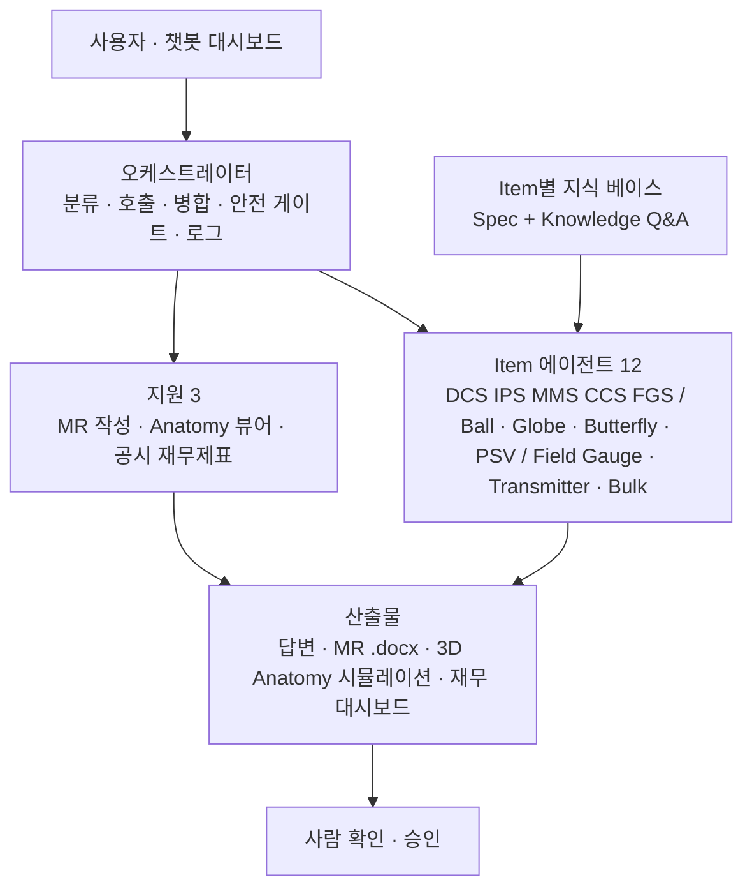

# [에이전트 기획서] 계측제어(I&C) 통합 사양 검토 멀티에이전트

작성자 백승욱(16번) · 작성일 2026-11-06 · 구현 상태: 대시보드 동작 확인(로컬 `python app/server.py`)

계측제어 설계자가 채팅으로 묻고, 12개 Item 전문 에이전트가 **Spec 근거로 간결하게** 답하며, Material Requisition(MR) 초안을 Word로 만드는 멀티에이전트이다. 이 문서는 5개 항(사용자·성공 정의 / 입력·판단 기준 / 절차·출력 / Human Gate / 규칙·AI 판별)으로 구성한다.

---

## 1. 사용자와 성공 정의

**사용자**: Spec 검토, MR 작성, 기술 질의 대응을 직접 하는 계측제어(I&C) 설계 엔지니어. 결재자가 아니다.

**한 문장 성공 정의**: "AI가 Item별 Spec을 근거로 답변·MR 초안·부품 설명을 간결하게 만들고, 사람이 원본 수치를 대조해 승인한 MR만 발행되면 성공이다."

**정답을 이미 아는 사례(정답 사례)**

| 구분 | 현황 |
| --- | --- |
| 과거 확정 사례 | 0건 확인됨(과거 발행 MR의 건수·위치는 미확인) |
| 대체 기준 사례 | 질의 3건(아래)을 기준 사례로 두고, 담당자가 첫 결과를 검토해 정답으로 확정한다 |

| 기준 질의 | 기대 결과 |
| --- | --- |
| Ball Valve Control Valve MR Spec 검토 시 유의할 사항은? | 검토 체크리스트 5개 이내 + 출처/미확인 + 부품 점멸 |
| Ball Valve Material Requisition 작성 | MR 초안 `.docx` (빈칸·근거 없는 값은 '미확인') |
| Ball Valve ESDV의 Partial Stroke Test란? | 정의 1줄 + 핵심 3줄 + Actuator·Solenoid 점멸 |

**합격선(제안, 담당자 확정 전)**

| 항목 | 합격선 |
| --- | --- |
| 수치마다 출처(문서명·Rev·절) 또는 '미확인' 표기 | 100% (예외 0건) |
| 안전 계통 답변에 '초안, 담당자 확인 필수' 표기 | 100% |
| 기준 질의 3건의 라우팅(Item 분류) | 3/3 정확 |
| 같은 입력 2회 → 규칙 단계 결과 동일 | 동일 |
| MR 필드 중 사람이 고친 값 비율 | 담당자가 첫 결과 검토 후 확정(미정) |

---

## 2. 입력 자산과 판단 기준

**입력 자산** (폴더 `해커톤/` 기준, ○ = 현재 존재, △ = 일반 EPC 초안·웹 조사라 프로젝트 대조 필요, × = 미확인)

| 자산 | 위치/파일명 | 상태 | 쓰임 |
| --- | --- | --- | --- |
| Item별 통합 Spec | `Spec for each Item/{Item}/*_Integration_Spec.md` (12) | △ | 검토 체크리스트·인터페이스 |
| Item별 지식 베이스 | `Spec for each Item/{Item}/*_Knowledge.md` (12, Q&A 28~40개, 출처 URL) | △ | 채팅형 답변 |
| MR 양식 | `data/mr/MR_Format_{Item}.json` + `make_mr.py` | △ | MR 필드 구조 → `.docx` |
| 치수 데이터 | `data/dim/Dim_*.json` (13) | △ | Anatomy·도면 |
| 부품 맵 | `data/parts/Parts_*.json` (12) | ○ | 답변 태그 → 부품 점멸 |
| 프로젝트 Spec·Datasheet | `{ITEM}_ProjectSpec_Rev{n}.pdf` 등 | × | 1순위 근거(수령 전) |
| 공시 재무 데이터 | DART OpenAPI(코드가 환경변수로 키 접근) | ○ | 재무제표 질의 |
| 회사 MR 양식·승인 조항 | — | × | 확정 양식 |

**고정 판단 기준**

- 근거 순위: 프로젝트 Spec > 고객·회사 표준 > 국제·업계 표준 > 일반 지식. 충돌은 숨기지 않고 그대로 표시한다.
- 출처 없는 수치·조항 번호는 만들지 않고 '미확인'으로 쓴다. 모든 수치에 문서명·Rev·절을 붙인다.
- `Spec for each Item/` 내용은 프로젝트 Spec 대조 전까지 '미확인' 취급한다.
- Item 간 문서는 섞지 않는다(Item별 지식 베이스 분리).
- 안전 계통(IPS, FGS, MMS, ESDV, BDV, SDV, PSV)은 확정 표현을 쓰지 않는다.
- 재무 수치는 DART 원본만 인용한다(표시 단위 억원 환산은 단위 변환만 허용, 추정·재계산 금지).

---

## 3. 처리 절차와 출력 구조

### 3.1 구조

사용자는 오케스트레이터하고만 대화한다. 서브에이전트끼리 직접 호출하지 않는다.

### 3.2 단계

1. **분류**: Item·작업 유형(검토/MR/개념/부품)을 식별한다. 약어 사전 우선(ESDV·SDV·BDV·XV→Ball Valve, PRV·MOV(Globe)→Globe Valve, MOV(Butterfly)→Butterfly Valve, 재무·공시→재무 에이전트). 모호하면 한 줄로 되묻는다.
2. **취합**: 해당 Item 폴더의 Spec·Knowledge만 읽는다.
3. **대조**: 수치를 근거 순위로 대조하고 근거 없는 값은 '미확인'.
4. **초안**: 간결 답변 형식(결론 → 번호 항목 → 표 → 출처)으로 쓰고 부품 태그를 붙인다.
5. **안전 게이트**: 안전 계통이 포함되면 '초안, 담당자 확인 필수'를 표기한다.
6. **응답·기록**: 답변하고 질의·답변 로그를 `logs/YYYY-MM-DD.md`에 남긴다(Key·비밀값 제외).
7. **MR**: Item 에이전트가 필드(JSON) 작성 → MR 작성 에이전트가 `.docx` 생성 → 사람이 승인해야 확정. 자동 발송 금지.

### 3.3 에이전트 구성 (15 = Item 12 + 지원 3)

| 구분 | 에이전트 | 범위 |
| --- | --- | --- |
| 제어·안전 | DCS, IPS*, MMS*, CCS, FGS* | 제어 시스템, SIS, 기계 감시, 압축기 제어, 화재·가스 |
| 밸브 | Ball Valve*(ESDV·SDV·BDV·XV), Globe Valve(Control·PRV·MOV), Butterfly Valve(Control·MOV), PSV* | 검토축: Fail 방향, 누설 등급, 동작 시간, PST, Cv, Set Pressure 등 |
| 계기·자재 | Field Gauge, Transmitter, Instrument Bulk Material | 정확도, Range, 통신, 방폭, Hook-up 자재 |
| 지원 | MR 작성, Anatomy 뷰어, 공시 재무제표 | `.docx`, 3D 부품·시뮬레이션, DART 공시 |

`*` = 안전 계통. 위 에이전트는 `.claude/agents/`에, 공통 규칙은 `.claude/skills/`(6개)에 있다.

### 3.4 출력 구조 (대시보드 UI)

| 영역 | 내용 |
| --- | --- |
| 좌측 | 에이전트 목록 + 에이전트별 1:1 채팅 스레드, 안 읽음 표시 |
| 중앙 | 답변: 결론 1줄 → 번호 항목 → 표 → 출처·미확인(가독성 형식 고정), 입력창 |
| 우측 탭 | 조직도(실행 상태·진행바) / **Anatomy 3D**(마우스 회전·휠 확대·부품 점멸·투시) / MR 미리보기 / 재무 대시보드 / 로그 |
| 시뮬레이션 | 기기 Anatomy에서 조작: 서지 발생·Anti-surge 밸브 개방(CCS), 4–20 mA 입력별 개도(Globe·Butterfly), ESDV 트립·PST, PSV 설정압, 트랜스미터 DP→mA 등 12종. 값은 예시이며 '미확인' |
| 재무 | "공시 재무제표 대시보드" UI를 우측에 임베드 + 새 창, 채팅과 실시간 연동, 표 단위 억원 |
| 기타 | 어두운/밝은 테마, 창·컬럼 크기 조절 |

### 3.5 MR Word 출력

1. Item 에이전트가 MR 필드 값을 JSON으로 채운다(`{field, value, source, status: 확인|미확인}`).
2. MR 작성 에이전트가 양식에 값을 넣어 `output/MR_{Item}_{날짜}_DRAFT.docx`를 만든다.
3. 빈칸·근거 없는 값은 '미확인'으로 강조한다.
4. 담당자가 승인하면 확정한다. 파일명에 `DRAFT`가 붙고, 자동 발송은 하지 않는다.

### 3.6 답변 방식 (현재 구현)

LLM·외부 API 없이 **로컬 검색형**으로 답한다. 웹 조사로 만든 Item별 Q&A와 Spec 조항에서 질의와 가장 가까운 항목을 점수로 골라 구성한다. 근거가 없으면 지어내지 않고 '미확인'과 추천 질문을 제시한다.

---

## 4. 사람 확인 지점 (Human Gate)

**AI 금지 사항**

- Spec에 없는 수치(SIL, Set Pressure, 누설 등급, 치수 등)를 추정해 쓰는 것
- 조항 번호·표준 내용을 원문 확인 없이 인용하는 것
- MR을 자동으로 발행·발송하는 것
- 안전 계통 답변을 확정 표현으로 쓰는 것
- 제조사 도면·저작물을 그대로 복제하는 것(수치와 링크만)
- `.env`·키 파일을 열거나 API Key 값을 출력·기록·전송하는 것(코드의 환경변수 접근만)
- 재무제표 수치를 재계산·추정하는 것

**확인·승인자**

| 대상 | 원본 수치 대조 | 승인 |
| --- | --- | --- |
| 일반 Item 답변·MR | 해당 Item 담당 계측 설계 엔지니어 | 팀 리드(MR 발행) |
| 안전 계통 | 담당 엔지니어 + 안전(SIS) 담당자 | 팀 리드 |
| 재무제표 답변 | 질의자가 공시 원본과 대조 | 해당 없음 |
| 웹 수집 치수 채택 | 담당 엔지니어 | 팀 리드 |

각 답변 끝에 "원본 수치 대조 후 승인 필요"를 표기한다. 직책명은 조직에 맞게 바꾼다(미확인).

---

## 5. 규칙/AI 영역 판별

기준: 한 번 정해 두면 고정되는 일은 **규칙**, 매번 새로 해석해야 하는 일만 **AI**, 최종 판정은 **사람**. 발주·클레임 근거가 되는 단계는 규칙으로 둔다.

| 단계 | 구분 | 이유 |
| --- | --- | --- |
| Item 약어 매칭·라우팅 | [규칙] | 약어 사전이 고정 |
| 질의 유형 분류(검토/MR/개념) | [AI 판단] | 표현이 매번 다름 (현재 구현은 키워드 규칙, 확장 시 AI) |
| Spec·템플릿·부품 맵 불러오기, Rev 확인 | [규칙] | 파일명·Rev로 판정 |
| Spec 구조 파악·조항 추출 | [AI 판단] | 문서마다 양식이 다름 |
| Spec 수치 ↔ 프로젝트 기준 대조 | [규칙] | 기준값·비교식 고정 |
| 검토 유의사항·우선순위 도출 | [AI 판단] | 프로젝트 맥락별 중요도 |
| 개념 설명(예: PST) | [AI 판단] | 발주 근거 아님 |
| MR 필드 값 채움(Datasheet 매핑) | [규칙] | 열 매핑 고정, 발주 근거 |
| MR 표준 조항 삽입 | [규칙] | 승인된 조항 라이브러리만 사용 |
| 프로젝트 특이 조항 제안 | [AI 판단] | 제안일 뿐, 사람이 승인 |
| `.docx` 생성 | [규칙] | 양식에 값 넣기 |
| 답변 형식·안전 표기 | [규칙] | 스킬의 고정 형식 |
| 부품 태그 → 점멸 | [규칙] | `Parts_*.json` 매핑 고정 |
| 웹 치수·지식 수집 | [AI 판단] | 사이트마다 양식 다름 |
| 수집 치수 채택 | [사람] | 원본과 대조 |
| 재무 수치 조회(DART API) | [규칙] | 호출 고정, 키는 환경변수 |
| 재무 결과 해설 | [AI 판단] | 수치는 원본만 |
| 답변 검토·MR 발행 판정 | [사람] | 최종 판정 |

**재현성 확인(규칙 단계)**: 같은 입력 2회 → 같은 결과. 현재 검색형 답변은 결정적(같은 질의 → 같은 항목 선택)이나 공식 반복 시험은 미실시(미확인).

---

## 부록. 가정·미확인

- 약어 해석: IPS = Instrumented Protective System(SIS), MMS = Machinery Monitoring System, PRV = 압력 조절 밸브(가정).
- 미확인: 프로젝트 Spec·Datasheet, 회사 MR 양식·승인 조항, 과거 발행 MR, 직책명, 실행 환경(사내 서버/로컬)·동시 사용자 수.
- Spec·Knowledge·Dim의 수치는 일반 EPC·웹 조사 기준이며 출처 URL 중 다수는 검색 결과만 확인(원문 미열람). Anatomy 모델은 개념 모델이며 제조사 도면이 아니다.
- 실행: `python app/server.py` → http://127.0.0.1:8790 (빌드 `node app/build.mjs`).
